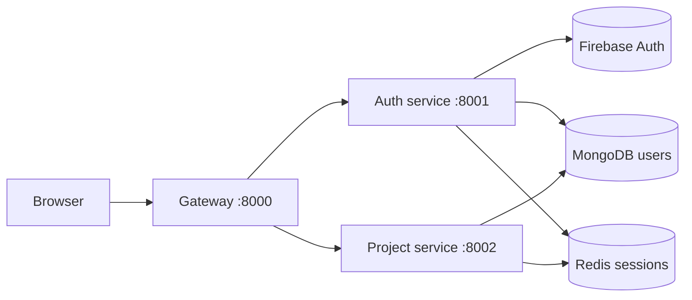

# NexPulse

NexPulse is a browser-first workspace app for building and organizing projects.
The current version is not a full AI IDE yet, but the foundation is already in
place: Google sign-in, a protected dashboard, project creation, starred project
views, and a small backend system that keeps the user session safe.

## What it does today

- Users sign in with Google.
- The backend verifies the Firebase token.
- A secure session cookie is saved in the browser.
- The dashboard loads the user's projects and starred projects from MongoDB.
- The gateway protects private routes and forwards only trusted requests.
- Redis is used for login sessions and short-term project caching.

## System map



A user clicks “Continue with Google”. Firebase returns a signed token. The
frontend sends that token to the gateway, which forwards it to the auth service.
The auth service verifies the token, creates or finds the user in MongoDB, and
stores a session in Redis. After that, the browser sends the session cookie back
on later requests, and the gateway checks it before letting the user in.

## Main pieces of the project

| Part | Folder | Port | Role |
| --- | --- | --- | --- |
| Frontend | `frontend` | `5173` | Login page, dashboard, project lists, Redux state |
| Gateway | `backend/gateway` | `8000` | Single entry point, CORS, cookie checks, route forwarding |
| Auth service | `backend/services/auth` | `8001` | Verifies Firebase tokens, keeps user records |
| Project service | `backend/services/project` | `8002` | Stores projects and starred items |
| Shared Redis client | `backend/shared` | — | Shared Redis access across services |

## Quick start

You need Node.js, MongoDB, Redis, and a Firebase project.

```bash
docker compose -f backend/docker-compose.yml up -d
```

Then start each app in its own terminal:

```bash
cd backend/services/auth
npm install
npm run dev
```

```bash
cd backend/services/project
npm install
npm run dev
```

```bash
cd backend/gateway
npm install
npm run dev
```

```bash
cd frontend
npm install
npm run dev
```

Open `http://localhost:5173` and sign in.

## Documentation map

- [Docs home](./docs/README.md)
- [Getting started](./docs/getting-started.md)
- [Backend overview](./docs/backend/README.md)
- [Gateway service](./docs/backend/gateway.md)
- [Auth service](./docs/backend/auth-service.md)
- [Project service](./docs/backend/project-service.md)
- [Frontend guide](./docs/frontend/README.md)

## Status

This project is in a strong foundation phase. The app already has the core app
flow working: sign in, keep a session, restore the user on reload, and show user
projects. The next big steps are the actual AI/editor features.

---

This project is intentionally simple and modular. The docs in the `docs/`
folder explain each part in plain English and show how the pieces fit together.
