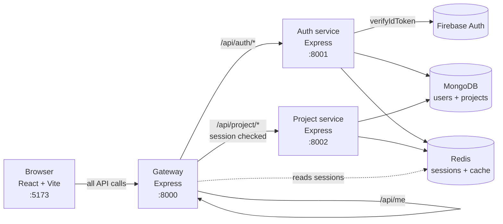

# NexPulse

NexPulse is a browser-first project workspace. Today it gives a user a secure
place to sign in, create projects, star the ones they use often, open a project
detail page, switch between light and dark themes, and log out. The long-term
goal is an AI-assisted workspace; the "AI editor" is not built yet, but the
foundation around identity, sessions, projects, and the UI is in place.

The project is intentionally split into small services behind one gateway. That
keeps each part easy to explain and gives future features (files, AI, billing)
a clear place to live.

## What works today

- Google sign-in through Firebase Authentication.
- Server-side token verification using `firebase-admin`.
- Redis-backed login sessions behind an `httpOnly` cookie.
- Session restore after a page reload (`GET /api/me`).
- A protected dashboard with all-projects and starred-projects views.
- Create, open, star/unstar, and delete projects.
- Optimistic UI updates with rollback and toast messages on failure.
- Project detail page with description, dates, star, and delete actions.
- Light/dark theme with a saved preference.
- A responsive app shell: navbar, sidebar, project grid, empty/loading/error
  states, 404 page, legal pages, and an error boundary.
- A gateway that adds CORS, cookie parsing, request logging, a login rate limit,
  and session protection in one place.

## System at a glance



The browser only knows the gateway. The gateway decides where a request goes and
whether the user is signed in. The auth service owns identity. The project
service owns project data. Redis holds short-lived session and cache entries;
MongoDB holds the permanent records.

## Main pieces

| Part | Folder | Port | Responsibility |
| --- | --- | --- | --- |
| Frontend | `frontend/` | `5173` | React UI, routes, Redux state, API calls |
| Gateway | `backend/gateway/` | `8000` | Public entry point, CORS, cookies, auth gate, forwarding |
| Auth service | `backend/services/auth/` | `8001` | Firebase verification, user records, sessions |
| Project service | `backend/services/project/` | `8002` | Project CRUD, starred list, Redis cache |
| Shared code | `backend/shared/` | — | Redis client used by all backend programs |
| Redis | Docker or local install | `6379` | Sessions and project-list cache |
| MongoDB | Local or Atlas | — | Users and projects |
| Firebase | Google cloud | — | Google sign-in |

## Tech stack

- **Frontend:** React 19, Vite 8, Tailwind CSS 4, React Router 7,
  Redux Toolkit, axios, Firebase client SDK, Motion, `lucide-react`,
  `react-icons`.
- **Backend:** Node.js, Express 5, `express-http-proxy`, `dotenv`, `cors`,
  `cookie-parser`, `morgan`, `nodemon`.
- **Data:** MongoDB + Mongoose, Redis + `ioredis`.
- **Identity:** Firebase Authentication (browser) and `firebase-admin` (server).

## Quick start

You need Node.js 18 or newer, MongoDB, Redis, and a Firebase project with Google
sign-in enabled.

```bash
# 1. Redis (Docker)
docker compose -f backend/docker-compose.yml up -d

# 2. Shared Redis client dependencies
cd backend/shared
npm install
```

Then start each program in its own terminal:

```bash
# Auth service (port 8001)
cd backend/services/auth
npm install
npm run dev
```

```bash
# Project service (port 8002)
cd backend/services/project
npm install
npm run dev
```

```bash
# Gateway (port 8000)
cd backend/gateway
npm install
npm run dev
```

```bash
# Frontend (port 5173)
cd frontend
npm install
npm run dev
```

Open `http://localhost:5173` and sign in with Google.

Each program reads its own `.env` file. Copy the matching `.env.example`, fill in
the values, and place the Firebase service account key at
`backend/services/auth/serviceAccountKey.json`. The full walkthrough, including
exact environment variables and verification steps, is in
[Getting Started](./docs/getting-started.md).

## Repository layout

```text
NexPulse/
├── backend/
│   ├── docker-compose.yml        Local Redis
│   ├── gateway/                  Front door + auth gate (:8000)
│   ├── services/
│   │   ├── auth/                 Identity + sessions (:8001)
│   │   └── project/              Project data + cache (:8002)
│   └── shared/
│       └── redis/                Shared ioredis client
├── frontend/                     React app (:5173)
├── docs/                         Full documentation
└── README.md
```

## Documentation

Start here:

- [Documentation home](./docs/README.md) — reading paths and the full map.

Understand the design:

- [Architecture](./docs/concepts/architecture.md)
- [Tools and libraries](./docs/concepts/tools.md)
- [Glossary](./docs/concepts/glossary.md)

Work on the backend:

- [Backend overview](./docs/backend/README.md)
- [Gateway](./docs/backend/gateway.md)
- [Auth service](./docs/backend/auth-service.md)
- [Project service](./docs/backend/project-service.md)
- [API reference](./docs/backend/api-reference.md)
- [Data model](./docs/backend/data-model.md)
- [Security model](./docs/backend/security.md)
- [Redis usage](./docs/backend/redis.md)

Work on the frontend:

- [Frontend overview](./docs/frontend/README.md)
- [Routing and auth](./docs/frontend/routing-and-auth.md)
- [State management](./docs/frontend/state-management.md)
- [Components](./docs/frontend/components.md)
- [Styling and theme](./docs/frontend/styling-and-theme.md)

Run and operate:

- [Getting started](./docs/getting-started.md)
- [Troubleshooting](./docs/guides/troubleshooting.md)
- [Deployment notes](./docs/guides/deployment.md)
- [Environment variables](./docs/reference/environment-variables.md)
- [Commands](./docs/reference/scripts.md)

Project history and direction:

- [Development log](./docs/development/README.md)
- [Roadmap and status](./docs/roadmap.md)
- [Contributing](./docs/guides/contributing.md)

## Status

NexPulse is in a strong foundation phase. The core loop is complete: sign in,
keep a session, restore the user on reload, manage projects, and sign out. The
next major steps are richer project content (files, editor state) and the
AI-assisted editing experience described in the [roadmap](./docs/roadmap.md).

## Important security rules

- `.env` files and `serviceAccountKey.json` are git-ignored. Never commit them.
- The browser never talks directly to the auth or project service.
- The project service trusts the `x-user-id` header, so it must stay private.
- `VITE_*` variables are public. Never put a server secret in the frontend.

---

The documentation is written in plain English and explains not only what the
code does, but why it is built this way. If a term feels like jargon, check the
[glossary](./docs/concepts/glossary.md).
