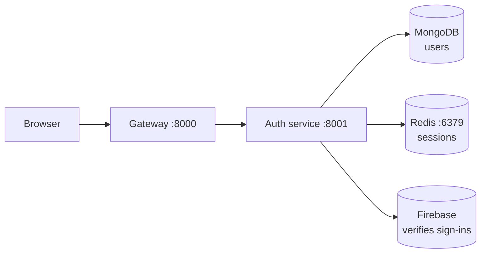

# NexPulse

An AI-powered code editor/IDE for the web.

NexPulse aims to give you a capable coding environment right in the browser —
write, organize, and build software while an AI assistant helps you along the
way. No heavy desktop install required.

> **Status:** early development. The foundation — a microservices backend behind
> an API gateway, with Firebase-backed sign-in and a React frontend — is in
> place. The AI features are not built yet.

## How it works



A user signs in with Google. The React app receives a signed token from Firebase
and sends it to the API gateway, which forwards it to the auth service. The auth
service verifies the token with Firebase and keeps a record of the user in
MongoDB. No password ever crosses the wire — the backend checks the token
itself rather than trusting the frontend.

## What's in the project

| Part | Folder | Port | What it does |
| --- | --- | --- | --- |
| **Frontend** | `frontend` | `5173` | React app. Signs users in with Google. |
| **Gateway** | `backend/gateway` | `8000` | Single entry point. Routes requests to services. |
| **Auth service** | `backend/services/auth` | `8001` | Verifies sign-ins and stores users. |
| **Shared code** | `backend/shared` | — | Cross-service helpers — today, the Redis client. |

The browser only ever talks to the gateway. The gateway decides where each
request goes — which keeps the frontend simple and keeps sensitive logic safely
on the server.

## Tech stack

- **Node.js + Express 5** — the backend runtime and web framework.
- **MongoDB + Mongoose** — storage, with schemas and validation.
- **Redis + `ioredis`** — login sessions, kept out of the database.
- **Firebase + `firebase-admin`** — signing users in (client) and verifying
  them (server).
- **React 19 + Vite 8 + Tailwind CSS 4** — the frontend.
- **`express-http-proxy`** — the one package that turns the gateway into a
  gateway.
- **axios** — one pre-configured HTTP client for the frontend.
- **`dotenv` / `cors` / `cookie-parser` / `morgan` / `nodemon` / ESLint** —
  everyday tooling.

Every tool is explained — what it is, why it's here, where it's used — on the
[Tools](./docs/concepts/tools.md) page.

## Getting started

You'll need **Node.js** (v18+), a **MongoDB** connection string, a **Firebase
service account key**, and **Redis** for sessions. Each part of the project is
installed and run separately, in its own terminal — Redis runs in the
background:

```bash
docker compose -f backend/docker-compose.yml up -d
```

**Terminal 1 — Auth service**

```bash
cd backend/services/auth
npm install
npm run dev
```

**Terminal 2 — Gateway**

```bash
cd backend/gateway
npm install
npm run dev
```

**Terminal 3 — Frontend**

```bash
cd frontend
npm install
npm run dev
```

Then open `http://localhost:5173` and click **Continue with Google**.

For the full walkthrough — including the environment files, the secrets you'll
need to supply, and how to fix common problems — see
[Getting Started](./docs/getting-started.md).

## Documentation

Everything is documented in the [`docs/`](./docs) folder. If a term is
unfamiliar, the [Glossary](./docs/concepts/glossary.md) explains it in plain language.

| Document | What it covers |
| --- | --- |
| [Docs home](./docs/README.md) | The index, and where to start. |
| [Architecture](./docs/concepts/architecture.md) | The overall design, the pattern chosen, and why. |
| [Tools](./docs/concepts/tools.md) | Every library and tool, explained. |
| [Getting Started](./docs/getting-started.md) | Running the whole stack locally. |
| [Glossary](./docs/concepts/glossary.md) | Plain-language definitions. |
| [Backend overview](./docs/backend/README.md) | A map of `backend/`. |
| [Gateway service](./docs/backend/gateway.md) | The front door of the backend. |
| [Auth service](./docs/backend/auth-service.md) | Firebase sign-in and user storage. |
| [Frontend](./docs/frontend/README.md) | The React app and the login flow. |
| [Development Log](./docs/development/README.md) | One page per commit — what changed and why. |

## Why it's built this way

The backend uses **microservices behind an API gateway**: several small
services, each doing one job, with a single front door in front of them.

The reasoning is a bet that NexPulse will grow — more features, and an AI
component that will want to scale differently from everything else. Splitting
early makes that growth cheaper later. The cost is extra complexity, and that
trade-off is discussed honestly in
[Architecture](./docs/concepts/architecture.md#the-honest-trade-off).

Sign-in is deliberately split too: **Firebase** does the actual
authentication, while the backend keeps its own user records in MongoDB and
verifies tokens rather than trusting the frontend. That avoids rebuilding
password handling badly, without giving up ownership of the user data.

## Contributing

Before making changes, read [Architecture](./docs/concepts/architecture.md) to understand
the conventions, and keep changes small and focused. When you land meaningful
work, add a page to the [Development Log](./docs/development/README.md) so the
reasoning behind it doesn't get lost.

## License

Not yet specified.
