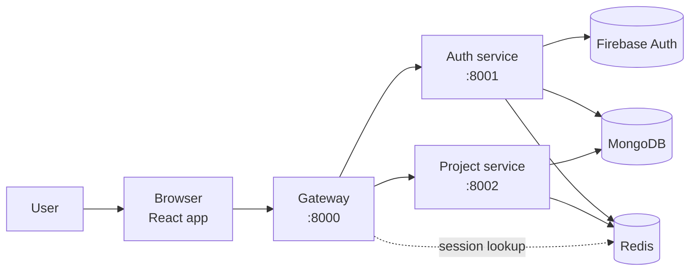
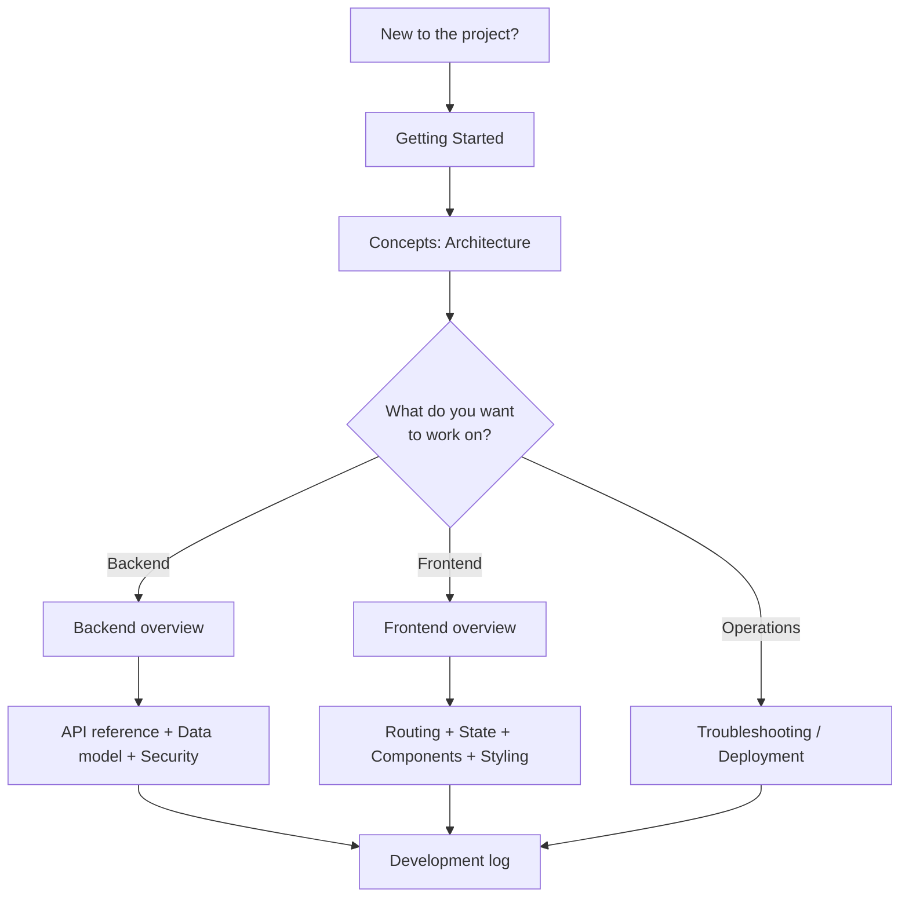

# NexPulse Documentation

Welcome. These docs describe NexPulse as it exists in the repository right now:
the flow, the code, the decisions, and the trade-offs. They are written in plain
English and use diagrams where a picture is clearer than a paragraph.

If you only have five minutes, read this page and the
[architecture overview](./concepts/architecture.md).

## What NexPulse is

NexPulse is a browser-based project workspace. A user signs in with Google,
lands on a dashboard, creates projects, stars the ones they use often, opens a
project detail page, and logs out. A small multi-service backend verifies the
sign-in, keeps a secure session, and stores project data.



The short version:

- The browser talks only to the gateway.
- The gateway allows CORS, reads cookies, checks sessions, and forwards requests.
- The auth service verifies Firebase tokens and creates users and sessions.
- The project service stores and returns projects, with a short Redis cache.
- MongoDB is the permanent store; Redis is the fast, temporary store.

## What is documented

| Area | What you will find |
| --- | --- |
| **Getting started** | Prerequisites, environment files, running all five processes, first sign-in, verification. |
| **Concepts** | Architecture, tools, and a glossary in plain language. |
| **Backend** | Gateway, auth service, project service, API reference, data model, security, Redis. |
| **Frontend** | App structure, routing/auth, Redux and contexts, components, styling/theme. |
| **Guides** | Troubleshooting, deployment notes, contributing, roadmap. |
| **Reference** | Environment variables and npm commands. |
| **Development log** | How the project was built, commit by commit. |

## Reading paths



### If you want to run the app

1. [Getting Started](./getting-started.md)
2. [Troubleshooting](./guides/troubleshooting.md) when something does not work

### If you are new to the codebase

1. [Architecture](./concepts/architecture.md) — the big picture and the "why"
2. [Glossary](./concepts/glossary.md) — terms used across the docs
3. [Backend overview](./backend/README.md)
4. [Frontend overview](./frontend/README.md)

### If you are changing backend behavior

1. [Backend overview](./backend/README.md)
2. [Gateway](./backend/gateway.md), [Auth service](./backend/auth-service.md),
   [Project service](./backend/project-service.md)
3. [API reference](./backend/api-reference.md)
4. [Data model](./backend/data-model.md)
5. [Security model](./backend/security.md)

### If you are changing the UI

1. [Frontend overview](./frontend/README.md)
2. [Routing and auth](./frontend/routing-and-auth.md)
3. [State management](./frontend/state-management.md)
4. [Components](./frontend/components.md)
5. [Styling and theme](./frontend/styling-and-theme.md)

### If you are deploying or operating it

1. [Environment variables](./reference/environment-variables.md)
2. [Deployment notes](./guides/deployment.md)
3. [Security model](./backend/security.md)
4. [Redis usage](./backend/redis.md)

## Folder map

```text
docs/
├── README.md                         This page
├── getting-started.md                Run the whole stack
├── roadmap.md                        Current status and next steps
├── concepts/
│   ├── README.md
│   ├── architecture.md               System design and reasoning
│   ├── glossary.md                   Plain-language definitions
│   └── tools.md                      Every library and tool
├── backend/
│   ├── README.md                     Backend map
│   ├── gateway.md                    Front door and auth gate
│   ├── auth-service.md               Sign-in, users, sessions
│   ├── project-service.md            Projects and cache
│   ├── api-reference.md              Every endpoint and status code
│   ├── data-model.md                 MongoDB schemas and Redis keys
│   ├── security.md                   Trust boundaries and safeguards
│   └── redis.md                      Sessions and caching in detail
├── frontend/
│   ├── README.md                     Frontend map
│   ├── routing-and-auth.md           Routes, guards, session restore
│   ├── state-management.md           Redux, contexts, axios interceptor
│   ├── components.md                 Component and page reference
│   └── styling-and-theme.md          Tailwind tokens, dark mode, animation
├── guides/
│   ├── README.md
│   ├── troubleshooting.md            Common failures and fixes
│   ├── deployment.md                 Production checklist and notes
│   └── contributing.md               Workflow, conventions, quality checks
├── reference/
│   ├── README.md
│   ├── environment-variables.md      Every setting, by app
│   └── scripts.md                    npm scripts and commands
└── development/
    ├── README.md                     Development log index
    └── 001-...-011-...               One page per meaningful change
```

## A note about accuracy

These docs describe what is implemented, not what is planned. When something is
a known limitation, it is labelled as one. Planned work lives in the
[roadmap](./roadmap.md), not in the "how it works" pages.

When code and docs disagree, the code wins. Please update the relevant page in
the same change that updates the behavior. The
[contributing guide](./guides/contributing.md) explains the small documentation
rules used here.
