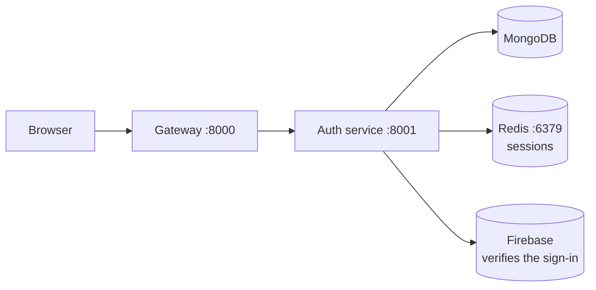

# NexPulse Documentation

Welcome. This folder is the reference for the NexPulse project — a web-based
code editor with AI assistance, built as a microservices backend behind an API
gateway, with a React frontend.

The writing here is deliberately plain. Technical projects tend to bury simple
ideas under jargon, and that helps no one. If a term anywhere feels like
jargon, it's defined in the [Glossary](./concepts/glossary.md).

## What NexPulse is, today

A user signs in with Google through the browser. A React app hands a signed
token to an API gateway, which forwards it to an auth service. That service
checks the token with Firebase, keeps a record of the user in MongoDB, and
stores the login session in Redis.



No AI features exist yet — the foundation comes first.

## Start here

Pick the path that matches what you're trying to do.

**"I want to run it."**
→ [Getting Started](./getting-started.md)

**"I want to understand how it's designed, and why."**
→ [Architecture](./concepts/architecture.md), then [Tools](./concepts/tools.md)

**"I want to work on one part."**
→ [Backend](./backend/README.md) or [Frontend](./frontend/README.md)

**"I want to know how it got built."**
→ [Development Log](./development/README.md)

**"What does this word mean?"**
→ [Glossary](./concepts/glossary.md)

## Folder layout

```
docs/
├── README.md            ← you are here: the index
├── getting-started.md   ← run the project, fix common problems
├── concepts/            ← the big picture, explained
│   ├── README.md
│   ├── architecture.md    how it's built, and why
│   ├── tools.md           every tool: what / why / where
│   └── glossary.md        plain-language definitions
├── backend/             ← walkthrough of server code
│   ├── README.md
│   ├── gateway.md         the front door
│   └── auth-service.md    sign-in and user storage
├── frontend/            ← walkthrough of the client code
│   └── README.md          the React app and login flow
└── development/         ← history: one page per commit
    ├── README.md
    └── 001 … 007
```

Three kinds of document, in three places: **concepts** explains the design,
**backend** / **frontend** walk through the code, and **development** records
what changed and when.

## The pages

### `concepts/` — understanding the project

| Document | What it covers |
| --- | --- |
| [Architecture](./concepts/architecture.md) | The overall design, the pattern chosen, and the reasoning behind it. |
| [Tools](./concepts/tools.md) | Every library and tool in use — what it is, why it's here, where it's used. |
| [Glossary](./concepts/glossary.md) | Plain-language definitions of the terms used throughout. |

### Building and running

| Document | What it covers |
| --- | --- |
| [Getting Started](./getting-started.md) | Running the whole stack locally, step by step. |

### `backend/` and `frontend/` — the parts

| Document | What it covers |
| --- | --- |
| [Backend Overview](./backend/README.md) | A map of `backend/` and how its services fit together. |
| [Gateway Service](./backend/gateway.md) | The front door — routing, middleware, and the proxy. |
| [Auth Service](./backend/auth-service.md) | Firebase sign-in, user storage, and the layered structure. |
| [Frontend](./frontend/README.md) | The React app and the login flow end to end. |

### `development/` — following the work

| Document | What it covers |
| --- | --- |
| [Development Log](./development/README.md) | One page per commit — what changed, and why. |

## How these docs are written

A few conventions, so you know what to expect:

- **Technology is explained as What / Why / Where.** Not just what a library is,
  but the problem it solves and where it appears in this project.
- **Trade-offs are stated, not hidden.** Every choice has a cost. Where a
  decision costs something, the docs say so — microservices add complexity;
  Firebase adds a third-party dependency.
- **Only what actually exists is documented.** Features that are planned but not
  built are not described as if they were working. This keeps the docs
  trustworthy.
- **Flow diagrams are Mermaid.** The diagrams that show how requests move are
  written as Mermaid code, so they render automatically on GitHub and stay easy
  to edit. Folder trees stay as plain text, because they're meant to be copied.

### Editing a diagram in draw.io

Every Mermaid diagram can be opened as a real, editable drawing:

1. Copy the code inside the ```` ```mermaid ```` block.
2. In draw.io (app.diagrams.net), choose **Arrange → Insert → Advanced →
   Mermaid…**
3. Paste the code and press **OK**.

The diagram becomes ordinary shapes you can restyle or export as an image. When
you change it, paste the updated Mermaid back into the docs so the two don't
drift apart.

## Keeping the docs honest

Code changes; docs rot. When you change how something works, update the page
that describes it — and if the change represents meaningful progress, add a page
to the [Development Log](./development/README.md).

A documentation page that describes last month's code is worse than none at all,
because readers trust it.
