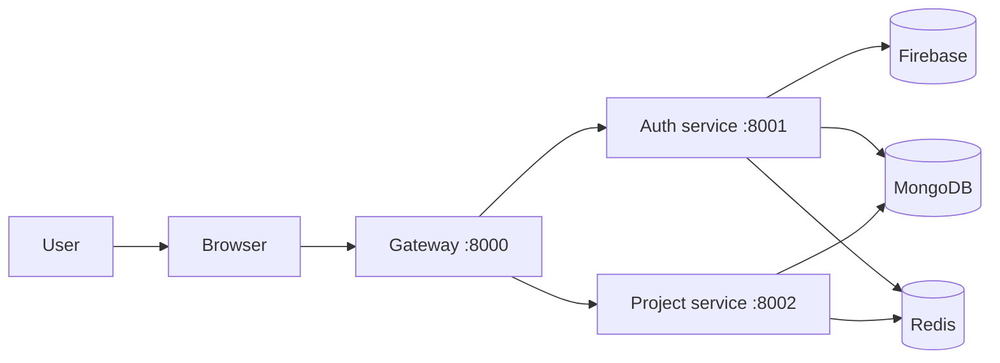

# NexPulse Documentation

This folder explains the project in plain English.

The app is not huge yet, but it already has a real flow:

- browser login with Google
- Firebase token verification
- Redis-backed session cookie
- protected project APIs
- project dashboard and starred lists

## The short version



The frontend talks to the gateway. The gateway decides where the request should
go. The auth service handles identity. The project service handles projects.

## Where to start

- [Getting started](./getting-started.md) — run the app locally
- [Backend overview](./backend/README.md) — how the server is split
- [Gateway service](./backend/gateway.md) — the front door
- [Auth service](./backend/auth-service.md) — Google sign-in and user records
- [Project service](./backend/project-service.md) — projects and caching
- [Frontend guide](./frontend/README.md) — dashboard and login flow

## Folder map

```text
docs/
├── README.md
├── getting-started.md
├── backend/
│   ├── README.md
│   ├── gateway.md
│   ├── auth-service.md
│   └── project-service.md
├── frontend/
│   └── README.md
├── concepts/
│   ├── architecture.md
│   ├── glossary.md
│   ├── README.md
│   └── tools.md
└── development/
    ├── README.md
    └── 001-...-008-...
```

## How to read this docs set

- Start with [Getting started](./getting-started.md) if you want to run the app.
- Read the backend pages if you want to change APIs or auth logic.
- Read the frontend page if you want to change the dashboard or sign-in flow.
- Read the concept pages if you want the big-picture reasoning.

The docs are intentionally simple. They focus on what is actually in the code
right now, not on ideas that are planned but not built yet.
