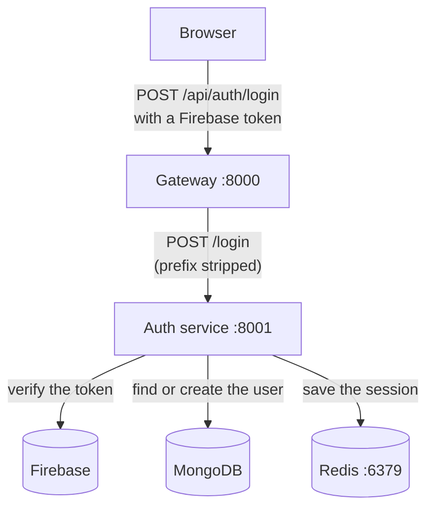
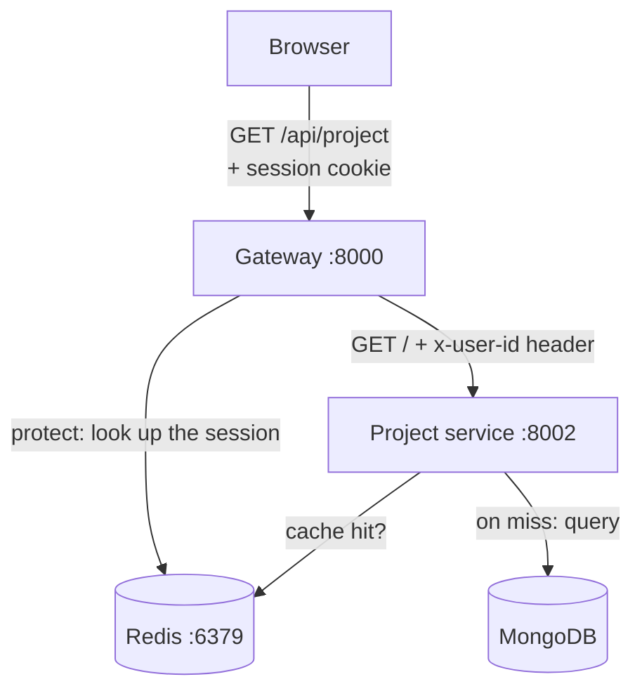

# The Backend

This page is the map for the `backend/` folder. Read it to see how the pieces
fit together, then dive into whichever service you're working on.

## What the backend is

The backend is the part of NexPulse that runs on a server rather than in the
browser. It holds the logic, the database connection, and the secrets (things
like API keys) that must never be exposed to users.

The browser sends the backend requests; the backend sends back answers. Today
that means two small running programs.

It is built as a collection of **services** rather than one big program. A
service is a small, self-contained program that does one job, with its own
folder, dependencies, and settings.

## Folder layout

```
backend/
├── gateway/            The front door. Routes requests to services.  (port 8000)
├── services/
│   ├── auth/           Verifies sign-ins and stores users.           (port 8001)
│   └── project/        Stores and serves user projects.              (port 8002)
└── shared/             Code used by more than one service. (the Redis client)
```

The split is intentional:

- `gateway/` sits at the top because it is **infrastructure** — it routes
  traffic but owns no data of its own. It also holds the `protect` middleware
  that guards authenticated routes.
- `services/` groups the **business services**. Each new service gets its own
  folder here.
- `shared/` holds code used by more than one service, with its own
  `package.json` so its dependencies are declared properly.

There's also `docker-compose.yml`, which starts Redis for local development.

## The services

### 1. Gateway (`backend/gateway`)

The gateway is the only backend address the frontend needs to know. It receives
every request and forwards each one to the right service.

- **Port:** `8000`
- **Routes it owns today:**
  - anything starting with `/api/auth` goes to the auth service (the `/api/auth`
    part is stripped before forwarding, so `/api/auth/login` arrives there as
    `/login`);
  - anything starting with `/api/project` goes to the project service, **behind
    the `protect` middleware** — and the gateway injects an `x-user-id` header so
    the project service knows who is asking;
  - `GET /api/me` is answered by the gateway itself.
- **Shared jobs handled here:** CORS (letting the frontend in), cookie parsing,
  and request logging — all done once, for every service.
- **Auth gate:** `middleware/protect.js` reads the session cookie, looks the
  session up in Redis, and attaches the user to `req.user` (or answers `401`).
  It's what makes a route "protected."

Full details: [Gateway Service](./gateway.md).
### 2. Auth service (`backend/services/auth`)

The auth service is where user identity lives. It uses **Firebase
Authentication** to verify that a request comes from a real user, then stores
that user's profile in **MongoDB**.

- **Port:** `8001`
- **Owns:** `POST /login` and the `GET /` health check.
- **Storage:** MongoDB for users, Redis for sessions.
- **External dependency:** Firebase Admin, used to verify sign-in tokens.

It's organised into the usual Express folders:

```
services/auth/
├── index.js              Wires everything together and starts the server.
├── config/               One-time setup: DB connection, Firebase init.
├── controllers/          The login logic.
├── models/               The user schema.
└── routes/               Maps URLs to controller functions.
```

Full details: [Auth Service](./auth-service.md).

### 3. Project service (`backend/services/project`)

The project service stores the code projects a user creates. It's the first
service to sit behind the gateway's `protect` middleware, so it only ever
answers authenticated requests.

- **Port:** `8002`
- **Owns:** `POST /`, `GET /`, `GET /starred`, `GET /:id`, `PATCH /:id`
  (toggle star), and `DELETE /:id`.
- **Storage:** MongoDB for projects, with a Redis cache in front of the common
  list queries.
- **How it knows the user:** it reads an `x-user-id` header, which the gateway
  adds from the verified session — the service never reads the session cookie
  itself.

It follows the same Express layout as the auth service:

```
services/project/
├── index.js              Wires everything together and starts the server.
├── config/               The DB connection.
├── controllers/          The project logic.
├── models/               The project schema.
└── routes/               Maps URLs to controller functions.
```

Full details: [Project Service](./project-service.md).

### 4. Shared (`backend/shared`)

Home for code that more than one service needs. Today it holds the **Redis
client** (`shared/redis/redis.js`), used by the auth service to store sessions,
by the gateway's `protect` middleware to look them up, and by the project
service to cache project lists.

It has its own `package.json` — declaring `"type": "module"` and `ioredis` —
rather than living inside whichever service happens to need it first. That way
the dependency has one honest home, and if a second service starts using Redis,
nothing moves.

### 5. Redis (`backend/docker-compose.yml`)

Sessions need a Redis server. For local development, one command starts it:

```bash
docker compose -f backend/docker-compose.yml up -d
```

The auth service is written to cope if Redis is down: login still works, a
single warning is logged, and sessions resume once Redis is back.

## How a request moves through the backend

A **login** (public — no session needed yet):



The response — including a `Set-Cookie` session header — travels back up the
same chain, unchanged.

A **protected** request (say, listing projects) carries that session cookie
instead:



The gateway is the only place that reads the session cookie. Everything behind
it trusts the `x-user-id` header the gateway attaches after a successful
`protect`. Note that `/api/auth` and `/api/project` prefixes are stripped at the
gateway, so each service defines its routes without them.

## Conventions every service follows

These habits keep the services predictable, so you can move between them without
re-learning how things work.

- **One folder per service.** Each service is self-contained: its own code,
  `package.json`, `.env`, and dependencies.
- **ES Modules.** Every `package.json` sets `"type": "module"`, so code uses
  `import` / `export` rather than the older `require`. Relative imports must
  include the file extension — `../models/user.model.js`, not
  `../models/user.model`. Leaving it out is the most common way this kind of
  project fails to start.
- **Configuration from the environment.** Ports, URLs, and database URIs come
  from `.env` files, never hard-coded.
- **Secrets stay out of Git.** `.env` files are ignored by Git, and other
  credential files (such as the auth service's `serviceAccountKey.json`) must be
  ignored too.
- **A `dev` script.** Every service runs with `npm run dev`, which uses
  `nodemon` to restart automatically when you save a file.
- **A health endpoint.** Every service answers `GET /` with a small JSON
  message, so you can confirm it's alive.
- **Requests flow in layers.** Routes point to controllers, controllers use
  models, and nothing jumps over a layer. Routing stays a one-liner, and the
  logic stays easy to test.
- **Protected routes go through the gateway's `protect`.** A service behind it
  never reads the session cookie; it reads the `x-user-id` header the gateway
  adds once the session checks out.

## Running the backend

You'll need **Node.js**. Each service is installed and started separately, in
its own terminal:

```bash
npm install
npm run dev
```

Repeat that inside each service folder. See
[Getting Started](../getting-started.md) for the full walkthrough.
