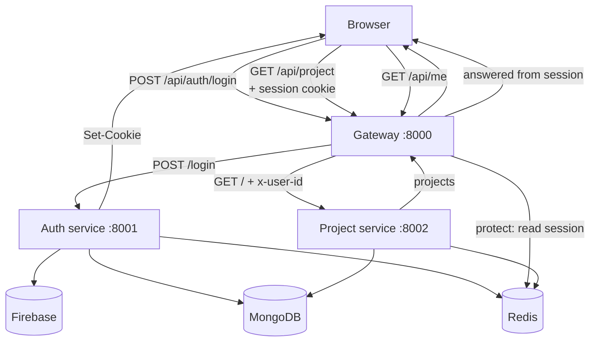

# Backend Overview

The backend is the part that runs on a server instead of in the browser. It owns
identity, sessions, project data, and the rules for who may access what.

This page is the map. Each service has its own page, and the cross-cutting topics
have dedicated pages too.

| Page | What it covers |
| --- | --- |
| [Gateway](./gateway.md) | The public entry point, routing, CORS, cookies, auth gate, rate limit. |
| [Auth service](./auth-service.md) | Firebase verification, users, login, logout. |
| [Project service](./project-service.md) | Project CRUD, starred list, caching. |
| [API Reference](./api-reference.md) | Every endpoint, body, response, and status code. |
| [Data Model](./data-model.md) | MongoDB schemas, relationships, Redis keys, TTLs. |
| [Security Model](./security.md) | Trust boundaries, cookies, rate limiting, known gaps. |
| [Redis Usage](./redis.md) | Sessions and caching in detail. |

## Folder layout

```text
backend/
├── docker-compose.yml          Local Redis
├── gateway/                    :8000 — public entry point
│   ├── index.js
│   ├── controllers/
│   │   └── user.controller.js  GET /api/me
│   ├── middleware/
│   │   ├── protect.js          session auth gate
│   │   └── loginLimiter.js     login rate limit
│   ├── utils/
│   │   └── proxyWithHeaders.js forwards x-user-id
│   └── package.json
├── services/
│   ├── auth/                   :8001 — identity
│   │   ├── index.js
│   │   ├── config/
│   │   │   ├── db.js
│   │   │   └── firebase.js
│   │   ├── controllers/
│   │   │   └── auth.controller.js
│   │   ├── models/
│   │   │   └── user.model.js
│   │   ├── routes/
│   │   │   └── auth.route.js
│   │   ├── serviceAccountKey.json  (secret, git-ignored)
│   │   └── package.json
│   └── project/                :8002 — project data
│       ├── index.js
│       ├── config/
│       │   └── db.js
│       ├── controllers/
│       │   └── project.controller.js
│       ├── models/
│       │   └── project.model.js
│       ├── routes/
│       │   └── project.route.js
│       └── package.json
└── shared/
    ├── package.json            declares ioredis
    └── redis/
        └── redis.js            one shared Redis client
```

## The three backend programs

### 1. Gateway

The gateway is the front door. The browser never talks directly to the auth or
project service. It sends all requests to the gateway first.

Responsibilities:

- allow the configured frontend origin through CORS, with credentials
- parse cookies
- log requests with `morgan`
- rate-limit `POST /api/auth/login`
- forward `/api/auth/*` to the auth service
- run `protect` before forwarding `/api/project/*`
- add the `x-user-id` header for the project service
- answer `GET /api/me` from the session
- return JSON `404` and `500` responses

### 2. Auth service

The auth service owns identity.

It does this:

- receives a Firebase ID token from the frontend
- verifies it with Firebase Admin
- finds or creates the user in MongoDB
- creates a session id and stores the public user in Redis
- sets an `httpOnly` session cookie
- deletes the session and clears the cookie on logout

### 3. Project service

The project service owns project records.

It does this:

- trusts the gateway's `x-user-id` header
- creates, lists, fetches, stars, and deletes projects
- scopes every query to the signed-in owner
- caches list responses in Redis for 5 minutes
- invalidates the cache on writes

## How a request moves



The important ideas:

- public login goes to the auth service
- private data goes through the gateway first
- the gateway checks the session before allowing access
- the project service never sees the session cookie

## Shared rules

Across the backend:

- each program has its own `package.json`
- configuration lives in `.env`
- MongoDB stores long-lived records
- Redis stores sessions and cache entries
- the gateway is the only public backend door
- services behind the gateway trust the gateway, not the browser
- errors return `{ "message": "..." }`; internal details are logged server-side

## Shared Redis client

The Redis client lives in `backend/shared/redis/redis.js` and is imported by all
three backend programs. It is one file with one connection definition.

Because `backend/shared/` has its own `package.json`, it needs its own install:

```bash
cd backend/shared
npm install
```

Redis is used for:

- login sessions (`session-<uuid>`, 7-day TTL)
- project list caches (`projects-<userId>` and
  `starred-projects-<userId>`, 5-minute TTL)

See [Redis Usage](./redis.md).

## Running the backend

Start Redis first:

```bash
docker compose -f backend/docker-compose.yml up -d
```

Then each service in its own terminal:

```bash
cd backend/shared && npm install
```

```bash
cd backend/services/auth && npm install && npm run dev
```

```bash
cd backend/services/project && npm install && npm run dev
```

```bash
cd backend/gateway && npm install && npm run dev
```

The auth service requires `serviceAccountKey.json` and a reachable MongoDB. The
project service requires MongoDB. All three need Redis for full behavior, though
they degrade differently: the auth service can still log in without Redis, while
the project service simply runs without caching.

## Health endpoints

| Service | URL | Response |
| --- | --- | --- |
| Gateway | `http://localhost:8000/` and `/health` | `{ "message": "Hello from gateway" }` |
| Auth | `http://localhost:8001/` and `/health` | `{ "message": "Hello from Auth" }` |
| Project | `http://localhost:8002/health` | `{ "message": "Hello from Project Service" }` |

## What the backend does not do yet

- No automated tests.
- No authorization roles or sharing; ownership is enforced by query filters.
- No project update endpoint for name/description.
- No account deletion.
- No structured logging or tracing.
- The login limiter is in memory, so it does not coordinate across multiple
  gateway instances.

Those are tracked in the [Roadmap](../roadmap.md).
