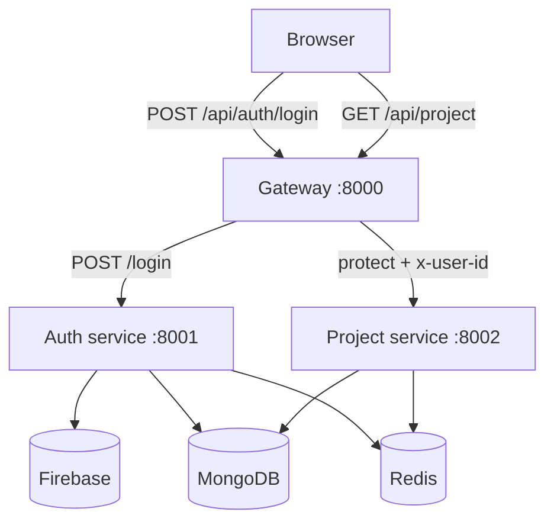

# Backend Overview

This is the map of the backend.

The backend is the part that runs on a server instead of in the browser. It is
responsible for identity, project data, and shared rules such as session checks.

## Folder layout

```text
backend/
├── docker-compose.yml
├── gateway/
│   ├── controllers/
│   ├── middleware/
│   ├── utils/
│   ├── index.js
│   └── package.json
├── services/
│   ├── auth/
│   │   ├── config/
│   │   ├── controllers/
│   │   ├── models/
│   │   ├── routes/
│   │   ├── index.js
│   │   ├── package.json
│   │   └── serviceAccountKey.json
│   └── project/
│       ├── config/
│       ├── controllers/
│       ├── models/
│       ├── routes/
│       ├── index.js
│       └── package.json
└── shared/
    └── redis/
        └── redis.js
```

## The three main pieces

### 1) Gateway

The gateway is the front door. The browser never talks directly to the auth or
project service. It sends all requests to the gateway first.

Roles:

- CORS setup for the frontend
- cookie parsing
- session validation
- route forwarding to auth and project services
- `GET /api/me` for session restore

### 2) Auth service

The auth service owns identity.

It does this:

- receives a Firebase token from the frontend
- verifies it using Firebase Admin
- finds or creates the user in MongoDB
- saves a session to Redis
- sends back an `httpOnly` cookie to the browser

### 3) Project service

The project service owns project records.

It does this:

- verifies the request has a valid session through the gateway
- reads the `x-user-id` header
- lists projects or starred projects
- creates, updates, deletes, and stars projects
- caches common project lists in Redis

## How a request moves through the backend



The important idea is simple:

- public login goes to the auth service
- private data goes through the gateway first
- the gateway checks the session before allowing access

## Shared rules

Across the app, a few patterns repeat:

- each service has its own `package.json`
- config values live in `.env`
- MongoDB stores long-lived records
- Redis stores sessions and cache data
- the gateway is the only public backend door

## Shared Redis

The Redis client lives in `backend/shared/redis/redis.js`.

That means more than one service can use it cleanly. In this project, Redis is
used for:

- session storage for login
- short-lived project cache values

## Running the backend

Each service is started separately:

```bash
cd backend/services/auth
npm install
npm run dev
```

```bash
cd backend/services/project
npm install
npm run dev
```

```bash
cd backend/gateway
npm install
npm run dev
```

That keeps the app modular and easy to debug.
