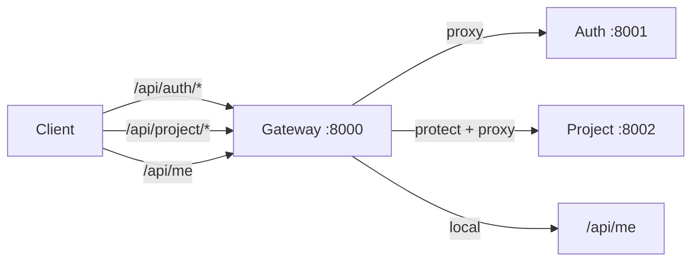

# API Reference

The public API is the gateway at `http://localhost:8000` in development. The auth
and project services are internal and should not be called directly, except for
debugging.

All request and response bodies are JSON. Errors use:

```json
{ "message": "A short, human-readable reason" }
```

## API surface



## Authentication

Two different credentials are used:

| Stage | Credential | Sent where |
| --- | --- | --- |
| Login | Firebase ID token in the JSON body | `POST /api/auth/login` |
| Every request after login | Session cookie (`session=<uuid>`) | Automatically by the browser |

The session cookie is `httpOnly`, so JavaScript cannot read it. The frontend's
axios client uses `withCredentials: true`, which is why the browser sends it.

Protected endpoints return `401` when the cookie is missing or the session is
unknown, and `503` when Redis cannot be reached.

## Gateway endpoints

### `GET /`

Health check.

**Response `200`**

```json
{ "message": "Hello from gateway" }
```

### `GET /health`

Same as `GET /`.

### `POST /api/auth/login`

Rate-limited to 30 attempts per IP per 15 minutes.

**Request body**

```json
{ "token": "<firebase-id-token>" }
```

**Responses**

| Status | Body | Meaning |
| --- | --- | --- |
| `200` | `{ "_id", "name", "email", "avatar" }` | Login succeeded. A `Set-Cookie` header is present when Redis is available. |
| `400` | `{ "message": "Token is required" }` | Body missing or `token` is not a string. |
| `401` | `{ "message": "Invalid token" }` | Token verified but had no uid/email. |
| `409` | `{ "message": "Login failed" }` | Duplicate user race. |
| `429` | `{ "message": "Too many login attempts. Try again later." }` | More than 30 attempts in 15 minutes from this IP. |
| `500` | `{ "message": "Login failed" }` | Token verification or server failure. |

If Redis is unavailable, the response is still `200` and returns the user, but no
session cookie is set. The next request will be unauthenticated.

### `GET /api/auth/logout`

Deletes the Redis session named by the `session` cookie and clears the cookie.

**Response `200`**

```json
{ "message": "Logout Successfully" }
```

If Redis is unavailable, the cookie is still cleared but the server-side session
may remain until it expires.

### `GET /api/me`

Protected. Restores the signed-in user from the session.

**Response `200`**

```json
{
  "_id": "663f...",
  "name": "Ada Lovelace",
  "email": "ada@example.com",
  "avatar": "https://..."
}
```

**Errors**

| Status | Body |
| --- | --- |
| `401` | `{ "message": "unauthorized" }` (no cookie) |
| `401` | `{ "message": "session not found" }` (unknown/expired session, or corrupt JSON) |
| `503` | `{ "message": "Session store unavailable" }` (Redis error) |

## Project endpoints

All project endpoints are protected by the gateway's `protect` middleware. The
gateway forwards the user id as `x-user-id`. The project service returns `401`
with `{ "message": "userid is required" }` only if that header is missing, which
means the request bypassed the gateway.

### `GET /api/project`

List all projects owned by the signed-in user, newest `updatedAt` first.

**Response `200`**

```json
[
  {
    "_id": "6640...",
    "owner": "663f...",
    "name": "Website redesign",
    "description": "Marketing site refresh",
    "starred": false,
    "lastOpenedAt": "2026-10-29T10:00:00.000Z",
    "createdAt": "2026-10-28T09:00:00.000Z",
    "updatedAt": "2026-10-29T10:00:00.000Z",
    "__v": 0
  }
]
```

The list is cached for 5 minutes under `projects-<userId>`.

### `GET /api/project/starred`

List only projects where `starred` is `true`, newest `updatedAt` first.

**Response `200`**: same shape as the list above.

Cached for 5 minutes under `starred-projects-<userId>`.

### `POST /api/project`

Create a project.

**Request body**

```json
{
  "name": "Website redesign",
  "description": "Marketing site refresh"
}
```

- `name` is required, trimmed, max 120 characters.
- `description` is optional, trimmed, max 2000 characters.

**Response `201`**

```json
{
  "_id": "6640...",
  "owner": "663f...",
  "name": "Website redesign",
  "description": "Marketing site refresh",
  "starred": false,
  "lastOpenedAt": "2026-10-29T10:00:00.000Z",
  "createdAt": "2026-10-29T10:00:00.000Z",
  "updatedAt": "2026-10-29T10:00:00.000Z",
  "__v": 0
}
```

**Errors**

| Status | Body |
| --- | --- |
| `400` | `{ "message": "Project name is required" }` |
| `400` | Mongoose validation message |
| `401` | `{ "message": "userid is required" }` |

### `GET /api/project/:id`

Fetch one project owned by the signed-in user.

- Updates `lastOpenedAt` to now.
- Invalidates both list caches.

**Response `200`**: the project document.

**Errors**

| Status | Body |
| --- | --- |
| `400` | `{ "message": "Invalid id" }` |
| `404` | `{ "message": "Project not found" }` |

A valid id owned by another user also returns `404`.

### `PATCH /api/project/star/:id`

Toggle the project's `starred` flag.

Alias: `PATCH /api/project/:id/star`.

**Response `200`**: the updated project document.

**Errors**

| Status | Body |
| --- | --- |
| `400` | `{ "message": "Invalid id" }` |
| `404` | `{ "message": "Project not found" }` |

### `DELETE /api/project/:id`

Delete a project owned by the signed-in user.

**Response `200`**: the deleted project document.

**Errors**

| Status | Body |
| --- | --- |
| `400` | `{ "message": "Invalid id" }` |
| `404` | `{ "message": "Project not found" }` |

## Status codes used

| Status | Meaning in this API |
| --- | --- |
| `200` | Success. |
| `201` | Project created. |
| `400` | Missing/invalid input, invalid ObjectId, or Mongoose validation. |
| `401` | Not signed in, invalid session, invalid token payload, or missing internal user header. |
| `404` | Unknown route, or project not found / not owned by this user. |
| `409` | Duplicate user on first login (race). |
| `429` | Login rate limit exceeded. |
| `500` | Unexpected server error. Details are logged, not returned. |
| `503` | Gateway could not reach Redis while checking the session. |

## Example requests with curl

Health:

```bash
curl http://localhost:8000/
```

Protected route without a cookie:

```bash
curl -i http://localhost:8000/api/project
```

Expected:

```http
HTTP/1.1 401 Unauthorized
Content-Type: application/json

{ "message": "unauthorized" }
```

Using a session cookie captured from the browser dev tools:

```bash
curl http://localhost:8000/api/project \
  -H "Cookie: session=<uuid>"
```

Create a project:

```bash
curl -X POST http://localhost:8000/api/project \
  -H "Content-Type: application/json" \
  -H "Cookie: session=<uuid>" \
  -d '{"name":"My project","description":"Notes"}'
```

Toggle a star:

```bash
curl -X PATCH http://localhost:8000/api/project/star/<projectId> \
  -H "Cookie: session=<uuid>"
```

Delete a project:

```bash
curl -X DELETE http://localhost:8000/api/project/<projectId> \
  -H "Cookie: session=<uuid>"
```

## Internal service endpoints

These exist for the gateway and for debugging. Do not expose them.

| Service | Method and path | Notes |
| --- | --- | --- |
| Auth | `POST /login` | Same body as the gateway login. |
| Auth | `GET /logout` | Reads the cookie directly; needs `cookie-parser`. |
| Auth | `GET /` and `/health` | Health. |
| Project | `POST /` | Requires `x-user-id`. |
| Project | `GET /` | Requires `x-user-id`. |
| Project | `GET /starred` | Requires `x-user-id`. |
| Project | `GET /:id` | Requires `x-user-id`. |
| Project | `PATCH /star/:id` | Requires `x-user-id`. |
| Project | `PATCH /:id/star` | Requires `x-user-id`. |
| Project | `DELETE /:id` | Requires `x-user-id`. |
| Project | `GET /health` | Health. |

## What is not in the API

- No project update endpoint for name/description.
- No search or pagination.
- No account deletion.
- No sharing, roles, or collaboration.
- No file or editor content endpoints.
- No refresh-token endpoint.

See [Roadmap](../roadmap.md) for the planned direction.
