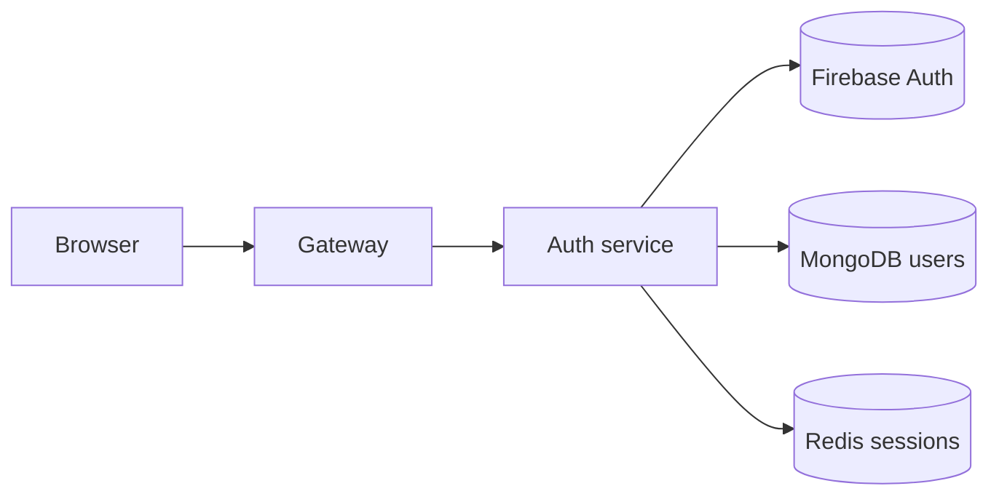

# Auth Service

The auth service is the login and identity layer.

Its job is to trust Firebase for the actual sign-in and then keep a local user
record in MongoDB. It also creates the browser session that later proves the
user is logged in.

## What it does

- accepts a Firebase token from the frontend
- verifies that token with Firebase Admin
- finds or creates the user in MongoDB
- stores a session in Redis
- sends a cookie back to the browser

## System flow



## Real routes

The auth service currently exposes:

- `POST /login`
- `GET /logout`
- `GET /` for health check

The route file is small and simple:

```js
router.post("/login", login);
router.get("/logout", logout);
```

## Login flow in plain English

1. The browser gets a Firebase Google sign-in result.
2. The frontend calls `POST /api/auth/login` with the token.
3. The gateway forwards it to the auth service as `POST /login`.
4. The auth service calls `verifyIdToken(token)`.
5. If the token is valid, it looks for a user by `firebaseUid`.
6. If no user exists, it creates one.
7. It saves a Redis session with the user info.
8. It sets an `httpOnly` session cookie on the response.

## The actual controller behavior

In `backend/services/auth/controllers/auth.controller.js` the login logic does
this:

```js
const decoded = await getAuth(app).verifyIdToken(token);
let user = await User.findOne({ firebaseUid: decoded.uid });

if (!user) {
  user = await User.create({
    firebaseUid: decoded.uid,
    name: decoded.name || decoded.email.split("@")[0] || "User",
    email: decoded.email,
    avatar: decoded.picture || "",
  });
}

const sessionId = crypto.randomUUID();
await redis.set(`session-${sessionId}`, JSON.stringify(publicUser), "EX", SESSION_TTL_SECONDS);
res.cookie("session", sessionId, cookieOptions);
```

The important details are:

- no password is stored locally
- the user is mapped to Firebase and MongoDB
- the session key is `session-<uuid>`
- the default session lifetime is 7 days
- the cookie is `httpOnly`, so it is not easy to read from JavaScript

## Redis session behavior

The session is saved in Redis with a TTL of 7 days.

```js
const SESSION_TTL_SECONDS = 7 * 24 * 60 * 60;
```

This means the browser keeps the login state for a week unless the user logs out
or the session is removed.

## logout behavior

The logout controller clears the Redis session and removes the cookie:

```js
await redis.del(`session-${sessionId}`);
res.clearCookie("session", { ... });
```

The route is defined in the auth route file, but the login flow is the part that
matters most today.

## MongoDB model

The user record is stored with fields like:

- `firebaseUid`
- `name`
- `email`
- `avatar`
- timestamps from MongoDB

This keeps the user record simple and tied to the Firebase identity.

## Why this setup is useful

Firebase handles the hard part of sign-in. The app then keeps a clean record in
its own database and a session in Redis. That keeps the app flexible and avoids
rebuilding password handling by hand.

## Files involved

- `backend/services/auth/index.js` — starts the app
- `backend/services/auth/config/firebase.js` — Firebase admin setup
- `backend/services/auth/config/db.js` — MongoDB connection
- `backend/services/auth/models/user.model.js` — user schema
- `backend/services/auth/controllers/auth.controller.js` — login/logout logic
- `backend/services/auth/routes/auth.route.js` — route mapping

## Health check

The auth service responds at:

```bash
http://localhost:8001/
```

with:

```json
{ "message": "Hello from Auth" }
```
