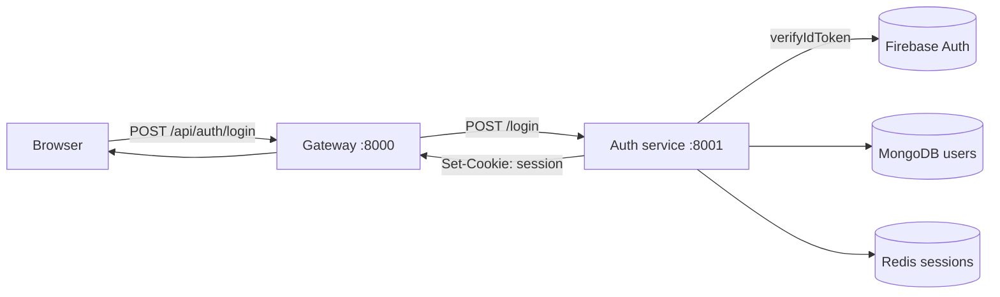
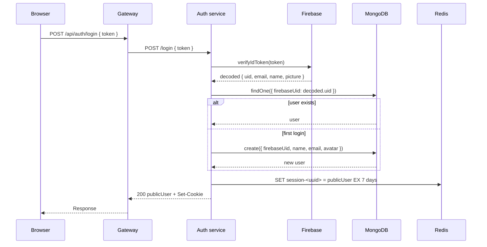
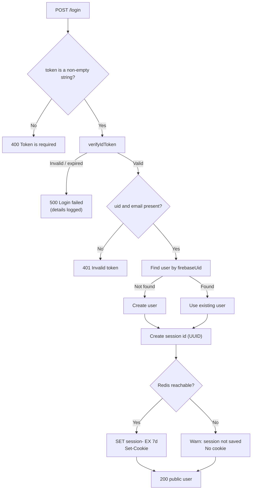

# Auth Service

The auth service is the identity layer. It trusts Firebase for the actual
sign-in, keeps a local user record in MongoDB, and creates the Redis session that
later requests use.

- **Folder:** `backend/services/auth/`
- **Port:** `8001` by default
- **Entry point:** `backend/services/auth/index.js`
- **Needs:** Firebase service account key, MongoDB, Redis

## What it does

- accepts a Firebase ID token from the frontend
- verifies that token with Firebase Admin
- finds or creates the user in MongoDB
- creates a session id and stores the public user in Redis
- sets an `httpOnly` session cookie
- deletes the session and clears the cookie on logout
- answers health checks

It does **not**:

- accept passwords
- sign users in itself
- check sessions on later requests (the gateway does that)
- authorize project access

## System flow



## Routes

The auth service is mounted at `/` in its own Express app, and the gateway strips
the `/api/auth` prefix. Therefore its routes are:

| Method | Path | Purpose |
| --- | --- | --- |
| `POST` | `/login` | Verify a Firebase token and create a session. |
| `GET` | `/logout` | Delete the session and clear the cookie. |
| `GET` | `/` | Health message (defined after the router). |
| `GET` | `/health` | Health message. |

The route file is deliberately small:

```js
router.post("/login", login);
router.get("/logout", logout);
```

Through the gateway, these become:

- `POST /api/auth/login`
- `GET /api/auth/logout`

## Login flow in plain English

1. The browser gets a Firebase Google sign-in result.
2. The frontend sends the ID token to `POST /api/auth/login`.
3. The gateway rate-limits the request and forwards it as `POST /login`.
4. The auth service calls `getAuth(app).verifyIdToken(token)`.
5. If the token is valid, it requires both `decoded.uid` and `decoded.email`.
6. It looks for a user by `firebaseUid`.
7. If no user exists, it creates one.
8. It stores `{ _id, name, email, avatar }` in Redis as `session-<uuid>`.
9. It sets the `session` cookie.
10. It returns the public user.



## The controller

`backend/services/auth/controllers/auth.controller.js` contains the logic.

Key parts:

```js
const SESSION_TTL_SECONDS = 7 * 24 * 60 * 60;

const cookieOptions = {
  httpOnly: true,
  secure: process.env.NODE_ENV === "production",
  sameSite: process.env.NODE_ENV === "production" ? "none" : "lax",
  path: "/",
  maxAge: SESSION_TTL_SECONDS * 1000,
};
```

The session payload is the "public user":

```js
{
  _id,      // MongoDB user id
  name,
  email,
  avatar,
}
```

The Firebase UID is not included in the session.

### Login behavior in detail



Important details:

- **No password is stored locally.** Firebase owns the credential.
- **The user is linked by `firebaseUid`.** MongoDB owns the local profile.
- **Redis failure is soft.** Login still succeeds and returns the user, but no
  session is created. The next request will look signed out.
- **Duplicate-key errors return `409`.** This is the `error.code === 11000` path,
  which can happen if two first-login requests race.
- **Invalid token errors return `500`.** The client sees a generic failure; the
  server logs the real reason. A more precise `401` for verification failures
  would be a reasonable future change.
- **The response is the public user**, not the raw decoded Firebase token.

## Session storage

```js
const sessionId = crypto.randomUUID();
await redis.set(
  `session-${sessionId}`,
  JSON.stringify(publicUser),
  "EX",
  SESSION_TTL_SECONDS,
);
res.cookie("session", sessionId, cookieOptions);
```

- The browser receives only a random UUID.
- The user data stays in Redis.
- The 7-day TTL means expired sessions delete themselves.
- Redis is configured with `enableOfflineQueue: false`; when it is down, the
  `set` throws immediately and is caught by the inner `try`/`catch`.
- The session is not refreshed on activity. After 7 days, the user signs in
  again.

## Cookie flags

| Flag | Development | Production |
| --- | --- | --- |
| `httpOnly` | `true` | `true` |
| `secure` | `false` | `true` |
| `sameSite` | `lax` | `none` |
| `path` | `/` | `/` |
| `maxAge` | 7 days | 7 days |

`httpOnly` blocks JavaScript access. `secure` requires HTTPS. `sameSite=none`
allows a cross-site frontend, but browsers only allow it with `secure`.

## Logout behavior

```js
const sessionId = req.cookies?.session;
if (sessionId) {
  await redis.del(`session-${sessionId}`);
}

res.clearCookie("session", {
  httpOnly: true,
  secure: process.env.NODE_ENV === "production",
  sameSite: process.env.NODE_ENV === "production" ? "none" : "lax",
  path: "/",
});
return res.status(200).json({ message: "Logout Successfully" });
```

- The auth service has `cookie-parser`, so it can read the cookie on logout.
- The Redis delete is wrapped in its own `try`/`catch`; a Redis failure is logged
  and the cookie is still cleared.
- The route is `GET /api/auth/logout` through the gateway.
- A state-changing route should ideally be `POST` or `DELETE` with CSRF
  protection. That is a known limitation, not a hidden one.

## Error responses

| Situation | Status | Body |
| --- | --- | --- |
| Missing or non-string token | `400` | `{ "message": "Token is required" }` |
| Token verified but missing uid/email | `401` | `{ "message": "Invalid token" }` |
| Duplicate user race | `409` | `{ "message": "Login failed" }` |
| Verification or server error | `500` | `{ "message": "Login failed" }` |
| Logout success | `200` | `{ "message": "Logout Successfully" }` |
| Logout failure | `500` | `{ "message": "Logout failed" }` |
| Unknown route | `404` | `{ "message": "Not found" }` |

## MongoDB model

`backend/services/auth/models/user.model.js`:

| Field | Type | Rules |
| --- | --- | --- |
| `firebaseUid` | String | Required, unique, trimmed |
| `name` | String | Required, trimmed |
| `email` | String | Required, unique, trimmed, lowercase |
| `avatar` | String | Default `""` |
| `createdAt` / `updatedAt` | Date | Added by Mongoose `timestamps` |

The schema's `toJSON` transform removes `firebaseUid` and `__v`, so serialized
users do not expose the Firebase link.

See [Data Model](./data-model.md) for the full picture.

## Firebase setup

`config/firebase.js`:

```js
import { cert, initializeApp } from "firebase-admin";
import serviceAccount from "../serviceAccountKey.json" with { type: "json" };

export const app = initializeApp({
  credential: cert(serviceAccount),
});
```

This runs at import time. A missing or malformed key throws before the server
starts listening. That is intentional: a broken auth service should fail
immediately, not pretend to work until the first login.

`serviceAccountKey.json` is git-ignored. If it leaks, revoke it in Firebase and
generate a new one.

## Database connection

`config/db.js` reads `MONGODB_URI` and calls `mongoose.connect`. It catches its
own errors:

- If `MONGODB_URI` is missing, it logs `[auth] MONGODB_URI is not set` and
  returns.
- If the connection fails, it logs `[auth] MongoDB connection failed: ...`.

The HTTP server still starts. Login will fail until MongoDB is reachable.

## Files involved

| File | Role |
| --- | --- |
| `index.js` | Express setup, JSON parsing, cookie parsing, routes, health, error handlers |
| `config/db.js` | MongoDB connection |
| `config/firebase.js` | Firebase Admin initialization |
| `models/user.model.js` | User schema |
| `controllers/auth.controller.js` | Login and logout logic |
| `routes/auth.route.js` | URL to controller mapping |
| `serviceAccountKey.json` | Firebase credential (secret) |

## Health check

```bash
curl http://localhost:8001/
curl http://localhost:8001/health
```

Both return:

```json
{ "message": "Hello from Auth" }
```

## Related pages

- [Gateway](./gateway.md)
- [Project service](./project-service.md)
- [Security Model](./security.md)
- [Redis Usage](./redis.md)
- [API Reference](./api-reference.md)
