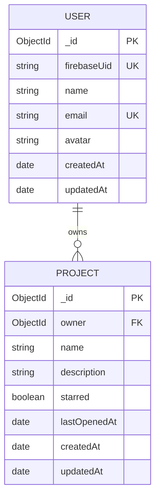
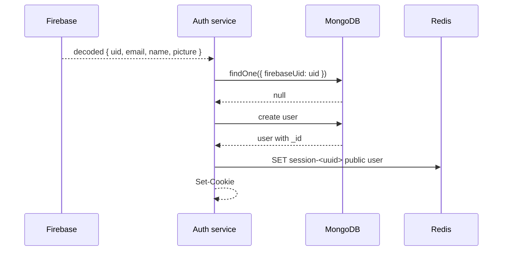

# Data Model

NexPulse stores durable data in MongoDB and short-lived data in Redis. MongoDB is
the source of truth. Redis holds sessions and cache entries that can be rebuilt.



## MongoDB

Each service connects to the database named in `MONGODB_URI`. The auth service
and project service can point at the same database; the project `owner` field
references a user `_id`.

### `users` collection

Defined in `backend/services/auth/models/user.model.js`. Mongoose pluralizes the
model name `User` to the collection name `users`.

| Field | Type | Required | Rules |
| --- | --- | --- | --- |
| `_id` | ObjectId | yes | Generated by MongoDB. |
| `firebaseUid` | String | yes | Unique, trimmed. Links the local user to Firebase. |
| `name` | String | yes | Trimmed. Comes from the Firebase profile on first login. |
| `email` | String | yes | Unique, trimmed, lowercased. |
| `avatar` | String | no | Defaults to `""`. |
| `createdAt` | Date | auto | Mongoose timestamps. |
| `updatedAt` | Date | auto | Mongoose timestamps. |

Indexes:

- `_id` (default)
- unique index on `firebaseUid`
- unique index on `email`

`toJSON` removes `firebaseUid` and `__v`. That means API responses and Redis
session payloads built from a user document do not expose the Firebase link.

Example document:

```json
{
  "_id": { "$oid": "663f0c..." },
  "firebaseUid": "firebase-uid-123",
  "name": "Ada Lovelace",
  "email": "ada@example.com",
  "avatar": "https://example.com/avatar.png",
  "createdAt": { "$date": "2026-10-28T09:00:00.000Z" },
  "updatedAt": { "$date": "2026-10-28T09:00:00.000Z" }
}
```

### `projects` collection

Defined in `backend/services/project/models/project.model.js`.

| Field | Type | Required | Rules |
| --- | --- | --- | --- |
| `_id` | ObjectId | yes | Generated by MongoDB. |
| `owner` | ObjectId | yes | References `User`, indexed. |
| `name` | String | yes | Trimmed, max 120 characters. |
| `description` | String | no | Trimmed, max 2000 characters, default `""`. |
| `starred` | Boolean | no | Default `false`. |
| `lastOpenedAt` | Date | no | Default now; updated when the project is fetched by id. |
| `createdAt` | Date | auto | Mongoose timestamps. |
| `updatedAt` | Date | auto | Mongoose timestamps. |

Indexes:

| Index | Supports |
| --- | --- |
| `{ owner: 1 }` | Owner-scoped lookups and deletes. |
| `{ owner: 1, updatedAt: -1 }` | Dashboard list, newest first. |
| `{ owner: 1, starred: 1, updatedAt: -1 }` | Starred list, newest first. |

The compound indexes cover the exact sort order used by the controllers, so
MongoDB can avoid an in-memory sort for those queries.

Example document:

```json
{
  "_id": { "$oid": "6640ab..." },
  "owner": { "$oid": "663f0c..." },
  "name": "Website redesign",
  "description": "Marketing site refresh",
  "starred": true,
  "lastOpenedAt": { "$date": "2026-10-29T10:00:00.000Z" },
  "createdAt": { "$date": "2026-10-28T09:00:00.000Z" },
  "updatedAt": { "$date": "2026-10-29T10:00:00.000Z" }
}
```

## Relationships

- One user owns zero or more projects.
- A project belongs to exactly one user.
- The relationship is stored only on the project (`owner`). The user document
  has no project array.
- There is no `populate` call. The frontend only needs the owner id, and the
  signed-in user is already known.
- Deleting a user is not implemented, so there is no cascade behavior to
  document.

## Ownership and security

Every project query includes `owner: userId`:

```js
Project.find({ owner: userId })
Project.findOne({ _id: id, owner: userId })
Project.findOneAndDelete({ _id: id, owner: userId })
```

This is the authorization rule. A project id that exists but belongs to someone
else produces the same `404` as a missing project, which avoids confirming that
another user's project exists.

The `owner` value comes from `x-user-id`, which the gateway sets after validating
the session. The project service does not verify that the id exists in `users`.
MongoDB does not enforce the `ref` at write time either; it is application-level
metadata.

## Redis data

Redis is not a database of record. It holds two kinds of data:

### Sessions

| Key | Value | TTL | Written by |
| --- | --- | --- | --- |
| `session-<uuid>` | JSON public user `{ _id, name, email, avatar }` | 7 days (604800 s) | Auth service on login |

- The UUID is random (`crypto.randomUUID()`).
- The browser holds the UUID in an `httpOnly` cookie.
- The gateway reads the key on every protected request.
- Logout deletes the key.
- There is no sliding expiration.

### Project caches

| Key | Value | TTL | Written by |
| --- | --- | --- | --- |
| `projects-<userId>` | JSON array of project documents | 5 minutes (300 s) | Project list read |
| `starred-projects-<userId>` | JSON array of starred project documents | 5 minutes (300 s) | Starred list read |

The cached JSON is the full Mongoose document as serialized by
`JSON.stringify`, including `_id`, `owner`, `__v`, `createdAt`, and `updatedAt`.

Cache invalidation:

| Action | Deletes `projects-<userId>` | Deletes `starred-projects-<userId>` |
| --- | --- | --- |
| Create project | yes | yes |
| Fetch project by id | yes | yes |
| Toggle star | yes | yes |
| Delete project | yes | yes |
| List projects | no | no |
| List starred projects | no | no |

Both keys are deleted together even when only one could change. That is simple
and avoids subtle bugs.

If Redis is unavailable:

- sessions cannot be written or read, so authentication fails soft or hard
  depending on the stage
- project reads fall back to MongoDB
- project writes still succeed, but stale cache entries may remain until TTL

See [Redis Usage](./redis.md).

## Data lifecycle

### First login



### Returning login

The user is found by `firebaseUid`. Local `name`, `email`, and `avatar` are not
refreshed from Firebase on every login. If a user changes their Google name or
photo, the local record keeps the old value until a profile-sync feature is
added.

### Project open

`GET /project/:id` sets `lastOpenedAt = new Date()` and saves. This changes
`updatedAt`, which is why the list caches are invalidated. The dashboard's
"recently updated" ordering can therefore move a project to the top just because
it was opened.

### Project deletion

The document is removed. Cache keys are deleted. There is no soft delete and no
trash. The response returns the deleted document so the frontend can remove it
from the list.

## What is not modeled

- Project members, invitations, or roles.
- Project content, files, or editor state.
- User preferences or settings.
- Audit history or activity log.
- Soft-deleted records.
- Refresh tokens or multiple sessions per user.
- A separate session index per user, so there is no "log out everywhere".

These are candidates for future work, not hidden behavior.
