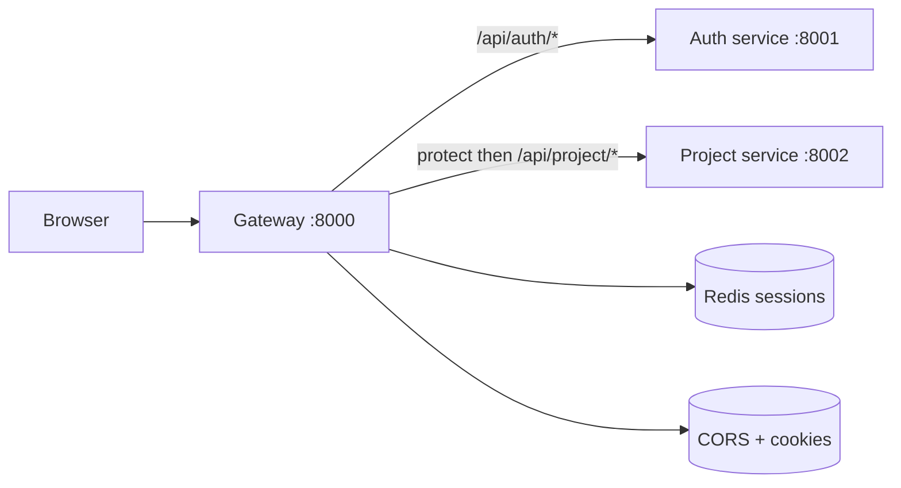
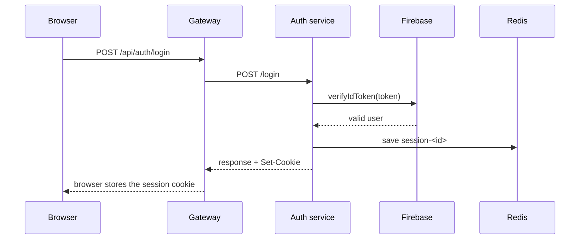
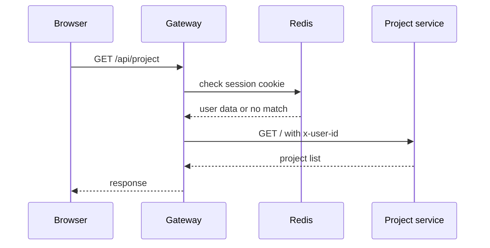

# Gateway Service

The gateway is the public front door of the backend.

The browser never talks directly to the auth or project microservice. It sends
all requests to the gateway first. The gateway decides who should handle the
request and whether the user is allowed in.

## What it does in plain English

- accepts browser requests from the frontend
- allows the frontend origin through CORS
- reads the session cookie
- checks Redis for the current session
- forwards public auth routes to the auth service
- forwards protected project routes to the project service
- answers `GET /api/me` for session restore

## System flow



## Real route setup

In `backend/gateway/index.js`, the gateway does this:

```js
app.use("/api/auth", proxy(authService));
app.use("/api/project", protect, proxyWithHeader(projectService));
app.get("/api/me", protect, getCurrentUser);
```

That means:

- `/api/auth/*` goes to the auth service
- `/api/project/*` is checked with `protect` before forwarding
- `/api/me` is handled directly by the gateway

## Why `protect` matters

The guard in `backend/gateway/middleware/protect.js` reads the `session` cookie,
looks it up in Redis, and loads the user payload if the session is valid.

```js
const sessionId = req.cookies?.session;
const result = await redis.get(`session-${sessionId}`);
req.user = JSON.parse(result);
```

If there is no cookie or the session is missing, it returns `401`.

## How the project service gets the user

The gateway adds `x-user-id` before forwarding project requests.

```js
proxyReqOpts.headers["x-user-id"] = req.user?._id;
```

This is important because the project service trusts the gateway, not the
browser. It does not read the session cookie itself.

## Login flow



## Protected request flow



## Good rules to remember

- The frontend only knows the gateway URL.
- The gateway handles auth, cookies, and CORS.
- The project service only trusts the `x-user-id` header.
- Protected routes fail at the gateway before they ever reach the service.

## Health check

The gateway also has a simple health endpoint:

```bash
http://localhost:8000/
```

It returns:

```json
{ "message": "Hello from gateway" }
```
