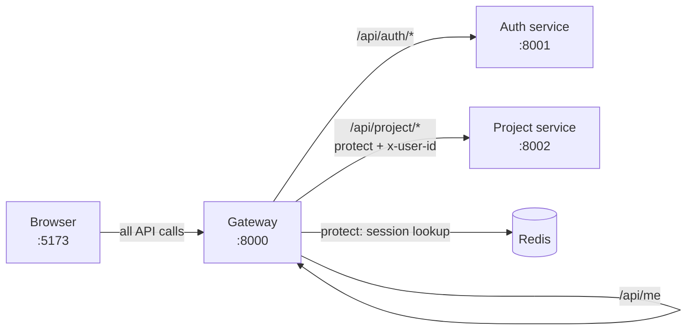
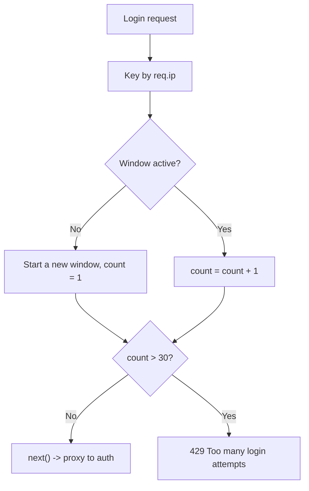
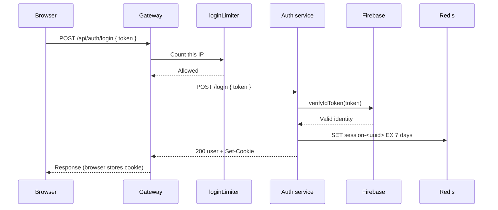
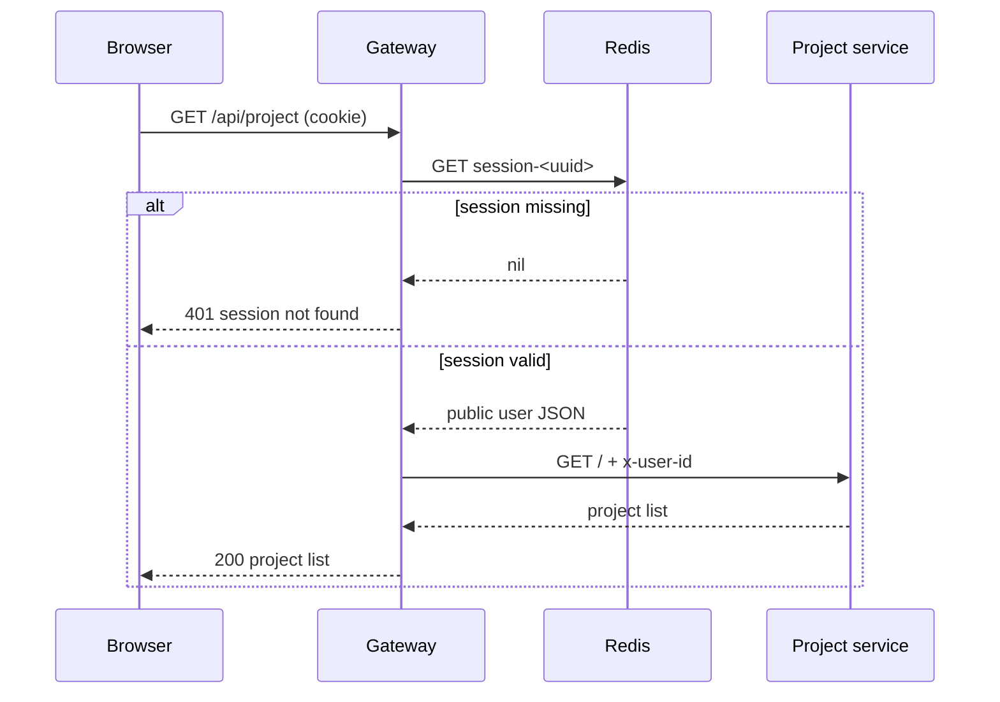

# Gateway Service

The gateway is the public front door of the backend. It is the only backend
program the browser is allowed to talk to. It decides where each request goes,
whether the user is signed in, and what error shape to return.

- **Folder:** `backend/gateway/`
- **Port:** `8000` by default
- **Entry point:** `backend/gateway/index.js`
- **Needs:** Redis (session checks), the auth service, and the project service

## What it does

- accepts browser requests from the configured frontend origin
- allows that origin through CORS with credentials
- parses cookies
- logs every request with `morgan`
- rate-limits `POST /api/auth/login`
- forwards `/api/auth/*` to the auth service
- checks the session for `/api/project/*` before forwarding
- adds `x-user-id` to project requests
- answers `GET /api/me` directly from the session
- returns consistent `404` and `500` JSON responses

## System flow



## Middleware order

Order matters. The gateway registers middleware in this sequence:

```js
app.set("trust proxy", 1);

app.use(cors({ origin: frontendOrigin, credentials: true }));
app.use(cookieParser());
app.use(morgan("dev"));

app.use("/api/auth/login", loginLimiter);
app.use("/api/auth", proxy(authService));
app.use("/api/project", protect, proxyWithHeader(projectService));

app.get("/api/me", protect, getCurrentUser);

app.get(["/", "/health"], (req, res) => {
  res.json({ message: "Hello from gateway" });
});

app.use((req, res) => {
  res.status(404).json({ message: "Not found" });
});

app.use((err, req, res, next) => {
  console.error(`[gateway] ${err.message}`);
  if (res.headersSent) return next(err);
  res.status(500).json({ message: "Internal server error" });
});
```

Why this order:

1. **CORS first.** Even error responses should carry the CORS headers, or the
   browser hides the real error behind a CORS error.
2. **Cookies before routes.** `protect` needs `req.cookies`.
3. **Logging before routes.** The log line is emitted for requests that reach the
   gateway, including failures.
4. **Rate limit before the auth proxy.** The limiter must run before the login
   request is forwarded.
5. **`protect` before the project proxy.** An unauthenticated request should
   never reach the project service.
6. **404 and error handlers last.** Express matches them after all routes.

## Routing

| Gateway path | Middleware | Destination |
| --- | --- | --- |
| `POST /api/auth/login` | `loginLimiter` | Auth service `POST /login` |
| `GET /api/auth/logout` | — | Auth service `GET /logout` |
| `GET /api/auth/*` | — | Auth service, prefix stripped |
| `/api/project/*` | `protect`, then `proxyWithHeader` | Project service, prefix stripped, plus `x-user-id` |
| `GET /api/me` | `protect` | Handled by the gateway |
| `GET /` and `/health` | — | Gateway health message |
| anything else | — | `404 { message: "Not found" }` |

### The prefix is stripped

When Express mounts a router or proxy on a path, it removes that mount prefix
from `req.url` before running the handler.

- Browser calls `/api/auth/login`.
- The gateway mounts the auth proxy on `/api/auth`.
- The auth service receives `/login`.

This is why `auth.route.js` defines `router.post("/login", login)` and not
`router.post("/api/auth/login", login)`.

The same applies to the project service: the browser calls
`/api/project/starred`, and the project service receives `/starred`. Its router
defines `router.get("/starred", getStarredProjects)`.

This is the most common source of 404s when adding a route. Check which side of
the gateway you are editing.

## The `protect` auth gate

`backend/gateway/middleware/protect.js` runs on every protected route:

```js
export const protect = async (req, res, next) => {
  try {
    const sessionId = req.cookies?.session;
    if (!sessionId) {
      return res.status(401).json({ message: "unauthorized" });
    }

    const result = await redis.get(`session-${sessionId}`);
    if (!result) {
      return res.status(401).json({ message: "session not found" });
    }

    req.user = JSON.parse(result);
    next();
  } catch (error) {
    if (error instanceof SyntaxError) {
      return res.status(401).json({ message: "session not found" });
    }
    console.error(`[protect] ${error.message}`);
    return res.status(503).json({ message: "Session store unavailable" });
  }
};
```

Behavior:

| Situation | Result |
| --- | --- |
| No `session` cookie | `401 { message: "unauthorized" }` |
| Cookie present, no Redis record | `401 { message: "session not found" }` |
| Stored value is invalid JSON | `401 { message: "session not found" }` |
| Redis unreachable or errors | `503 { message: "Session store unavailable" }` |
| Valid record | `req.user` is set, request continues |

`protect` is authentication, not authorization. It answers "who is this person?"
It does not answer "is this person allowed to touch this particular project?" That
second question is handled by the project service's owner filters.

### Why it trusts Redis

The session record is written by the auth service and contains only the public
user fields. Redis is on the private network. If someone can write arbitrary
values to `session-*` keys, the system is already compromised; the gateway does
not add a second signature on top.

## Forwarding identity to the project service

The plain auth proxy forwards requests unchanged. The project proxy uses a
wrapper that adds the user id:

```js
export const proxyWithHeader = (serviceUrl) => {
  return proxy(serviceUrl, {
    proxyReqPathResolver: (req) => req.url,
    proxyReqOptDecorator: (proxyReqOpts, req) => {
      if (req.user?._id) {
        proxyReqOpts.headers["x-user-id"] = String(req.user._id);
      }
      return proxyReqOpts;
    },
  });
};
```

The project service reads `x-user-id` and never reads the cookie. This keeps
session handling in one place, but it means the project service must never be
exposed publicly.

## Login rate limiting

`backend/gateway/middleware/loginLimiter.js` allows **30 login attempts per IP
per 15 minutes**.



Implementation notes:

- Counters live in a `Map` in memory, keyed by `req.ip`.
- A timer removes expired windows every 15 minutes.
- `setInterval(...).unref()` lets the process exit without waiting for the timer.
- `app.set("trust proxy", 1)` makes `req.ip` use the forwarded client address
  when there is one trusted proxy in front.
- Because the map is per process, multiple gateway instances do not share
  counters. Move the limiter to Redis before scaling horizontally.

The limit applies only to `/api/auth/login`. Logout and normal API calls are not
limited here.

## CORS and cookies

```js
cors({
  origin: frontendOrigin, // FRONTEND_URL
  credentials: true,
})
```

- `origin` must be exact. `*` is invalid with credentials.
- `credentials: true` lets the browser send and accept the session cookie.
- If `FRONTEND_URL` does not match the actual page origin, the browser blocks the
  response or refuses to store the cookie.

In development, the cookie is `SameSite=Lax` because both sides are on
`localhost` and the auth service is reached through the gateway's origin. In
production, the auth service sets `SameSite=None; Secure` so a cross-site
frontend can use it over HTTPS.

## `/api/me`

`GET /api/me` is answered by the gateway, not forwarded:

```js
export const getCurrentUser = (req, res) => {
  return res.status(200).json(req.user);
};
```

Because `protect` already loaded the session payload, no service call is needed.
The frontend calls this once on app start to restore the signed-in user after a
reload.

## Error responses

| Case | Status | Body |
| --- | --- | --- |
| No session on a protected route | `401` | `{ "message": "unauthorized" }` |
| Unknown session | `401` | `{ "message": "session not found" }` |
| Redis unavailable during `protect` | `503` | `{ "message": "Session store unavailable" }` |
| Too many login attempts | `429` | `{ "message": "Too many login attempts. Try again later." }` |
| Unknown route | `404` | `{ "message": "Not found" }` |
| Unhandled gateway error | `500` | `{ "message": "Internal server error" }` |

Downstream error responses are passed through by the proxy. For example, a `400`
from the auth service reaches the browser as a `400`.

## Login flow through the gateway



## Protected request flow



## Health check

```bash
curl http://localhost:8000/
curl http://localhost:8000/health
```

Both return:

```json
{ "message": "Hello from gateway" }
```

## Rules to remember

- The frontend only knows the gateway URL.
- The gateway owns CORS, cookies, session checks, and the login rate limit.
- The gateway strips `/api/auth` and `/api/project` before forwarding.
- The project service trusts `x-user-id`; keep it private.
- Protected routes fail at the gateway before reaching a service.
- A `401` means "not signed in"; a `503` from `protect` means "Redis is down".

## Related pages

- [Auth service](./auth-service.md)
- [Project service](./project-service.md)
- [Security Model](./security.md)
- [API Reference](./api-reference.md)
