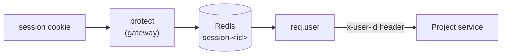

# Project Service

**Location:** `backend/services/project`
**Default port:** `8002`

The project service stores the code projects a user creates. It's the first
service that only ever answers **authenticated** requests — the gateway's
`protect` middleware stands in front of it, so by the time a request arrives
here, the user has already been identified.

## Where identity comes from — the `x-user-id` header

This service never reads the session cookie, and never talks to Firebase. It
doesn't need to. The gateway has already done that work:



Every controller here starts the same way:

```js
const userId = req.headers["x-user-id"];
if (!userId) {
  return res.status(401).json({ message: "userid is required" });
}
```

The header is added by the gateway's `proxyWithHeader` helper, which copies
`req.user._id` into `x-user-id` just before forwarding (see
[Gateway Service](./gateway.md#9-routing-to-the-project-service-protected)).

**Why a header and not the cookie?** A session cookie is the gateway's business.
If every service parsed it, each would need `cookie-parser`, Redis access, and
the same lookup logic — and any one of them getting it wrong would be a security
bug. Passing a single trusted header keeps identity handling in one place.

**The trade-off:** the project service *must* never be exposed to the internet
directly. Anyone who could reach port `8002` and set an `x-user-id` header
themselves could impersonate any user. In this project only the gateway calls
it, which is what makes the header trustworthy.

## The folder structure

```
services/project/
├── index.js                      The entry point. Wires everything together.
├── config/
│   └── db.js                     Connects to MongoDB via Mongoose.
├── controllers/
│   └── project.controller.js     The project logic.
├── models/
│   └── project.model.js          The shape of a project in MongoDB.
├── routes/
│   └── project.route.js          Maps URLs to controller functions.
├── .env                          Config: port, MongoDB URI, Redis URL.
└── package.json
```

Same Express layout as the auth service — `routes → controllers → models`, with
one-time setup in `config/`.

| Folder | Job |
| --- | --- |
| `routes/` | Which URL does what. |
| `controllers/` | The actual logic for each route. |
| `models/` | The database schema — what a record looks like. |
| `config/` | Setup that happens once, like connecting to a database. |

## The request, step by step

1. The browser calls `GET /api/project` and the session cookie rides along.
2. The gateway's `protect` middleware looks the session up in Redis and attaches
   `req.user`.
3. The gateway forwards the request to this service with an `x-user-id` header.
4. This service reads the header, queries MongoDB (or Redis — see caching), and
   returns the user's projects.

## The endpoints

| Method | Path | What it does |
| --- | --- | --- |
| `POST` | `/` | Create a project. |
| `GET` | `/` | List the user's projects. |
| `GET` | `/starred` | List the user's starred projects. |
| `GET` | `/:id` | Fetch one project, updating its `lastOpenedAt`. |
| `PATCH` | `/:id` | Toggle a project's `starred` flag. |
| `DELETE` | `/:id` | Delete a project. |

Remember the gateway strips the `/api/project` prefix, so the browser's
`GET /api/project` is this service's `GET /`.

## The code, explained

### `index.js` — the entry point

```js
import "dotenv/config";
import express from "express";
import { connectDb } from "./config/db.js";
import router from "./routes/project.route.js";

const port = process.env.PORT || 8002;

const app = express();
app.use(express.json());
app.use("/", router);

app.get("/", (req, res) => {
  res.json({ message: "Hello from Project Service" });
});

app.listen(port, () => {
  connectDb();
  console.log(`Project service running at ${port}`);
});
```

Identical in shape to the auth service: load env first, parse JSON, mount the
router, start listening, then connect to the database.

### `models/project.model.js` — what a project looks like

```js
const projectSchema = new mongoose.Schema(
  {
    owner: {
      type: mongoose.Schema.Types.ObjectId,
      ref: "User",
      required: true,
    },
    name: { type: String, required: true },
    description: { type: String },
    starred: { type: Boolean, default: false },
    lastOpenedAt: { type: Date, default: Date.now },
  },
  { timestamps: true },
);
```

- **`owner`** links a project to a user. It's an `ObjectId` with a `ref: "User"`
  — the same value that arrives in the `x-user-id` header.
- **`timestamps: true`** adds `createdAt` and `updatedAt` automatically.
- **`lastOpenedAt`** updates whenever a project is fetched by id, which is what
  makes "recently opened" lists possible.

### `controllers/project.controller.js` — the logic

The controllers follow a consistent pattern: read `x-user-id`, do the work,
return JSON.

**Create** — inserts the project, then clears the user's cached list:

```js
const project = await Project.create({ owner: userId, name, description });

const key = `projects-${userId}`;
await redis.del(key);

return res.status(201).json(project);
```

**List** — checks Redis first, falls back to MongoDB, then caches the result:

```js
const key = `projects-${userId}`;
let result = await redis.get(key);

if (result) {
  return res.status(200).json(JSON.parse(result));
}

const projects = await Project.find({ owner: userId }).sort({ updatedAt: -1 });
await redis.set(key, JSON.stringify(projects));
return res.status(200).json(projects);
```

**Fetch one** — updates `lastOpenedAt` so the project counts as "recently
opened":

```js
const project = await Project.findById(id);
if (!project) {
  return res.status(404).json({ message: "Project not found" });
}

project.lastOpenedAt = new Date();
await project.save();
return res.status(200).json(project);
```

## Redis caching — read-through, invalidated on write

Listing projects is the most frequent thing a user does, and the result only
changes when they add, star, or delete one. That's a good fit for a **cache**:

- **Reads** (`getProjects`, `getStarredProjects`) try Redis first (`projects-<userId>`,
  `starred-projects-<userId>`). On a miss, they query MongoDB and store the JSON
  in Redis for next time.
- **Writes** (`createProject`, `toggleStar`, `deleteProject`) delete the relevant
  key so the next read rebuilds it. This is the important half — a write that
  forgets to invalidate leaves stale data in the cache.

Unlike sessions, these cache keys have **no expiry** — they live until a write
clears them. That's fine while the only writer is this service; if something
else ever modifies projects, it would need to invalidate these keys too.

If Redis is unreachable, the shared client fails the command immediately (see
the auth service's notes on `enableOfflineQueue: false`), which means the
`redis.get`/`redis.del` calls throw and the request falls into the `catch`. A
more forgiving design would fall through to MongoDB when the cache is down; today
it doesn't.

## Configuration

From `.env`:

| Variable | Used by | What it does |
| --- | --- | --- |
| `PORT` | `index.js` | The port the service listens on (`8002`). |
| `MONGODB_URI` | `config/db.js` | The MongoDB connection string. |
| `REDIS_URL` | `shared/redis/redis.js` | Where Redis lives (`redis://localhost:6379`). |

The gateway also needs to know where this service is, via `PROJECT_SERVICE` in
**its** `.env` (`http://localhost:8002`).

## Dependencies

| Package | What it is | Why we use it |
| --- | --- | --- |
| `express` | Web framework | Runs the service and handles routes. |
| `mongoose` | MongoDB ODM | Defines the project schema and talks to the database. |
| `dotenv` | Config loader | Keeps the port and database URI out of the code. |
| `nodemon` | Dev auto-restart | Restarts the service when you save a file. |

The Redis client's own dependency, `ioredis`, is declared in
`backend/shared/package.json` rather than here — it belongs to the shared client.
