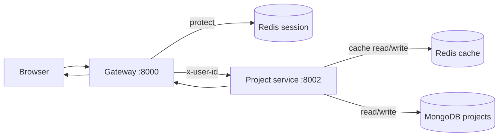
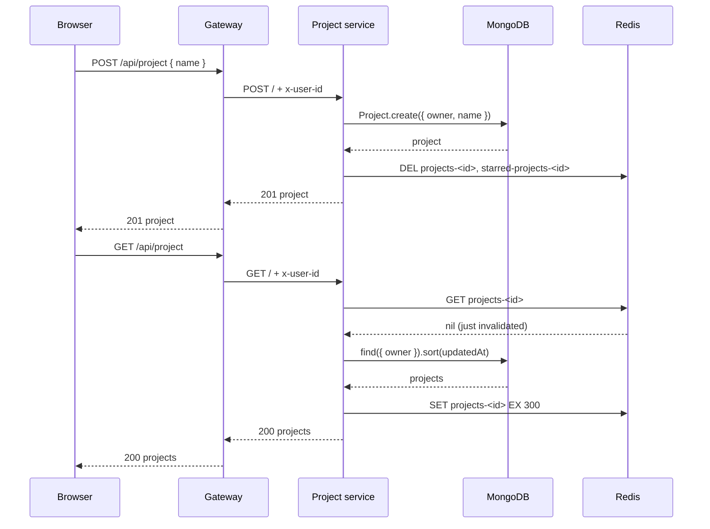

# Project Service

The project service stores a user's projects: name, description, starred state,
and last-opened time. It is the data layer behind the dashboard and the project
detail page.

- **Folder:** `backend/services/project/`
- **Port:** `8002` by default
- **Entry point:** `backend/services/project/index.js`
- **Needs:** MongoDB and Redis

## What it does

- creates a project
- lists all projects for the signed-in user
- lists only starred projects
- fetches one project by id and updates `lastOpenedAt`
- toggles the star state
- deletes a project
- caches list responses in Redis for 5 minutes
- invalidates the cache on writes

It does **not**:

- read the session cookie
- verify Firebase tokens
- decide "who is this user"

All of that happens at the gateway. This service trusts the gateway's
`x-user-id` header.

## Flow



## Identity comes from the gateway

The service never parses cookies. It reads:

```js
const userId = req.headers["x-user-id"];
if (!userId) {
  return res.status(401).json({ message: "userid is required" });
}
```

The gateway sets that header only after `protect` has validated the session. The
project service therefore does no independent verification. This is intentional:

- session logic stays in one place
- services behind the gateway stay simple
- the project service must never be exposed publicly

If you can reach port `8002` directly and set `x-user-id`, you can impersonate a
user. Keep it on a private network.

## Routes

The service is mounted at `/` and the gateway strips `/api/project`. Therefore:

| Method | Service path | Gateway path | Purpose |
| --- | --- | --- | --- |
| `POST` | `/` | `/api/project` | Create a project |
| `GET` | `/` | `/api/project` | List all projects |
| `GET` | `/starred` | `/api/project/starred` | List starred projects |
| `GET` | `/:id` | `/api/project/:id` | Fetch one project |
| `PATCH` | `/star/:id` | `/api/project/star/:id` | Toggle star |
| `PATCH` | `/:id/star` | `/api/project/:id/star` | Toggle star (alias) |
| `DELETE` | `/:id` | `/api/project/:id` | Delete a project |
| `GET` | `/health` | — | Health check |

Route order matters:

```js
router.post("/", createProject);
router.get("/", getProjects);
router.get("/starred", getStarredProjects);
router.patch("/star/:id", toggleStar);
router.patch("/:id/star", toggleStar);
router.get("/:id", getProjectById);
router.delete("/:id", deleteProject);
```

`/starred` is declared before `/:id`. If it were after, Express would treat
`starred` as an id.

There is **no** general update route (`PATCH /:id`) for name or description yet.

## Create a project

Request body:

```json
{ "name": "My Project", "description": "Optional notes" }
```

Behavior:

- `name` is trimmed. If it is empty, the response is
  `400 { message: "Project name is required" }`.
- `description` is trimmed and defaults to `""`.
- A project is created with `owner: userId`.
- Both list caches for that user are deleted.
- The response is `201` with the new project document.

Mongoose also enforces `name` max length 120 and `description` max length 2000.
A validation failure returns `400` with the validation message.

## List projects

```js
const cached = await cacheGet(projectsKey(userId));
if (cached) {
  return res.status(200).json(cached);
}

const projects = await Project.find({ owner: userId }).sort({
  updatedAt: -1,
});

await cacheSet(projectsKey(userId), projects);
return res.status(200).json(projects);
```

- Cache key: `projects-<userId>`.
- Sorted by `updatedAt` descending, so recently changed projects come first.
- A cache hit returns the stored JSON immediately.

## List starred projects

Same pattern with:

- Query: `{ owner: userId, starred: true }`
- Cache key: `starred-projects-<userId>`
- Sort: `updatedAt` descending

## Fetch one project

```js
const project = await Project.findOne({ _id: id, owner: userId });
if (!project) {
  return res.status(404).json({ message: "Project not found" });
}

project.lastOpenedAt = new Date();
await project.save();
await invalidateProjectCaches(userId);
```

- The id must be a valid MongoDB ObjectId; otherwise `400 Invalid id`.
- Ownership is part of the query. Another user's project looks like a missing
  project (`404`).
- Opening a project updates `lastOpenedAt`, which changes the project, so both
  list caches are cleared.

## Toggle star

- `PATCH /star/:id` and `PATCH /:id/star` both call the same controller.
- It finds the project with `{ _id, owner: userId }`.
- It flips `starred` and saves.
- It invalidates both caches.
- It returns the updated project.

The frontend deliberately updates the UI first, then calls this route, and rolls
back if the request fails. See
[State Management](../frontend/state-management.md).

## Delete a project

- Finds and deletes with `{ _id, owner: userId }`.
- Returns `404` if no matching project exists.
- Invalidates both caches.
- Returns the deleted project document.

## Cache behavior

| Key | Value | TTL | Invalidated by |
| --- | --- | --- | --- |
| `projects-<userId>` | JSON array of project documents | 5 minutes | Create, fetch-by-id, star toggle, delete |
| `starred-projects-<userId>` | JSON array of project documents | 5 minutes | Create, fetch-by-id, star toggle, delete |

The cache helpers are intentionally forgiving:

```js
const cacheGet = async (key) => {
  try {
    const result = await redis.get(key);
    return result ? JSON.parse(result) : null;
  } catch (error) {
    console.warn(`[redis] get failed: ${error.message}`);
    return null;
  }
};
```

- If Redis is down, `get` returns `null`, so the request falls through to
  MongoDB.
- If `set` fails, the request still returns data; the cache simply is not
  updated.
- If `del` fails, the request still succeeds; the cache may be stale until its
  TTL expires.

This is different from sessions: the project service does not fail a request
because caching is unavailable.

The 5-minute TTL is a safety net. Writes through this service invalidate
immediately, but a change made directly in MongoDB or by another process will
not be seen until the TTL expires or the keys are deleted manually.

## Error responses

| Situation | Status | Body |
| --- | --- | --- |
| Missing `x-user-id` | `401` | `{ "message": "userid is required" }` |
| Missing project name | `400` | `{ "message": "Project name is required" }` |
| Invalid ObjectId | `400` | `{ "message": "Invalid id" }` |
| Mongoose validation error | `400` | Mongoose validation message |
| Project not found / not owned | `404` | `{ "message": "Project not found" }` |
| Unexpected error | `500` | `{ "message": "<label> error" }` |
| Unknown route | `404` | `{ "message": "Not found" }` |

The `500` labels come from the controller: `create project error`,
`get projects error`, `get project by id error`, `get starred projects error`,
`toggle star error`, and `project delete error`. Internal details are logged with
`console.error`.

## Project schema

`backend/services/project/models/project.model.js`:

| Field | Type | Rules |
| --- | --- | --- |
| `owner` | ObjectId | Required, references `User`, indexed |
| `name` | String | Required, trimmed, max 120 |
| `description` | String | Trimmed, max 2000, default `""` |
| `starred` | Boolean | Default `false` |
| `lastOpenedAt` | Date | Default now |
| `createdAt` / `updatedAt` | Date | Added by Mongoose `timestamps` |

Indexes:

```js
projectSchema.index({ owner: 1, updatedAt: -1 });
projectSchema.index({ owner: 1, starred: 1, updatedAt: -1 });
```

These match the two dashboard queries: all projects by owner sorted by update
time, and starred projects by owner sorted by update time.

See [Data Model](./data-model.md) for relationships and Redis keys.

## Example: create then list



## Files involved

| File | Role |
| --- | --- |
| `index.js` | Express setup, JSON parsing, health, routes, error handlers |
| `config/db.js` | MongoDB connection |
| `controllers/project.controller.js` | CRUD, ownership filters, cache logic |
| `models/project.model.js` | Schema and indexes |
| `routes/project.route.js` | URL to controller mapping |

## Health check

```bash
curl http://localhost:8002/health
```

Returns:

```json
{ "message": "Hello from Project Service" }
```

## Related pages

- [Gateway](./gateway.md)
- [Auth service](./auth-service.md)
- [Redis Usage](./redis.md)
- [API Reference](./api-reference.md)
- [Data Model](./data-model.md)
