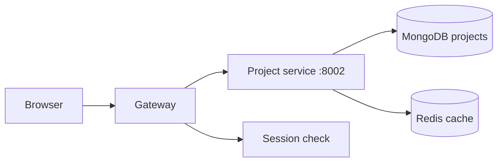

# Project Service

The project service stores a user's work items: project names, descriptions,
and starred state.

It is the data layer behind the dashboard.

## What it does

- creates a project
- lists all projects for the logged-in user
- lists only starred projects
- toggles the star state
- fetches one project by id
- deletes a project
- caches common reads in Redis

## Flow



The gateway checks the user's session first. If the session is valid, the
project service receives the user identity in the `x-user-id` header.

## Important rule: identity comes from the gateway

The project service does not read the session cookie. It trusts the gateway.

```js
const userId = req.headers["x-user-id"];
if (!userId) {
  return res.status(401).json({ message: "userid is required" });
}
```

This is intentional. The project service should only accept requests that have
a valid session already checked by the gateway.

## Route list

The project service defines these routes:

- `POST /` — create project
- `GET /` — list all projects
- `GET /starred` — list starred projects
- `GET /:id` — fetch one project
- `PATCH /star/:id` — toggle star
- `PATCH /:id/star` — toggle star
- `DELETE /:id` — delete project

## Redis cache keys

The controller uses these keys:

- `projects-${userId}`
- `starred-projects-${userId}`

When a project is created, updated, starred, or deleted, the cache is invalidated
so the next read pulls fresh data from MongoDB.

## Example: list projects

```js
const cached = await cacheGet(projectsKey(userId));
if (cached) {
  return res.status(200).json(cached);
}

const projects = await Project.find({ owner: userId }).sort({ updatedAt: -1 });
await cacheSet(projectsKey(userId), projects);
return res.status(200).json(projects);
```

This gives a fast read for the dashboard and keeps the database call small.

## Project schema

The project model contains fields such as:

- `owner`
- `name`
- `description`
- `starred`
- `lastOpenedAt`
- timestamps

This lets the app show starred-only lists and keep track of recent project usage.

## Files involved

- `backend/services/project/index.js` — starts the service
- `backend/services/project/routes/project.route.js` — route map
- `backend/services/project/controllers/project.controller.js` — business logic
- `backend/services/project/models/project.model.js` — project schema
- `backend/services/project/config/db.js` — MongoDB connection

## Health check

The project service responds at:

```bash
http://localhost:8002/
```

with:

```json
{ "message": "Hello from Project Service" }
```
