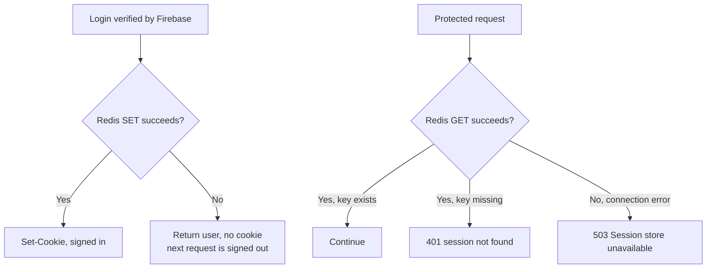
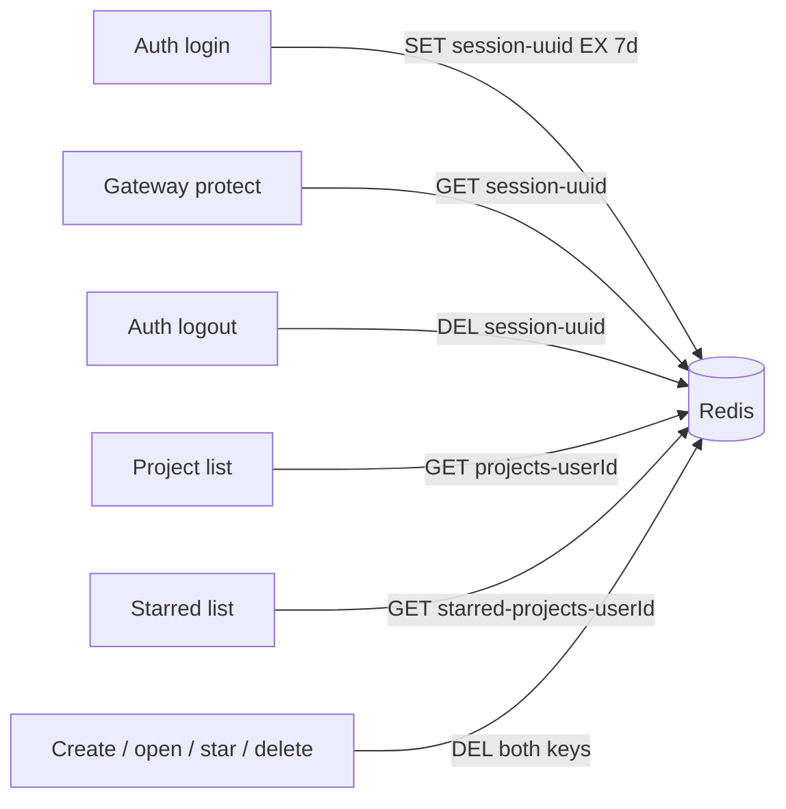

# Redis Usage

Redis has two jobs in NexPulse:

1. **Sessions** — remember who is signed in.
2. **Project caches** — avoid repeating the same MongoDB list queries.

It is not the source of truth. Losing Redis signs everyone out and empties the
caches, but no projects or users are lost.

## One client, three consumers

`backend/shared/redis/redis.js` creates a single Redis client:

```js
import Redis from "ioredis";

const redis = new Redis(process.env.REDIS_URL || "redis://127.0.0.1:6379", {
  enableOfflineQueue: false,
  retryStrategy: (times) => Math.min(times * 1000, 5000),
});
```

It is imported by:

- the auth service, to write and delete sessions
- the gateway, to read sessions
- the project service, to read and write caches

Each process gets its own connection. "Shared" means shared code, not a shared
socket.

### Why `enableOfflineQueue: false`

By default, ioredis queues commands while disconnected. They wait and then run
when Redis comes back. For this app that is misleading: a login request would
hang instead of failing, and a cache write could apply minutes later.

With the queue disabled, a command fails immediately when Redis is unreachable.
Each caller decides what to do:

- auth login: warn and continue without a session
- auth logout: warn and still clear the cookie
- gateway `protect`: return `503`
- project cache: warn and fall back to MongoDB

### Retry strategy

`Math.min(times * 1000, 5000)` retries after 1s, 2s, 3s, 4s, then every 5s. The
client keeps trying, so a service recovers automatically when Redis returns.

The `error` listener logs once per outage to avoid flooding the console. A
successful `connect` resets the warning flag and logs `redis connected`.

## Sessions

| Property | Value |
| --- | --- |
| Key | `session-<uuid>` |
| Value | JSON `{ "_id", "name", "email", "avatar" }` |
| TTL | 7 days (604800 seconds) |
| Created by | Auth service, after Firebase verification |
| Read by | Gateway `protect` |
| Deleted by | Auth logout, TTL expiry, Redis restart without persistence |

### Write

```js
const sessionId = crypto.randomUUID();

await redis.set(
  `session-${sessionId}`,
  JSON.stringify(publicUser),
  "EX",
  SESSION_TTL_SECONDS,
);

res.cookie("session", sessionId, cookieOptions);
```

The UUID is random. The browser never sees the user data, only the id.

### Read

```js
const sessionId = req.cookies?.session;
if (!sessionId) {
  return res.status(401).json({ message: "unauthorized" });
}

const result = await redis.get(`session-${sessionId}`);
if (!result) {
  return res.status(401).json({ message: "session not found" });
}

req.user = JSON.parse(result);
```

There is no sliding expiration. A session created at time T expires at T + 7
days, even if the user is active the whole time.

### Delete

```js
if (sessionId) {
  await redis.del(`session-${sessionId}`);
}
```

Logout deletes the exact key from the cookie. If Redis is down, the cookie is
still cleared on the client, but the Redis key remains until TTL. That is
harmless unless someone still has the old UUID.

### Session failure modes



The asymmetry is intentional: failing to create a session should not throw away
a successful Firebase login, while failing to check a session must not let a
request through.

## Project caches

| Key | Value | TTL |
| --- | --- | --- |
| `projects-<userId>` | JSON array of all owned projects | 5 minutes (300 s) |
| `starred-projects-<userId>` | JSON array of starred projects | 5 minutes (300 s) |

The `<userId>` is the MongoDB `_id` string from `x-user-id`.

### Read path

```js
const cached = await cacheGet(projectsKey(userId));
if (cached) {
  return res.status(200).json(cached);
}

const projects = await Project.find({ owner: userId }).sort({
  updatedAt: -1,
});

await cacheSet(projectsKey(userId), projects);
return res.status(200).json(projects);
```

- Empty arrays are cached too. `JSON.stringify([])` is `"[]"`, which is truthy,
  so a cached empty list is returned without hitting MongoDB.
- A Redis miss (or error) is `null`, so the query runs.

### Write path and invalidation

Every mutation deletes both list keys for that user:

```js
const invalidateProjectCaches = (userId) =>
  cacheDel(projectsKey(userId), starredKey(userId));
```

Called by:

- create project
- get project by id (because `lastOpenedAt` changes)
- toggle star
- delete project

Both keys are removed together. This is simpler than deciding which list is
affected, and the cost is one extra cache miss.

### Why not `DEL` a pattern?

The keys are deterministic per user, so the service can delete exact keys. A
`SCAN`/pattern delete would be slower and riskier at scale.

### Cache TTL as a safety net

The 5-minute TTL bounds staleness even if an invalidation is missed. Examples:

- someone edits MongoDB directly
- a future second backend instance writes without deleting the same keys
- a `DEL` fails because Redis was unavailable

The next read after expiry rebuilds the cache from MongoDB.

## Key map



## Local setup

The provided compose file runs Redis with the default configuration:

```bash
docker compose -f backend/docker-compose.yml up -d
```

It publishes `6379:6379` and has no password or persistent volume. Consequences:

- restarting the container loses all sessions and caches
- anyone who can reach the host port can read or write keys
- this is fine for local development, not for production

Check that it is alive:

```bash
docker compose -f backend/docker-compose.yml ps
```

Inspect keys:

```bash
docker exec -it <redis-container> redis-cli keys '*'
```

Inspect a session:

```bash
docker exec -it <redis-container> redis-cli get session-<uuid>
```

Check a TTL:

```bash
docker exec -it <redis-container> redis-cli ttl projects-<userId>
```

Delete a cache manually:

```bash
docker exec -it <redis-container> redis-cli del projects-<userId>
```

Do not delete `session-*` keys unless you intend to sign that user out.

## Configuration

| Variable | Default | Used by |
| --- | --- | --- |
| `REDIS_URL` | `redis://127.0.0.1:6379` | All three backend programs |

The client reads `process.env.REDIS_URL` at import time. Set it before starting a
service; changing it later has no effect until restart.

## Scaling notes

The current design works with one Redis instance and one gateway. Before scaling:

- **Rate limiting:** move the in-memory login counter to Redis so instances share
  it.
- **Sessions:** Redis already supports multiple gateway instances because the
  session is server-side. Any gateway can read any session.
- **Cache invalidation:** all writers must delete the same keys. They do today, as
  long as they use the same Redis database.
- **Persistence:** decide whether sessions should survive a Redis restart. The
  local compose file does not persist; production should use a managed Redis or
  configure AOF/RDB.
- **Eviction:** the compose file sets no `maxmemory` policy. In production, use a
  policy that does not evict sessions unexpectedly, or monitor memory closely.

## Health and failure behavior summary

| Consumer | Operation | Redis failure behavior |
| --- | --- | --- |
| Auth login | `SET session` | Warn, return user, no cookie |
| Auth logout | `DEL session` | Warn, clear cookie anyway |
| Gateway `protect` | `GET session` | `503 Session store unavailable` |
| Project list | `GET` cache | Warn, query MongoDB |
| Project list | `SET` cache | Warn, still return data |
| Any mutation | `DEL` cache | Warn, still succeed; TTL bounds staleness |

## Related pages

- [Auth service](./auth-service.md)
- [Project service](./project-service.md)
- [Data Model](./data-model.md)
- [Security Model](./security.md)
