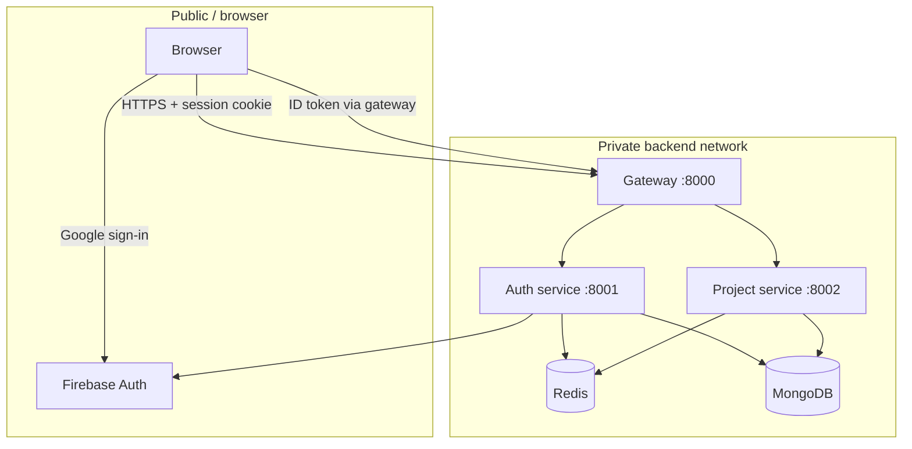

# Security Model

This page explains how NexPulse decides who a user is, what they may access, and
where the current protections stop. It describes the code as it exists today,
including the gaps.

## Trust boundaries



Rules implied by the diagram:

- Only the gateway may be exposed to the internet.
- The auth and project services trust traffic from the gateway.
- The project service trusts `x-user-id` and nothing else.
- Redis and MongoDB are private infrastructure.

The most important consequence: **if port `8002` is publicly reachable, anyone
can set `x-user-id` and read or modify another user's projects.** The same is true
for port `8001`; it accepts login requests without the gateway's rate limit.

## Authentication

### Firebase owns credentials

The app never receives or stores a password. The frontend performs Google
sign-in with Firebase, then sends the resulting ID token to
`POST /api/auth/login`.

The auth service calls:

```js
getAuth(app).verifyIdToken(token);
```

Firebase checks the token's signature, issuer, audience, and expiry. NexPulse
does not re-implement those checks.

The token must contain both `uid` and `email`. Otherwise the service returns
`401 { message: "Invalid token" }`.

### Local identity

On first login, the service creates a MongoDB user:

```js
{
  firebaseUid: decoded.uid,
  name: decoded.name || decoded.email.split("@")[0] || "User",
  email: decoded.email,
  avatar: decoded.picture || "",
}
```

`firebaseUid` is the link to Firebase. It is unique and removed from JSON output.
`email` is also unique and lowercased.

### Session creation

After verifying the token, the service creates a random session id:

```js
const sessionId = crypto.randomUUID();
```

It stores the public user in Redis:

```text
session-<uuid> -> {"_id":"...","name":"...","email":"...","avatar":"..."}
```

and sets the cookie:

```text
session=<uuid>; HttpOnly; Path=/; Max-Age=604800; SameSite=Lax
```

In production, `Secure` and `SameSite=None` are added.

The session payload contains no Firebase UID and no token. It is not a JWT and
has no signature; its security comes from the UUID being unguessable and from
Redis being private.

### Session checks

Every protected request goes through `protect`:

1. Read `req.cookies.session`.
2. If missing, return `401`.
3. Look up `session-<uuid>` in Redis.
4. If missing, return `401`.
5. Parse the JSON into `req.user`.
6. Continue.

A malformed stored value returns `401`. A Redis connection failure returns `503`.

## Authorization

Authorization is ownership. Every project query includes the current user id:

```js
{ owner: userId }
```

This applies to reads, star toggles, and deletes. A valid project id owned by
another user returns `404 Project not found`, not `403`. That avoids revealing
whether the id exists.

There are no roles, teams, sharing links, or admin accounts. A user can only see
their own projects.

## Cookies

| Attribute | Development | Production | Why |
| --- | --- | --- | --- |
| `HttpOnly` | yes | yes | JavaScript cannot read the session id. |
| `Secure` | no | yes | Production requires HTTPS. |
| `SameSite` | `Lax` | `None` | Cross-site production frontend; local same-site development. |
| `Path` | `/` | `/` | Cookie is sent to all gateway paths. |
| `Max-Age` | 7 days | 7 days | Matches the Redis TTL. |

The cookie is not signed or encrypted. It only contains a random UUID. All
sensitive data stays server-side.

`SameSite=None` requires `Secure`; browsers reject the combination otherwise.
This is why production must be served over HTTPS.

## CSRF

CSRF is about another site causing the browser to send a state-changing request
with the user's cookie.

Current state:

- Dev uses `SameSite=Lax`, which blocks most cross-site `POST` requests.
- Production uses `SameSite=None` so the frontend can call the API cross-site.
- There is no CSRF token and no `Origin`/`Referer` check.
- `GET /api/auth/logout` changes state.

Therefore, in production, a cross-site form or image request could potentially
trigger logout, and state-changing project requests rely on CORS plus
`SameSite=None` behavior. Browsers do not allow a cross-origin `fetch` to read the
response without CORS approval, but a "simple" request can still be sent; JSON
bodies and custom headers normally require a preflight.

Hardening options:

- add a CSRF token for state-changing requests
- require a custom header such as `X-Requested-With` on mutations
- check `Origin` against `FRONTEND_URL`
- make logout `POST` and protected

None of these are implemented today.

## CORS

```js
cors({
  origin: process.env.FRONTEND_URL || "http://localhost:5173",
  credentials: true,
})
```

- One exact origin is allowed.
- Credentials are allowed, so cookies work.
- A wildcard origin is not used, which is required when credentials are enabled.
- Requests from other origins do not receive the approval headers, so the browser
  blocks JavaScript from reading the response.

CORS is a browser rule, not a server authentication mechanism. `curl` ignores it.
That is why the project service must stay private.

## Rate limiting

The login route is limited by IP:

- 30 attempts
- per 15 minutes
- in-memory `Map`
- keyed by `req.ip`, with `trust proxy` set to 1

This slows down token-guessing and login abuse. It does not protect against a
distributed attack, and it resets when the gateway restarts. Multiple gateway
instances each keep their own counters.

There is no rate limit on project routes or logout.

## Input validation

| Input | Validation |
| --- | --- |
| Login token | Must be a non-empty string. Firebase verifies the rest. |
| `x-user-id` | Must be present. Not checked against MongoDB. |
| Project id | `mongoose.Types.ObjectId.isValid(id)` before querying. |
| Project name | Must be a non-empty string after trimming; max 120. |
| Project description | Must be a string to be trimmed; max 2000. |

The project id check matters: it prevents a malformed string from reaching
MongoDB's cast layer and producing an unhandled error.

MongoDB query operators are not accepted from the body. The body supplies
`name` and `description` only; `owner` comes from the trusted header.

## Secrets

Secrets are read from environment variables and files that are git-ignored:

- `.env` at the project root and per service
- `backend/services/auth/serviceAccountKey.json`
- any `.env.*` file except `.env.example`

Never commit real values. If the Firebase service account key leaks, revoke it
in the Firebase console and generate a replacement.

The frontend's `VITE_FIREBASE_*` values are **not** secrets. They identify the
Firebase project and are visible in the browser bundle. Access control comes from
Firebase rules and the backend token verification, not from hiding those values.

## Transport

- Local development uses HTTP on `localhost`.
- Production must use HTTPS end to end.
- `Secure` cookies require HTTPS.
- If a proxy terminates TLS, `app.set("trust proxy", 1)` lets Express use the
  forwarded client IP for rate limiting and see the original protocol.

## Error handling and information leakage

- API errors return short messages.
- Internal errors are logged server-side with `console.error`.
- Token verification failures return `500 Login failed`, not the underlying
  Firebase reason.
- The project service returns the same `404` for "missing" and "not yours".

Some detail still leaks operationally: `500` bodies include labels such as
`create project error`, and the gateway's `503` reveals that Redis is unavailable.
That is acceptable for this project but worth tightening in production.

## Redis and MongoDB

- Redis has no password in the provided `docker-compose.yml` and publishes port
  `6379` to the host. This is a local-development setup. Do not expose it.
- Redis is the session store. Anyone who can issue Redis commands can create a
  session for any user id.
- MongoDB is reached with `MONGODB_URI`. Use a dedicated database user, TLS, and
  network restrictions in production.
- `enableOfflineQueue: false` means Redis failures surface immediately instead of
  piling up commands. It does not add security, but it prevents silent hangs.

## Known gaps

These are real and should be addressed before a public production launch:

1. No CSRF token or origin check for mutations.
2. Logout is a `GET` request.
3. No security headers (`helmet` or equivalent).
4. No account or session revocation endpoint.
5. Sessions are not refreshed and cannot be listed.
6. The login limiter is per-process and in memory.
7. No automated dependency or secret scanning.
8. No audit log for sign-ins or destructive actions.
9. Local Redis is unauthenticated and exposed on the host.
10. Services rely entirely on network isolation; they do not re-verify identity.

## Checklist for deploying

- [ ] Serve the frontend and gateway over HTTPS.
- [ ] Set `NODE_ENV=production`.
- [ ] Set exact production `FRONTEND_URL`.
- [ ] Keep `8001` and `8002` off the public internet.
- [ ] Use a protected Redis instance, not the local compose file.
- [ ] Use a restricted MongoDB user.
- [ ] Rotate and store the Firebase key securely.
- [ ] Add CSRF protection before enabling cross-site cookies.
- [ ] Review CORS and cookie settings together.

## Related pages

- [Gateway](./gateway.md)
- [Auth service](./auth-service.md)
- [Project service](./project-service.md)
- [Redis Usage](./redis.md)
- [Deployment Guide](../guides/deployment.md)
