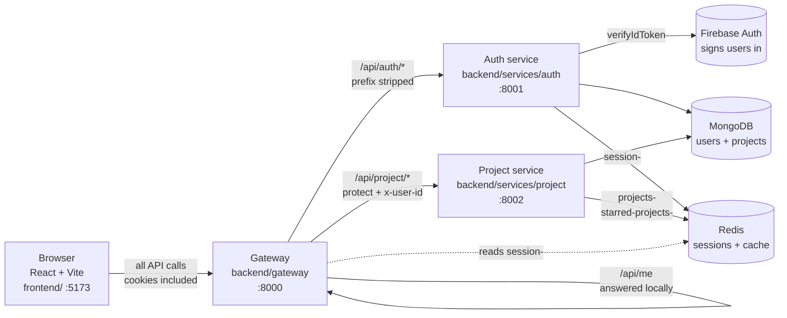
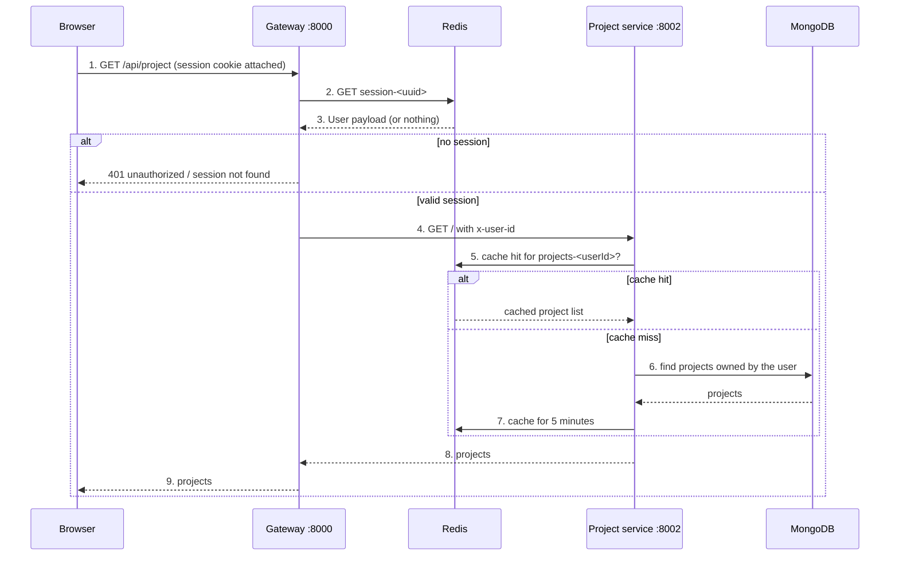
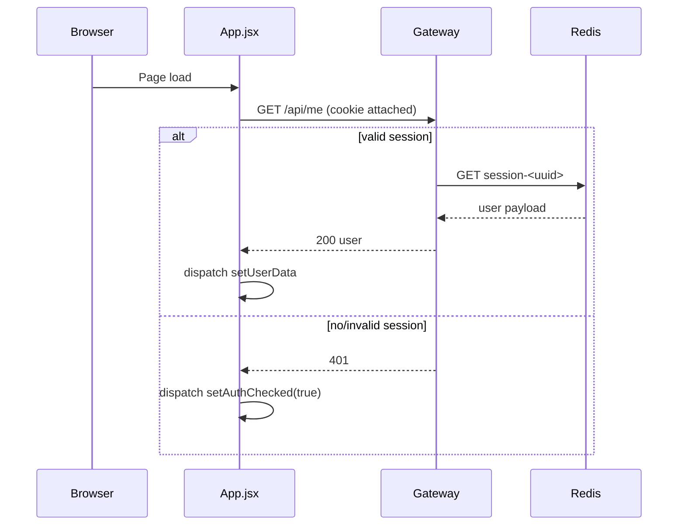
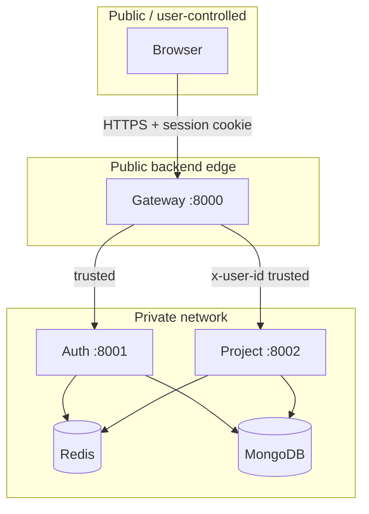

# Architecture

This page explains how NexPulse is put together and why it is built this way. It
describes the current code, not an imagined future. Terms are defined in the
[Glossary](./glossary.md); individual libraries are on the
[Tools](./tools.md) page.

## The big picture



There are four Node programs in development: the frontend dev server, the
gateway, the auth service, and the project service. Two external services matter:
MongoDB (permanent data) and Redis (temporary data). Firebase is the identity
provider.

| Piece | Runs on | Job |
| --- | --- | --- |
| **Frontend** | `:5173` | What the user sees and clicks. React, routes, Redux. |
| **Gateway** | `:8000` | The single public backend door. CORS, cookies, auth gate, forwarding. |
| **Auth service** | `:8001` | Verifies Firebase tokens, stores users, creates sessions. |
| **Project service** | `:8002` | Stores projects and serves the project lists/detail. |
| **Redis** | `:6379` | Login sessions and project-list cache. |
| **MongoDB** | external | Durable user and project records. |
| **Firebase Auth** | external | Actually signs users in. |

## The pattern: microservices behind an API gateway

**A microservice** is a small program with one job, its own folder, its own
dependencies, and its own process. **An API gateway** is a single front door in
front of those services. The outside world talks only to the gateway; the gateway
decides which service handles each request.

NexPulse uses this pattern deliberately, even though the app is still small.

### Why this pattern here

| Benefit | What it means in NexPulse |
| --- | --- |
| **Clear boundaries** | Only the auth service knows how Firebase verification works. Only the project service knows how projects are stored. |
| **A single front door** | The frontend has one base URL and one cookie story. |
| **Independent change** | A new service is a new folder plus one gateway route. |
| **Independent scaling** | Login traffic and project traffic can scale separately. |
| **Fault isolation** | A broken project service does not stop sign-in. |
| **Room to grow** | A future `files` or `ai` service slots in behind the same gate. |

### The honest trade-off

Microservices are not free. They add moving parts, network hops, configuration
files, and failure modes. For a small app with one team, a monolith is often the
better choice.

NexPulse accepts the extra complexity as a bet on growth: the project is intended
to gain more data types and an AI component that may want to scale differently.
The bet is reversible: folding the services back into one server would be
mechanical, because the layers are already separated by clear boundaries.

### Why a gateway specifically

Without a gateway, the frontend would need to know every service's address and
quirks. Every move or new service would change the frontend. The gateway reduces
that to one address.

It also gives the backend one place for cross-cutting concerns:

- **CORS** — lets the browser frontend call the API with credentials.
- **Cookie parsing** — reads the session cookie.
- **Logging** — `morgan("dev")` logs every request.
- **Authentication** — `protect` checks the session before protected routes.
- **Rate limiting** — `loginLimiter` applies to the login path.
- **Identity forwarding** — `proxyWithHeader` adds `x-user-id` for the project
  service.

The cost is one extra hop. For this project, the clarity is worth it.

## How a request flows

### Login

Login is the clearest example because it touches everything.

```mermaid
sequenceDiagram
    participant B as Browser
    participant F as Firebase
    participant G as Gateway :8000
    participant A as Auth service :8001
    participant M as MongoDB
    participant R as Redis

    B->>F: 1. User clicks "Continue with Google"
    F-->>B: 2. Short-lived signed ID token
    B->>G: 3. POST /api/auth/login { token }
    G->>G: 4. loginLimiter checks the IP
    G->>A: 5. POST /login (mount prefix stripped)
    A->>F: 6. verifyIdToken(token)
    F-->>A: 7. Valid identity
    A->>M: 8. Find user by firebaseUid, or create one
    M-->>A: 9. User record
    A->>R: 10. SET session-<uuid> with 7-day TTL
    A-->>G: 11. 200 public user + Set-Cookie
    G-->>B: 12. Response; browser stores httpOnly cookie
```

Two details cause most confusion:

- **The gateway strips the mount prefix.** `/api/auth/login` arrives at the auth
  service as `/login`. The auth service defines routes without `/api/auth`.
  See [Gateway](../backend/gateway.md#routing).
- **The backend verifies the token; the frontend never sends a password.** The
  only thing crossing the wire is a signed token the backend can check
  independently.

### A protected request

After login, the browser sends the session cookie. It does not send the Firebase
token again.



The session cookie never leaves the gateway. Services behind it trust the
`x-user-id` header the gateway attaches. That is why those services must never be
reachable directly.

### Session restore

Redux is in memory; a reload empties it. The browser still has the cookie, so the
frontend asks the gateway who it belongs to:



## The three layers

Looked at from above, the project is a classic three-layer web app:

| Layer | Lives in | Responsibility |
| --- | --- | --- |
| **Presentation** | `frontend/` | What the user sees. React components and routes. |
| **Application** | `backend/` | Rules and logic. Gateway, auth service, project service. |
| **Data** | MongoDB, Redis | Users, projects, sessions, cache. |

Keeping these apart means each can be replaced without dragging the others
along. Swap React and the backend does not care. Move MongoDB and only the
services that use it notice.

## Where identity lives, and why Firebase

**The problem.** Handling passwords yourself means hashing, reset emails,
brute-force protection, social login, and email verification. Each is easy to get
wrong, and getting it wrong is a security incident.

**The decision.** Split the job:

- **Firebase Authentication** does the actual sign-in with Google.
- **The auth service** keeps its own user record in MongoDB and trusts Firebase's
  verified word about who the user is.

**Why keep our own user records?** So the data lives in a database we control,
with a schema we can query. Firebase stays in charge of *who* the user is;
MongoDB stays in charge of *what we know about them*. It also gives projects a
stable owner id.

**Why verify on the server?** The frontend runs in the user's hands. Anything it
claims could be forged. `verifyIdToken` checks that the token is genuine,
unexpired, and issued by this Firebase project.

**The trade-off:** a dependency on a third party. If Firebase is down, new
sign-ins fail, though existing sessions and user data remain usable.

## Trust boundaries



- The browser is untrusted.
- The gateway is the only public backend.
- Behind the gateway, the services are trusted because they are not exposed.
- The project service trusts `x-user-id` completely. It performs no independent
  token check. Exposing port `8002` would be a security hole.

See [Security Model](../backend/security.md) for the details.

## How the code is organized

```text
NexPulse/
├── backend/
│   ├── gateway/              The front door + auth gate.   (:8000)
│   │   ├── index.js          Express setup, routes, errors.
│   │   ├── middleware/       protect, loginLimiter.
│   │   ├── controllers/      /api/me handler.
│   │   └── utils/            proxyWithHeader (forwards x-user-id).
│   ├── services/
│   │   ├── auth/             Users and sign-in.            (:8001)
│   │   │   ├── index.js
│   │   │   ├── config/       DB + Firebase setup.
│   │   │   ├── controllers/  Login + logout logic.
│   │   │   ├── models/       User schema.
│   │   │   └── routes/       URL -> controller.
│   │   └── project/          Projects and caching.         (:8002)
│   │       ├── index.js
│   │       ├── config/
│   │       ├── controllers/
│   │       ├── models/
│   │       └── routes/
│   └── shared/               Code used by more than one service.
│       └── redis/            The shared ioredis client.
├── frontend/                 The React app.                (:5173)
├── docs/                     These pages.
└── README.md
```

The logic behind the layout:

- **`gateway/` is separate from `services/`** because it is infrastructure, not
  business logic. It routes traffic, checks sessions, and owns no data.
- **`services/` holds the business services.** A new one gets a folder here.
- **`shared/` holds code used by more than one service.** It has its own
  `package.json`, so its dependencies are declared there. It also needs
  `"type": "module"`.
- **Requests flow in layers inside a service:** routes → controllers → models.
  Skipping a layer is tempting and regretted later.
- **Frontend code is grouped by role:** `pages/` for screens, `components/` for
  reusable UI, `features/` for API calls, `redux/` for shared state, `hooks/` for
  cross-cutting providers, and `utils/` for the axios client.

## Design principles

1. **One front door.** The browser only needs the gateway.
2. **Verify, don't trust.** The auth service checks Firebase tokens itself; the
   project service trusts only the gateway.
3. **Configuration over hard-coding.** Settings live in `.env`.
4. **Secrets stay on the server.** Nothing sensitive ships to the browser.
   `VITE_*` values are public by design.
5. **Fail loudly at startup.** A bad Firebase key crashes the auth service
   immediately rather than leaving it half-working.
6. **Fail soft at runtime.** Redis cache failures are logged and ignored, and a
   database connection failure is logged without crashing the process.
7. **Keep it explainable.** If a piece cannot be explained simply, it is probably
   too complicated.

## How the architecture will grow

- **More protected services.** The project service is the template: add a folder,
  mount it behind `protect`, forward `x-user-id`.
- **More screens.** The router already handles public, protected, and fallback
  pages. New pages are new routes.
- **Finer authorization.** `protect` confirms *who* the user is. Ownership is
  currently enforced by querying projects with `{ _id, owner: userId }`. Roles,
  sharing, and team access would be the next authorization layer.
- **An AI service.** It would sit behind the gateway, receive `x-user-id`, keep
  provider keys server-side, and likely scale independently.
- **Horizontal scaling.** Sessions and cache are already in Redis, so stateless
  instances work. The in-memory login limiter and cache invalidation assumptions
  are the first things to revisit.

The [Development Log](../development/README.md) records how the architecture
actually arrived, decision by decision.
