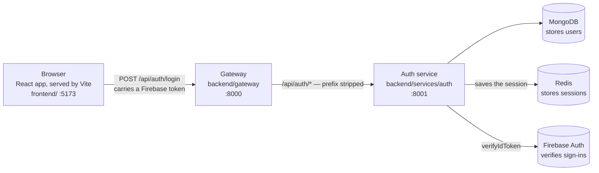
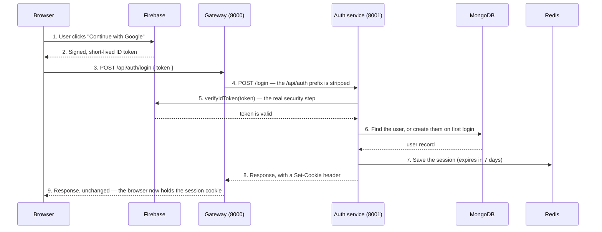

# Architecture

This page explains how NexPulse is put together and — more importantly — *why*
it's built this way rather than some other way. A few terms here are defined in
the [Glossary](./glossary.md). The individual libraries are on the
[Tools](./tools.md) page.

## The big picture



Three Node processes run locally — plus Redis and two external services:

| Piece | Runs on | Job |
| --- | --- | --- |
| **Frontend** | `:5173` | What the user sees and clicks. |
| **Gateway** | `:8000` | The single entry point for every backend request. |
| **Auth service** | `:8001` | Verifies sign-ins and stores user records. |
| **Redis** | `:6379` | Keeps login sessions. Started via `backend/docker-compose.yml`. |
| **MongoDB** | (external) | Keeps the user data. |
| **Firebase Auth** | (external) | Actually signs users in. |

## The architecture pattern: microservices behind an API gateway

NexPulse follows a pattern called **microservices with an API gateway**. It's
worth naming, because the name carries assumptions that are useful to unpack.

**A microservice** is a small program that does one job well, with its own
folder, its own dependencies, and its own process. Instead of one big server
handling everything, there are several small ones.

**An API gateway** is a single front door that sits in front of those services.
The outside world only ever talks to the gateway; the gateway decides which
service should handle each request.

So: several small services, and one door into them.

### Why this pattern for NexPulse

The honest reason is a bet on the future. NexPulse is intended to grow — more
features, more kinds of data, and an AI component that will want to scale
differently from everything else. Splitting early makes that growth cheaper
later, because each piece can change, be rewritten, or be scaled on its own.

The specific wins:

| Benefit | What it means here |
| --- | --- |
| **Clear boundaries** | Auth logic lives in one place and nothing else needs to know how it works. |
| **Independent scaling** | If login traffic grows, the auth service can be scaled without touching anything else. |
| **Independent change** | The gateway can learn new routes without anyone editing the auth service. |
| **Room to grow** | A future `files` or `ai` service slots in as one more folder and one more route. |
| **Fault isolation** | A problem in one service doesn't have to take the others down. |

### The honest trade-off

Microservices are **not** free, and pretending otherwise would be dishonest.

You get more moving parts, more network calls between them, more configuration
files, and more things that can be misconfigured. For a small app with a single
team, a **monolith** — one server that does everything — is often the better
choice: it's simpler to build, run, and debug.

NexPulse accepts the extra complexity deliberately, on the assumption that it
will pay for itself as the project grows. If that assumption turns out to be
wrong, folding the services back into one server is a mechanical change, not a
rewrite. That reversibility is part of why the pattern is a reasonable bet.

### Why a gateway, specifically

Without a gateway, the frontend would need to know about every service: their
addresses, their quirks, which one handles what. Every time a service moved or
was added, the frontend would have to change. That's fragile.

The gateway fixes this with a simple idea: **the frontend only knows one
address.** Everything else is the backend's private business.

It also gives the project a place to put things that belong to *all* services at
once:

- **CORS** — letting the browser frontend in. Configured once.
- **Cookie parsing** — so any service behind it can read sessions.
- **Logging** — one consistent request log.
- **Security checks** — later, a user's session can be verified at the front
  door, before a request reaches any service.

The cost is one extra hop: requests travel frontend → gateway → service → and
back. For most applications that delay is negligible, and the clarity is worth
it.

## How a request actually flows

The clearest example is login, because it touches everything.



Two details in that flow cause most of the confusion in this project, so they're
repeated here:

- **The gateway strips the mount prefix.** `/api/auth/login` arrives at the
  auth service as `/login`. The auth service therefore defines its routes
  *without* `/api/auth`. See
  [Gateway Service](../backend/gateway.md#7-routing-to-the-auth-service).
- **The backend verifies the token; the frontend never sends a password.** The
  only thing crossing the wire is a signed token that the backend can check
  independently.

## The three layers

Looked at from above, the project is a classic three-layer web app:

| Layer | Lives in | Responsibility |
| --- | --- | --- |
| **Presentation** | `frontend/` | What the user sees. React components. |
| **Application** | `backend/` | The rules and logic. Gateway + auth service. |
| **Data** | MongoDB, Redis | What gets remembered — users and sessions. |

Keeping these apart means each can be replaced without dragging the others
along. Swap React for something else and the backend doesn't care. Move the
databases and only the auth service notices.

## Where identity lives — and why Firebase

The project's most consequential decision is how sign-in works, so it deserves
its own section.

**The problem.** Users need to sign in, and handling passwords yourself is a
lot of work to do badly or well. Hashing, reset emails, brute-force protection,
social login, email verification — each is easy to get wrong, and getting it
wrong is a security incident.

**The decision.** Split the job:

- **Firebase Authentication** does the actual signing in. It's Google's
  service, and it's very good at this.
- **The auth service** keeps its own user records in MongoDB, and trusts
  Firebase's word about who the user is.

**Why keep our own user records at all?** So the data lives in a database we
control, with a schema we can query however we like. Firebase stays in charge of
*who the user is*; MongoDB stays in charge of *what we know about them*.

**Why verify on the server rather than trust the frontend?** Because the
frontend runs in the user's hands. Anything it says could be forged. A signed
token can be checked independently, which is exactly what `verifyIdToken` does.

**The trade-off:** a dependency on a third party. If Firebase has an outage, new
sign-ins fail until it recovers — though existing user data stays safe in
MongoDB.

## The technology, at a glance

Full explanations live on the [Tools](./tools.md) page. In short:

- **Node.js + Express 5** — the runtime and web framework for the backend.
- **`express-http-proxy`** — the one package that makes the gateway a gateway.
- **MongoDB + Mongoose** — storage, with schemas and validation.
- **Redis + `ioredis`** — login sessions, kept out of the database.
- **Firebase + `firebase-admin`** — signing in (client) and verifying (server).
- **React + Vite + Tailwind CSS** — the frontend.
- **React Router + Redux Toolkit** — the frontend's routes and shared app state.
- **axios** — one pre-configured HTTP client for the frontend.
- **`dotenv`, `cors`, `cookie-parser`, `morgan`, `nodemon`** — the everyday
  backend utilities.

## How the code is organized

```
NexPulse/
├── backend/
│   ├── gateway/              The front door.      (port 8000)
│   │   └── index.js
│   ├── services/
│   │   └── auth/             Users and sign-in.   (port 8001)
│   │       ├── index.js
│   │       ├── config/       One-time setup: DB, Firebase.
│   │       ├── controllers/  The logic.
│   │       ├── models/       The data shapes.
│   │       └── routes/       URL → controller.
│   └── shared/               Code used by more than one service.
│       └── redis/            The Redis client. (its own package.json)
├── frontend/                 The React app.       (port 5173)
├── docs/                     These pages.
└── README.md
```

The logic behind this layout:

- **`gateway/` sits apart from `services/`** because it's infrastructure, not
  business logic. It routes traffic; it owns no data.
- **`services/` holds the business services.** Each new one gets a folder here.
- **`shared/` holds code used by more than one service.** It has its own
  `package.json`, so its dependencies — today, `ioredis` — are declared and
  installed there rather than inside whichever service happens to use them
  first. It also needs `"type": "module"`, or Node treats its files as legacy
  CommonJS and warns on every start.
- **Requests flow in layers** inside a service — routes → controllers →
  models. Skipping a layer is tempting and regretted later.

## Design principles

1. **One front door.** The browser only ever needs the gateway.
2. **Verify, don't trust.** The backend checks tokens itself rather than
   believing the frontend.
3. **Configuration over hard-coding.** Settings live in `.env`, so the same
   code works anywhere.
4. **Secrets stay on the server.** Nothing sensitive is ever shipped to the
   browser. (Note: Vite's `VITE_*` variables are public — anything secret
   belongs on the backend.)
5. **Fail loudly at startup.** A bad Firebase key crashes the app immediately
   rather than leaving it half-working. Silent failures are far more expensive.
6. **Keep it explainable.** If a piece can't be explained simply, it's probably
   too complicated.

## How the architecture will grow

The structure is built to absorb new pieces without redesign:

- **Using the session** — login already stores a session in Redis and sets an
  `httpOnly` cookie. The next step is the gateway reading that cookie, so
  requests can be checked at the front door.
- **More services** — a `files` or `ai` service becomes a new folder plus one
  gateway route.
- **More screens** — the landing page and router are already in place; new pages
  slot in as routes without changing the backend contract.
- **Authorization** — once the gateway can check sessions, "is this user
  allowed to do this?" becomes a front-door concern rather than something every
  service reinvents.

The [Development Log](../development/README.md) records how the architecture
actually arrived, decision by decision, commit by commit.
