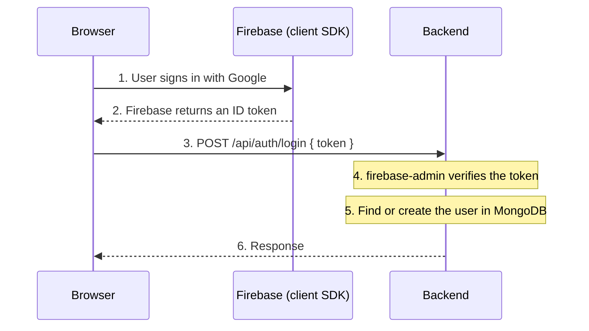

# 4 — React Frontend and Firebase Auth

## At a glance

| | |
| --- | --- |
| **Commit** | `bfa14ad` |
| **Date** | 2026-10-17 |
| **Author** | Yaman Hassan |
| **Message** | `feat: add initial setup for React app with Vite and Tailwind CSS` |

## What changed

The project becomes a full-stack app. The commit message mentions only the
frontend, but three related things landed together:

1. **A React frontend** — built with Vite and styled with Tailwind CSS, with
   Firebase sign-in and an axios client pointing at the backend.
2. **The auth service grew up** — from a health check to a real service that
   verifies Firebase sign-ins and stores users in MongoDB, organised into
   routes, controllers, models, and config.
3. **The gateway route changed** — `/auth` became `/api/auth`, so requests carry
   an `/api` prefix.

Secrets also became properly ignored: `serviceAccountKey.json` and `postman/`
joined `.gitignore`.

## Why it was done

Login can't be built from one side alone. The frontend needs something to send
its token to, and the backend needs a client to exercise it. Landing both
together means the round trip can be tested immediately rather than sitting
half-finished.

The `/api` prefix change is about consistency with the frontend's expectations.
It's a small edit with a meaningful ripple: every path now looks like
`/api/...`, which is a common convention for API servers.

## Files touched

| File | State |
| --- | --- |
| `frontend/` | **Added** — the whole React app. |
| `backend/services/auth/routes/auth.route.js` | **Added** — maps `POST /login`. |
| `backend/services/auth/controllers/auth.controller.js` | **Added** — the login logic. |
| `backend/services/auth/models/user.model.js` | **Added** — the user schema. |
| `backend/services/auth/config/db.js` | **Added** — MongoDB connection. |
| `backend/services/auth/config/firebase.js` | **Added** — Firebase initialization. |
| `backend/services/auth/index.js` | Edited — mounts the router, adds JSON parsing. |
| `backend/services/auth/package.json` | Edited — adds `firebase-admin`. |
| `backend/gateway/index.js` | Edited — `/auth` → `/api/auth`. |
| `.gitignore` | Edited — ignores `postman/` and `serviceAccountKey.json`. |
| `.postman/resources.yaml` | **Added** — Postman workspace config. |

## The big decision: where sign-in actually happens

This commit settles the project's most important architectural question, so
it's worth spelling out.

**The problem.** Users need to sign in, and passwords are dangerous to handle
yourself. Get the hashing, the reset emails, or the rate limiting wrong and
you've built a liability.

**The split.**



- **Firebase Authentication** does the hard part — the actual sign-in, with
  Google. It's a mature, well-audited service.
- **The backend** keeps its own user records in MongoDB, and only trusts
  Firebase's *word* about who the user is, via `verifyIdToken`.

The frontend never sends a password, and the backend never sees one. The only
thing crossing the wire is a short-lived, signed token that the backend can
check independently. That's what makes it safe: the backend verifies the token
rather than believing whatever the frontend claims.

**The trade-off:** a third-party dependency. If Firebase has an outage, new
sign-ins fail until it recovers. Existing user data stays safe in MongoDB.

## Frontend structure

```
frontend/
├── index.html              The single HTML page Vite serves.
├── firebase.js             Initializes Firebase and exports auth helpers.
├── vite.config.js          Vite + React + Tailwind plugins.
├── public/                 Static assets (favicon, icons).
└── src/
    ├── main.jsx            Mounts React onto the page.
    ├── App.jsx             The login button and its click handler.
    ├── index.css           Imports Tailwind.
    ├── features/
    │   └── login.js        Sends the token to the backend.
    ├── utils/
    │   └── axios.js        One configured axios client.
    └── assets/             Images.
```

The `features/` and `utils/` folders are a small but useful habit:

- **`utils/`** holds general-purpose helpers — here, a single axios instance so
  the server URL and credential settings are defined once instead of repeated
  in every request.
- **`features/`** groups code by *what it does for the user*, not by file type.
  "Login" is a feature, not a "service" or a "helper."

This is a taste of organizing by feature, which scales far better than
scattering all API calls in one folder.

## Backend structure

```
services/auth/
├── index.js              Wires it together and starts the server.
├── config/
│   ├── db.js             Connects to MongoDB.
│   └── firebase.js       Initializes Firebase Admin.
├── controllers/
│   └── auth.controller.js  The login logic.
├── models/
│   └── user.model.js       The user schema.
└── routes/
    └── auth.route.js       Maps POST /login.
```

Requests now flow in layers — **routes → controllers → models**:

- **Routes** only decide which URL runs which function. A route stays one line.
- **Controllers** do the thinking.
- **Models** define and interact with the data.

Skipping a layer is tempting and always regrettable later. Keeping the layers
is what makes the logic easy to test and change.

### Two easy-to-miss details in `index.js`

```js
app.use(express.json());
```

Without this, `req.body` is empty — the token the frontend sends would never
arrive. Body-parsing is something you have to ask for explicitly in Express.

```js
app.listen(port, () => {
  connectDb();
  console.log(`Auth running at ${port}`);
});
```

The server starts listening *first*, then opens the database connection. A slow
database therefore doesn't block startup, and `connectDb` catches its own errors
and logs them rather than crashing the app.

### Why the key file throws at import time

`config/firebase.js` runs the moment it's imported — before the server listens:

```js
import serviceAccount from "../serviceAccountKey.json" with { type: "json" };
export const app = initializeApp({ credential: cert(serviceAccount) });
```

Two things to notice:

- The JSON **import attribute** (`with { type: "json" }`) is the modern way to
  load a JSON file directly.
- Because this runs at import time, a **missing or malformed key file crashes
  the app at startup** rather than leaving it half-working. That's the right
  behaviour: failing loudly beats failing mysteriously later.

## Security note

`serviceAccountKey.json` is a Firebase credential — anyone holding it can act as
your Firebase project. This commit adds it to `.gitignore`, which is the correct
move. `.env` (holding `MONGODB_URI`) is ignored too.

If such a key is ever committed by accident, treat it as leaked: revoke it in
the Firebase console and issue a new one. Rotating beats apologizing.

## How to verify

Run all three pieces:

```bash
# terminal 1 — auth
cd backend/services/auth && npm install && npm run dev

# terminal 2 — gateway
cd backend/gateway && npm install && npm run dev

# terminal 3 — frontend
cd frontend && npm install && npm run dev
```

The frontend needs two environment variables (e.g. in `frontend/.env.local`):

| Variable | Points at |
| --- | --- |
| `VITE_FIREBASE_API_KEY` | The Firebase web API key. |
| `VITE_SERVER_URL` | The gateway, e.g. `http://localhost:8000`. |

Clicking **Continue with Google** should open the Google sign-in popup, and the
browser console should log the backend's response.

## Known rough edges

- **The route prefix is easy to trip over.** The frontend calls
  `/api/auth/login`; the gateway strips `/api/auth` so the auth service sees
  `/login`. If these ever drift out of sync, requests 404 — and it's usually the
  gateway path that needs checking first.
- **Responses aren't yet in a consistent shape.** Login currently returns the
  raw decoded token, and errors return a different structure. Fine for a first
  pass; worth standardizing once more endpoints exist.
- **No session handling yet.** Cookies are parsed in the gateway, but nothing
  sets one — the user is authenticated per-request by their token, not by a
  server-side session.

## Up next

Real UI in place of the bare button, a logout flow, and sessions that persist.
