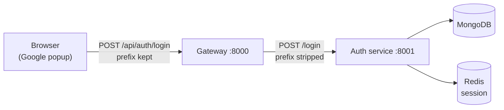

# Frontend

**Location:** `frontend`
**Default port:** `5173` (Vite's default)

The frontend is the part users actually see and click. It's a React app built
with Vite, styled with Tailwind CSS, and it signs users in with Google through
Firebase.

At the moment it's deliberately small — a single page with one button. Its job
right now is to prove the whole login round trip works, from a Google popup all
the way to a user record in MongoDB and a session cookie in the browser.

## Why these tools

| Tool | Why it's here |
| --- | --- |
| **React** | Components keep UI code organized and reusable. |
| **Vite** | Near-instant dev server and a tiny config. |
| **Tailwind CSS** | Utility classes, so styling lives next to the markup. |
| **Firebase (client SDK)** | Actually signs the user in and hands over a token. |
| **axios** | One pre-configured HTTP client for every request. |

Each is explained in full on the [Tools](../concepts/tools.md) page.

## The folder structure

```
frontend/
├── index.html                The one HTML page Vite serves.
├── firebase.js               Firebase setup; exports `auth` and `googleProvider`.
├── vite.config.js            Vite + React + Tailwind plugins.
├── .env.local                Your local environment variables (not committed).
├── public/                   Static files served as-is: favicon, icons.
└── src/
    ├── main.jsx              Mounts React onto the page.
    ├── App.jsx               The login button and its click handler.
    ├── index.css             Imports Tailwind.
    ├── features/
    │   └── login.js          Sends the token to the backend.
    ├── utils/
    │   └── axios.js          One shared axios client.
    └── assets/               Images.
```

### `features/` vs `utils/`

A small distinction that pays off later:

- **`utils/`** holds general-purpose helpers that aren't about any one feature.
  Here it's the axios client — something every feature might use.
- **`features/`** groups code by *what it does for the user*. "Login" is a
  feature.

Organizing by feature rather than by file type means that when a feature grows,
its files grow together in one place, instead of being spread across
`api/`, `services/`, `helpers/`, and so on.

## The login flow, end to end

This is the most important thing the frontend currently does, so it's worth
following step by step.

**Step 1 — the user clicks the button.** `App.jsx` handles it:

```jsx
const handleLogin = async () => {
  const result = await signInWithPopup(auth, googleProvider)
  const token = await result.user.getIdToken();
  const data = await login(token)
  console.log(data)
}
```

- `signInWithPopup` opens Google's sign-in window. Firebase handles the whole
  exchange and hands back a user.
- `getIdToken()` gets a short-lived signed token proving who this user is.
- `login(token)` sends that token to the backend.

**Step 2 — the request goes to the backend.** `features/login.js`:

```js
export const login = async (token) => {
  const { data } = await api.post("/api/auth/login", { token });
  return data;
}
```

This posts the token to `/api/auth/login`. If the request fails, it logs the
error and returns `null` — which is fine for a prototype, though a real app
would surface the failure to the user instead.

**Step 3 — the backend verifies it.** The gateway strips the `/api/auth`
prefix and forwards the request as `POST /login` to the auth service, which asks
Firebase to verify the token, finds or creates the user in MongoDB, saves a
session in Redis, and attaches an `httpOnly` session cookie to the response.
The browser stores that cookie automatically — `withCredentials: true` on the
axios client is what allows it to be sent back later.



The prefix being kept at the frontend and stripped at the gateway is the one
thing in this project people trip over most. See
[Gateway Service](../backend/gateway.md#7-routing-to-the-auth-service).

## `firebase.js` — set up once, exported

```js
const app = initializeApp(firebaseConfig);
export const auth = getAuth(app);
export const googleProvider = new GoogleAuthProvider();
```

Firebase is configured in one file and exported, so nothing else has to know
the project's settings. `googleProvider` is the thing that tells Firebase "we
want people to sign in with Google."

Note the config mixes a hard-coded project ID with an API key from the
environment:

```js
apiKey: import.meta.env.VITE_FIREBASE_API_KEY,
authDomain: "nexpulse-3a2c3.firebaseapp.com",
```

The project ID, app ID, and measurement ID are safe to commit — they identify
*which* project, but can't do anything on their own. The API key comes from
`.env.local` because it's tidier to keep it out of source, even though a Firebase
web key is public by design.

## `utils/axios.js` — the one client

```js
export const api = axios.create({
  baseURL: import.meta.env.VITE_SERVER_URL,
  withCredentials: true,
});
```

Two things worth understanding:

- **`baseURL`** comes from the environment, so pointing the app at a different
  server (staging, production) is a config change rather than a code change.
- **`withCredentials: true`** tells the browser to send and accept cookies with
  requests. This is what makes sessions work: the auth service sets an
  `httpOnly` session cookie on login, and this flag is why the browser sends it
  back on later requests.

## Environment variables

Vite reads variables starting with `VITE_` and bakes them into the browser
bundle.

| Variable | Used by | Points at |
| --- | --- | --- |
| `VITE_SERVER_URL` | `src/utils/axios.js` | The gateway, e.g. `http://localhost:8000`. |
| `VITE_FIREBASE_API_KEY` | `firebase.js` | The Firebase web API key. |

Put them in `frontend/.env.local` (git-ignored) rather than `.env` if they're
only for your machine.

**The one rule about frontend variables: they are public.** Anything prefixed
`VITE_` can be read by anyone who opens the browser's developer tools. That's
why a Firebase *web* API key is fine here — it's designed to be visible — but a
server secret like `serviceAccountKey.json` must never appear in frontend code.

## How to run it

```bash
cd frontend
npm install
npm run dev
```

Vite prints the address (usually `http://localhost:5173`). Open it, and you
should see **Continue with Google**.

It needs the backend running too — the button won't do anything useful without
the gateway and auth service. See [Getting Started](../getting-started.md).

## Other useful commands

| Command | What it does |
| --- | --- |
| `npm run dev` | Start the dev server with hot reload. |
| `npm run build` | Produce an optimized production build in `dist/`. |
| `npm run preview` | Serve the production build locally to check it. |
| `npm run lint` | Run ESLint over the code. |

## Where this goes next

The current UI is a placeholder. Natural next steps:

- A real landing page and a proper login screen, styled with Tailwind.
- Handling the failure case instead of returning `null`.
- Checking the session on page load — the cookie exists now, but nothing reads
  it, so a reload still looks signed out.
- A logout flow. (The backend controller exists; it needs a route and
  `cookie-parser` in the auth service.)
- Routes and pages once there's more than one screen.
