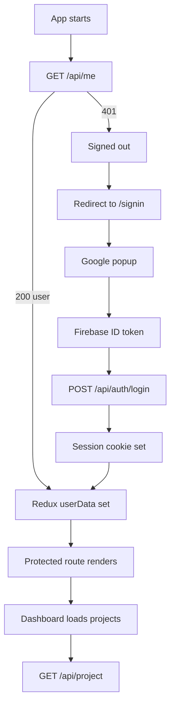
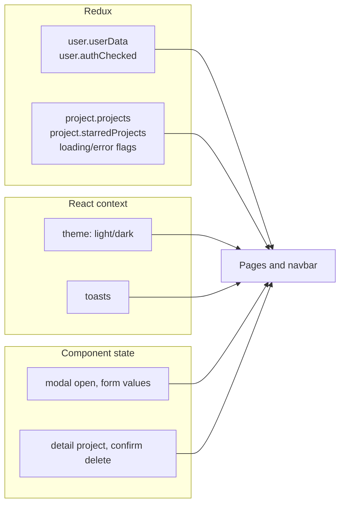

# Frontend Overview

The frontend is the browser application: sign-in, the project dashboard, the
project detail page, legal pages, and the not-found page. It is a React single
page app built with Vite.

- **Folder:** `frontend/`
- **Dev URL:** `http://localhost:5173`
- **Needs:** a running gateway at `VITE_SERVER_URL`, plus Firebase web config
- **Entry point:** `frontend/src/main.jsx`

## What a user can do today

- sign in with Google
- stay signed in after a refresh
- see their projects, newest first
- filter to starred projects
- create a project with a name and optional description
- open a project detail page
- star or unstar a project
- delete a project, with confirmation
- switch between light and dark themes
- sign out
- read Terms of Service and Privacy Policy

There is no AI editor, file tree, code editor, or real-time collaboration yet.
The current product is the workspace shell around project records.

## Pages

| Route | Page | Protected |
| --- | --- | --- |
| `/signin` | Google sign-in | Public; redirects signed-in users away |
| `/` | Dashboard | Yes |
| `/project/:id` | Project detail | Yes |
| `/terms` | Terms of Service | No |
| `/privacy` | Privacy Policy | No |
| `*` | Not found | No |

All pages are lazy-loaded except the small fallback loader. See
[Routing and Auth](./routing-and-auth.md).

## High-level flow



## Folder layout

```text
frontend/
├── firebase.js                 Firebase app, auth, Google provider
├── index.html                  HTML shell + pre-paint theme script
├── vite.config.js              React + Tailwind v4 plugins
├── eslint.config.js
├── package.json
└── src/
    ├── main.jsx                Providers and root render
    ├── App.jsx                 Router, session restore, lazy routes
    ├── index.css               Tailwind import, theme tokens, utilities
    ├── assets/                 Logos, favicon, unused starter images
    ├── components/
    │   ├── Background.jsx
    │   ├── CreateProjectModel.jsx
    │   ├── DashboardHeader.jsx
    │   ├── DashboardWatermark.jsx
    │   ├── ErrorBoundary.jsx
    │   ├── Logo.jsx
    │   ├── PageLoader.jsx
    │   ├── ProjectCard.jsx
    │   ├── ProjectsSection.jsx
    │   ├── ProtectedRoute.jsx
    │   ├── Sidebar.jsx
    │   ├── SignInButton.jsx
    │   ├── ThemeToggle.jsx
    │   ├── Toast.jsx
    │   └── UserNavbar.jsx
    ├── features/
    │   ├── login.js             POST /api/auth/login
    │   ├── logout.js            GET /api/auth/logout
    │   ├── me.js                GET /api/me
    │   └── project.js           Project HTTP calls
    ├── hooks/
    │   ├── ThemeProvider.jsx    Theme state + DOM/localStorage sync
    │   ├── themeContext.js      useTheme
    │   ├── toastContext.js      useToast
    │   └── (ToastProvider lives in components/Toast.jsx)
    ├── pages/
    │   ├── Dashboard.jsx
    │   ├── Legal.jsx
    │   ├── NotFound.jsx
    │   ├── ProjectDetail.jsx
    │   └── SignIn.jsx
    ├── redux/
    │   ├── store.js
    │   ├── userSlice.js
    │   └── projectSlice.js
    └── utils/
        └── axios.js
```

`CreateProjectModel` is spelled "Model" in the filename and component name, not
"Modal". Use the existing name when importing it.

## Provider tree

```jsx
<ErrorBoundary>
  <Provider store={store}>
    <ThemeProvider>
      <ToastProvider>
        <App />
      </ToastProvider>
    </ThemeProvider>
  </Provider>
</ErrorBoundary>
```

Order matters:

- `ErrorBoundary` catches render errors anywhere below it.
- `Provider` makes Redux available to every page.
- `ThemeProvider` sets the `dark` class and exposes `useTheme`.
- `ToastProvider` exposes `pushToast` and renders the toast stack.
- `App` owns the router and the one-time session restore.

There is no `<StrictMode>` in `main.jsx`. React's development-only double-render
checks are therefore off.

## State in one picture



- **Redux:** signed-in user and project lists, shared across routes.
- **Context:** theme and toast queue, UI-wide but not server data.
- **Local state:** transient details such as form input and confirmation state.

See [State Management](./state-management.md).

## HTTP layer

All API calls go through `src/utils/axios.js`:

```js
export const api = axios.create({
  baseURL: import.meta.env.VITE_SERVER_URL,
  withCredentials: true,
});
```

- `baseURL` points at the gateway, not at a service.
- `withCredentials` lets the browser send the `httpOnly` session cookie.
- A response interceptor clears the user and project state when a protected call
  returns `401`, except for `/api/me` and `/api/auth/login`.

The `features/` files are thin wrappers. They return response data, not the full
axios response. Pages and components decide what to do with it.

## Environment

Create `frontend/.env.local`:

```bash
VITE_SERVER_URL=http://localhost:8000
VITE_FIREBASE_API_KEY=your-firebase-web-api-key
```

`firebase.js` hard-codes the Firebase project id, auth domain, storage bucket,
messaging sender id, app id, and measurement id. Only the web API key comes from
the environment. All `VITE_*` values are public in the browser bundle.

See [Environment Variables](../reference/environment-variables.md).

## Run and build

```bash
cd frontend
npm install
npm run dev
```

| Command | Purpose |
| --- | --- |
| `npm run dev` | Vite dev server with hot reload. |
| `npm run build` | Production build into `dist/`. |
| `npm run preview` | Serve the production build locally. |
| `npm run lint` | ESLint over the project. |

The build is a single-page app. A static host must rewrite unknown paths to
`index.html`, otherwise direct visits to `/project/<id>` return the host's 404.

## Third-party UI libraries

| Library | Used for |
| --- | --- |
| `react-router-dom` | Client-side routing and redirects |
| `@reduxjs/toolkit` / `react-redux` | Global user and project state |
| `axios` | HTTP client |
| `firebase` | Google sign-in and ID tokens |
| `tailwindcss` + `@tailwindcss/vite` | Styling |
| `lucide-react` | Most icons |
| `react-icons` | Google logo (`FcGoogle`) and Feather-style icons |
| `motion` | Animations (`motion/react`) |

## Known limitations

- No automated tests for components or flows.
- No TypeScript.
- No form library or schema validation beyond `maxLength` and required checks.
- No pagination or search; the dashboard loads all projects.
- No project editing for name or description after creation.
- No dedicated mobile sidebar; below `sm`, the sidebar is hidden and the project
  tabs move into the section header.
- The detail page keeps its project in local state, so star changes are also
  dispatched to Redux but other detail edits do not exist.
- Some starter assets (`src/assets/hero.png`, `react.svg`, `vite.svg`) are still
  in the repository but unused.
- No route-level code splitting beyond `React.lazy`.

## Related pages

- [Routing and Auth](./routing-and-auth.md)
- [State Management](./state-management.md)
- [Components](./components.md)
- [Styling and Theme](./styling-and-theme.md)
- [Getting Started](../getting-started.md)
- [API Reference](../backend/api-reference.md)
