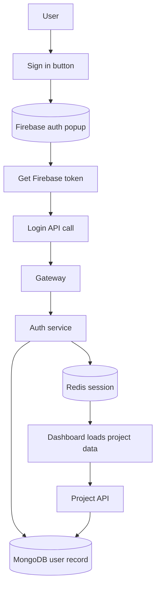

# Frontend Overview

The frontend is the user-facing part of NexPulse.

It is a React app built with Vite. Right now, it mostly handles two things:

- Google sign-in
- the dashboard that shows the user's projects

## How the frontend is structured

```text
frontend/
├── firebase.js
├── index.html
├── vite.config.js
├── src/
│   ├── App.jsx
│   ├── main.jsx
│   ├── components/
│   ├── features/
│   ├── pages/
│   ├── redux/
│   └── utils/
└── .env.local
```

## Main frontend flow



## The real app flow in code

### 1) Sign in

`frontend/src/pages/Dashboard.jsx` runs the Google sign-in popup:

```js
const result = await signInWithPopup(auth, googleProvider);
const token = await result.user.getIdToken();
const data = await login(token);
dispatch(setUserData(data));
```

This means the browser does not send the password. It sends a Firebase token,
and the backend verifies it.

### 2) Session restore

The app runs a session check on startup through `App.jsx`:

```js
const data = await me();
if (data) dispatch(setUserData(data));
```

If the browser has a valid session cookie, the gateway returns the current user.
This keeps the user signed in after a page refresh.

### 3) Dashboard data

After the user is loaded, the dashboard fetches either:

- all projects, or
- starred projects

depending on the active tab.

```js
if (activeSession === "projects") {
  fetchAll();
} else {
  fetchStarred();
}
```

It uses Redux slices to manage:

- `userData`
- `authChecked`
- `projects`
- `starredProjects`

## The Redux store

The store keeps two key areas of state:

- user state (`userSlice.js`)
- project state (`projectSlice.js`)

This lets components read the current user and the current project list without
passing props through many layers.

## `axios` setup

The shared client in `frontend/src/utils/axios.js` sets:

```js
baseURL: import.meta.env.VITE_SERVER_URL,
withCredentials: true,
```

This is important because the session cookie must be sent along with future
requests.

## The sign-in page

The first screen is a simple landing view with a Google button. When the user is
not signed in, they see the auth card. Once signed in, the app shows the
project dashboard.

## What is missing right now

The frontend is still in the foundation stage. It has a clean login flow and a
workspace dashboard, but the actual AI editing experience is not built out yet.

The current focus is on the app shell and the user flow, not on editing code in
real time.

## Files worth knowing

- `frontend/firebase.js` — Firebase client setup
- `frontend/src/App.jsx` — initial session restore
- `frontend/src/pages/Dashboard.jsx` — login + dashboard layout
- `frontend/src/features/login.js` — login API function
- `frontend/src/features/me.js` — session check
- `frontend/src/features/project.js` — project requests
- `frontend/src/redux/userSlice.js` — user state
- `frontend/src/redux/projectSlice.js` — project list state

## Local dev URL

The app usually runs at:

```bash
http://localhost:5173
```

This is the public frontend URL. Behind it, the gateway is handling the
necessary backend work.
future components will look for "who is signed in." A one-page app doesn't
*need* Redux; it's here because the user object is exactly the kind of state many
screens will want, and putting it in a store now avoids passing it down through
props later.

## Routing — `App.jsx`

```jsx
<BrowserRouter>
  <Routes>
    <Route path='/' element={<Dashboard/>} />
  </Routes>
</BrowserRouter>
```

One route for now, but the frame exists: adding an editor screen is a new
`<Route>` and a new file in `pages/`. `App.jsx` also owns the session-restore
effect described [above](#staying-signed-in--session-restore).

## The design system — `index.css`

Styling is Tailwind utility classes in the JSX, plus a handful of reusable
classes defined once in `index.css` so the markup stays readable:

| Class | What it does |
| --- | --- |
| `bg-grid` | The faint grid behind the page. |
| `glass-panel` | Frosted, translucent panels. |
| `ring-hairline` | A 1px, low-contrast border. |
| `text-gradient` | The gradient headline text. |
| `animate-aurora` / `-slow` | Slow-moving background glows. |
| `animate-float` | The code window's gentle bob. |
| `animate-caret` | The blinking cursor in the code window. |
| `animate-rise` | Fade-and-rise on load. |

The logo lives in `src/assets/` as three SVGs — `logo.svg` (color),
`logo-white.svg` (for dark surfaces), and `favicon.svg` (the app tile). A
`Logo.jsx` component picks between the first two, so no JSX ever holds raw
drawing code.

## `firebase.js` — set up once, exported

```js
const app = initializeApp(firebaseConfig);
export const auth = getAuth(app);
export const googleProvider = new GoogleAuthProvider();
```

Firebase is configured in one file and exported, so nothing else has to know
the project's settings. `googleProvider` is the thing that tells Firebase "we
want people to sign in with Google."

Note the config mixes a hard-coded project ID with an API key from the
environment:

```js
apiKey: import.meta.env.VITE_FIREBASE_API_KEY,
authDomain: "nexpulse-3a2c3.firebaseapp.com",
```

The project ID, app ID, and measurement ID are safe to commit — they identify
*which* project, but can't do anything on their own. The API key comes from
`.env.local` because it's tidier to keep it out of source, even though a Firebase
web key is public by design.

## `utils/axios.js` — the one client

```js
export const api = axios.create({
  baseURL: import.meta.env.VITE_SERVER_URL,
  withCredentials: true,
});
```

Two things worth understanding:

- **`baseURL`** comes from the environment, so pointing the app at a different
  server (staging, production) is a config change rather than a code change.
- **`withCredentials: true`** tells the browser to send and accept cookies with
  requests. This is what makes sessions work: the auth service sets an
  `httpOnly` session cookie on login, and this flag is why the browser sends it
  back on later requests.

## Environment variables

Vite reads variables starting with `VITE_` and bakes them into the browser
bundle.

| Variable | Used by | Points at |
| --- | --- | --- |
| `VITE_SERVER_URL` | `src/utils/axios.js` | The gateway, e.g. `http://localhost:8000`. |
| `VITE_FIREBASE_API_KEY` | `firebase.js` | The Firebase web API key. |

Put them in `frontend/.env.local` (git-ignored) rather than `.env` if they're
only for your machine.

**The one rule about frontend variables: they are public.** Anything prefixed
`VITE_` can be read by anyone who opens the browser's developer tools. That's
why a Firebase *web* API key is fine here — it's designed to be visible — but a
server secret like `serviceAccountKey.json` must never appear in frontend code.

## How to run it

```bash
cd frontend
npm install
npm run dev
```

Vite prints the address (usually `http://localhost:5173`). Open it, and you
should see the landing page with a **Continue with Google** button.

It needs the backend running too — the button won't do anything useful without
the gateway and auth service. See [Getting Started](../getting-started.md).

## Other useful commands

| Command | What it does |
| --- | --- |
| `npm run dev` | Start the dev server with hot reload. |
| `npm run build` | Produce an optimized production build in `dist/`. |
| `npm run preview` | Serve the production build locally to check it. |
| `npm run lint` | Run ESLint over the code. |

## Known rough edges

These are real, current limitations — documented rather than hidden, so the code
isn't mistaken for more finished than it is.

- **Sign-in failures only reach the console.** `handleLogin` now has a
  `try`/`catch`/`finally`, so the button never sticks — but a failure (a closed
  popup, a backend error) is logged rather than shown to the user. There's no
  toast or error message yet.
- **The stored user isn't read anywhere.** Redux holds `userData` and the
  session-restore effect fills it on reload, but no component selects it — so
  the UI looks the same signed in or out. Nothing tells the user they're logged
  in.
- **Session restore has no loading or error state.** While `/api/me` is in
  flight the app renders as if signed out; a slow or failed request silently
  settles into the signed-out look.
- **One route only.** The router exists; `/` is the whole app.
- **No error boundary.** A render error blanks the entire app rather than
  showing a fallback.
- **Unused assets are still tracked.** `src/assets/hero.png`,
  `src/assets/react.svg`, `src/assets/vite.svg`, and `public/icons.svg` are
  committed but imported nowhere.
- **`main.jsx` has no `<StrictMode>`.** React's development-only warnings
  (double-rendering to catch side effects) are switched off, which makes effect
  bugs — like a restore that runs twice — easier to miss.
- **Placeholder links.** The navbar and footer use `href="#"` with no real
  targets.

## Where this goes next

- Show sign-in and sign-out state in the UI — a name in the navbar, a real
  signed-out view — by reading `userData` from the store.
- Surface errors to the user instead of `console.error`.
- A logout flow. (The backend controller exists; it needs a route and
  `cookie-parser` in the auth service.)
- Delete the unused assets and re-enable `<StrictMode>`.
- More routes and pages now that the router is in place.
