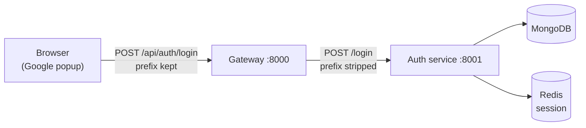

# Frontend

**Location:** `frontend`
**Default port:** `5173` (Vite's default)

The frontend is the part users actually see and click. It's a React app built
with Vite, styled with Tailwind CSS, and it signs users in with Google through
Firebase.

It's a single **landing page** today — a navbar, a hero with a sign-in button, an
illustrated code window, and a footer — with a client-side router and a Redux
store already in place. Its job right now is to prove the whole login round trip
works, from a Google popup all the way to a user record in MongoDB and a session
cookie in the browser — and to restore that session on reload.

## Why these tools

| Tool | Why it's here |
| --- | --- |
| **React** | Components keep UI code organized and reusable. |
| **Vite** | Near-instant dev server and a tiny config. |
| **Tailwind CSS** | Utility classes, so styling lives next to the markup. |
| **React Router** | Gives the app real URLs, ready for more than one screen. |
| **Redux Toolkit** | Holds the signed-in user where any component can read it. |
| **`react-icons`** | Small icon set, inlined as components — no image requests. |
| **Firebase (client SDK)** | Actually signs the user in and hands over a token. |
| **axios** | One pre-configured HTTP client for every request. |

Each is explained in full on the [Tools](../concepts/tools.md) page.

## The folder structure

```
frontend/
├── index.html                The one HTML page Vite serves.
├── firebase.js               Firebase setup; exports `auth` and `googleProvider`.
├── vite.config.js            Vite + React + Tailwind plugins.
├── .env.local                Your local environment variables (not committed).
└── src/
    ├── main.jsx              Mounts React, wrapped in the Redux <Provider>.
    ├── App.jsx               The router + the session-restore effect.
    ├── index.css             Tailwind import + the design-system classes.
    ├── pages/
    │   └── Dashboard.jsx     Composes the landing page; owns `handleLogin`.
    ├── components/           One file per piece of the page.
    │   ├── Background.jsx      Grid, aurora glows, vignette.
    │   ├── Navbar.jsx          Logo, nav links, sign-in button.
    │   ├── Hero.jsx            Headline, copy, sign-in, feature list.
    │   ├── SignInButton.jsx    The Google button, with a loading state.
    │   ├── FeatureList.jsx     The three short claims.
    │   ├── CodeWindow.jsx      The mock AI editor.
    │   ├── Footer.jsx          Logo and legal links.
    │   └── Logo.jsx            Picks the color or white SVG mark.
    ├── features/
    │   ├── login.js          Sends the token to the backend.
    │   └── me.js             Fetches the signed-in user (`GET /api/me`).
    ├── redux/
    │   ├── store.js            The store, with the `user` reducer.
    │   └── userSlice.js        `userData` state + the `setUserData` action.
    ├── utils/
    │   └── axios.js          One shared axios client.
    └── assets/               Logos and the favicon (SVG).
```

### `pages/`, `components/`, `features/`, and `utils/`

A small set of distinctions that pays off as the app grows:

- **`pages/`** are the screens the router points at. `Dashboard` is the only one
  today.
- **`components/`** are the reusable pieces a page is built from. They take props
  and render UI; they don't fetch data or decide routes.
- **`utils/`** holds general-purpose helpers that aren't about any one feature —
  here, the axios client.
- **`features/`** groups code by *what it does for the user*. "Login" is a
  feature.

Splitting the page into components means the navbar can change without touching
the hero, and each file stays small enough to hold in your head.

## The login flow, end to end

This is the most important thing the frontend currently does, so it's worth
following step by step.

**Step 1 — the user clicks the button.** `Dashboard.jsx` handles it:

```jsx
const handleLogin = async () => {
  setLoading(true)
  try {
    const result = await signInWithPopup(auth, googleProvider)
    const token = await result.user.getIdToken();
    const data = await login(token)
    dispatch(setUserData(data))
  } catch (error) {
    console.error(`[login] ${error.message}`)
  } finally {
    setLoading(false)
  }
}
```

- `signInWithPopup` opens Google's sign-in window. Firebase handles the whole
  exchange and hands back a user.
- `getIdToken()` gets a short-lived signed token proving who this user is.
- `login(token)` sends that token to the backend.
- `dispatch(setUserData(data))` stores the returned user in Redux, so any
  component can read it without prop drilling.
- The `try`/`catch`/`finally` means the loading state always clears — closing
  the Google popup (a normal action that throws `auth/popup-closed-by-user`) no
  longer leaves the button stuck.

**Step 2 — the request goes to the backend.** `features/login.js`:

```js
export const login = async (token) => {
  const { data } = await api.post("/api/auth/login", { token });
  return data;
};
```

This posts the token to `/api/auth/login`. It doesn't catch anything itself —
errors propagate to `handleLogin`, which logs them. Keeping `fetch`-style
functions free of `try`/`catch` means there's one place that decides how to
handle failures.

**Step 3 — the backend verifies it.** The gateway strips the `/api/auth`
prefix and forwards the request as `POST /login` to the auth service, which asks
Firebase to verify the token, finds or creates the user in MongoDB, saves a
session in Redis, and attaches an `httpOnly` session cookie to the response.
The browser stores that cookie automatically — `withCredentials: true` on the
axios client is what allows it to be sent back later.



The prefix being kept at the frontend and stripped at the gateway is the one
thing in this project people trip over most. See
[Gateway Service](../backend/gateway.md#7-routing-to-the-auth-service).

## Staying signed in — session restore

Login sets an `httpOnly` session cookie, so the browser keeps it across reloads.
But Redux doesn't survive a refresh: on reload `userData` is `null` again, and
the app would look signed out until the user clicked the button a second time.

`App.jsx` fixes that by asking the backend who it is, once, on mount:

```jsx
useEffect(() => {
  const fetchCurrentUser = async () => {
    try {
      const data = await me()
      if (data) dispatch(setUserData(data))
    } catch (error) {
      if (error.response?.status !== 401) {
        console.error(`[me] ${error.message}`)
      }
    }
  }
  fetchCurrentUser()
}, [dispatch])
```

`features/me.js` is one line — it just calls the endpoint:

```js
export const me = async () => {
  const { data } = await api.get("/api/me");
  return data;
};
```

The endpoint lives on the **gateway**, not a service: the session cookie is
attached automatically (`withCredentials`), the gateway's `protect` middleware
looks the session up in Redis, and returns the user. That means a `401` here is
the *normal* answer for a visitor who isn't signed in — so the effect ignores
`401` and only logs anything unexpected. See
[Gateway Service](../backend/gateway.md#10-get-apime--who-am-i).

`[dispatch]` is the effect's dependency: the store's `dispatch` is stable, so the
effect runs once. Switching from `userData` (which changes) to `dispatch` avoids
re-running on every login.

## State management — the Redux store

`main.jsx` wraps the app in a Redux `<Provider>`, so every component can reach
the store:

```jsx
createRoot(document.getElementById('root')).render(
  <Provider store={store}>
    <App />
  </Provider>
)
```

The store holds a single slice today — the signed-in user:

```js
const userSlice = createSlice({
  name: "user",
  initialState: { userData: null },
  reducers: {
    setUserData: (state, action) => {
      state.userData = action.payload;
    },
  },
});
```

`Dashboard` dispatches `setUserData(data)` after a successful login, and
`App.jsx`'s session-restore effect dispatches it on load. **Nothing reads it
yet** — there's no navbar name, no protected route — but the store is the place
future components will look for "who is signed in." A one-page app doesn't
*need* Redux; it's here because the user object is exactly the kind of state many
screens will want, and putting it in a store now avoids passing it down through
props later.

## Routing — `App.jsx`

```jsx
<BrowserRouter>
  <Routes>
    <Route path='/' element={<Dashboard/>} />
  </Routes>
</BrowserRouter>
```

One route for now, but the frame exists: adding an editor screen is a new
`<Route>` and a new file in `pages/`. `App.jsx` also owns the session-restore
effect described [above](#staying-signed-in--session-restore).

## The design system — `index.css`

Styling is Tailwind utility classes in the JSX, plus a handful of reusable
classes defined once in `index.css` so the markup stays readable:

| Class | What it does |
| --- | --- |
| `bg-grid` | The faint grid behind the page. |
| `glass-panel` | Frosted, translucent panels. |
| `ring-hairline` | A 1px, low-contrast border. |
| `text-gradient` | The gradient headline text. |
| `animate-aurora` / `-slow` | Slow-moving background glows. |
| `animate-float` | The code window's gentle bob. |
| `animate-caret` | The blinking cursor in the code window. |
| `animate-rise` | Fade-and-rise on load. |

The logo lives in `src/assets/` as three SVGs — `logo.svg` (color),
`logo-white.svg` (for dark surfaces), and `favicon.svg` (the app tile). A
`Logo.jsx` component picks between the first two, so no JSX ever holds raw
drawing code.

## `firebase.js` — set up once, exported

```js
const app = initializeApp(firebaseConfig);
export const auth = getAuth(app);
export const googleProvider = new GoogleAuthProvider();
```

Firebase is configured in one file and exported, so nothing else has to know
the project's settings. `googleProvider` is the thing that tells Firebase "we
want people to sign in with Google."

Note the config mixes a hard-coded project ID with an API key from the
environment:

```js
apiKey: import.meta.env.VITE_FIREBASE_API_KEY,
authDomain: "nexpulse-3a2c3.firebaseapp.com",
```

The project ID, app ID, and measurement ID are safe to commit — they identify
*which* project, but can't do anything on their own. The API key comes from
`.env.local` because it's tidier to keep it out of source, even though a Firebase
web key is public by design.

## `utils/axios.js` — the one client

```js
export const api = axios.create({
  baseURL: import.meta.env.VITE_SERVER_URL,
  withCredentials: true,
});
```

Two things worth understanding:

- **`baseURL`** comes from the environment, so pointing the app at a different
  server (staging, production) is a config change rather than a code change.
- **`withCredentials: true`** tells the browser to send and accept cookies with
  requests. This is what makes sessions work: the auth service sets an
  `httpOnly` session cookie on login, and this flag is why the browser sends it
  back on later requests.

## Environment variables

Vite reads variables starting with `VITE_` and bakes them into the browser
bundle.

| Variable | Used by | Points at |
| --- | --- | --- |
| `VITE_SERVER_URL` | `src/utils/axios.js` | The gateway, e.g. `http://localhost:8000`. |
| `VITE_FIREBASE_API_KEY` | `firebase.js` | The Firebase web API key. |

Put them in `frontend/.env.local` (git-ignored) rather than `.env` if they're
only for your machine.

**The one rule about frontend variables: they are public.** Anything prefixed
`VITE_` can be read by anyone who opens the browser's developer tools. That's
why a Firebase *web* API key is fine here — it's designed to be visible — but a
server secret like `serviceAccountKey.json` must never appear in frontend code.

## How to run it

```bash
cd frontend
npm install
npm run dev
```

Vite prints the address (usually `http://localhost:5173`). Open it, and you
should see the landing page with a **Continue with Google** button.

It needs the backend running too — the button won't do anything useful without
the gateway and auth service. See [Getting Started](../getting-started.md).

## Other useful commands

| Command | What it does |
| --- | --- |
| `npm run dev` | Start the dev server with hot reload. |
| `npm run build` | Produce an optimized production build in `dist/`. |
| `npm run preview` | Serve the production build locally to check it. |
| `npm run lint` | Run ESLint over the code. |

## Known rough edges

These are real, current limitations — documented rather than hidden, so the code
isn't mistaken for more finished than it is.

- **Sign-in failures only reach the console.** `handleLogin` now has a
  `try`/`catch`/`finally`, so the button never sticks — but a failure (a closed
  popup, a backend error) is logged rather than shown to the user. There's no
  toast or error message yet.
- **The stored user isn't read anywhere.** Redux holds `userData` and the
  session-restore effect fills it on reload, but no component selects it — so
  the UI looks the same signed in or out. Nothing tells the user they're logged
  in.
- **Session restore has no loading or error state.** While `/api/me` is in
  flight the app renders as if signed out; a slow or failed request silently
  settles into the signed-out look.
- **One route only.** The router exists; `/` is the whole app.
- **No error boundary.** A render error blanks the entire app rather than
  showing a fallback.
- **Unused assets are still tracked.** `src/assets/hero.png`,
  `src/assets/react.svg`, `src/assets/vite.svg`, and `public/icons.svg` are
  committed but imported nowhere.
- **`main.jsx` has no `<StrictMode>`.** React's development-only warnings
  (double-rendering to catch side effects) are switched off, which makes effect
  bugs — like a restore that runs twice — easier to miss.
- **Placeholder links.** The navbar and footer use `href="#"` with no real
  targets.

## Where this goes next

- Show sign-in and sign-out state in the UI — a name in the navbar, a real
  signed-out view — by reading `userData` from the store.
- Surface errors to the user instead of `console.error`.
- A logout flow. (The backend controller exists; it needs a route and
  `cookie-parser` in the auth service.)
- Delete the unused assets and re-enable `<StrictMode>`.
- More routes and pages now that the router is in place.
