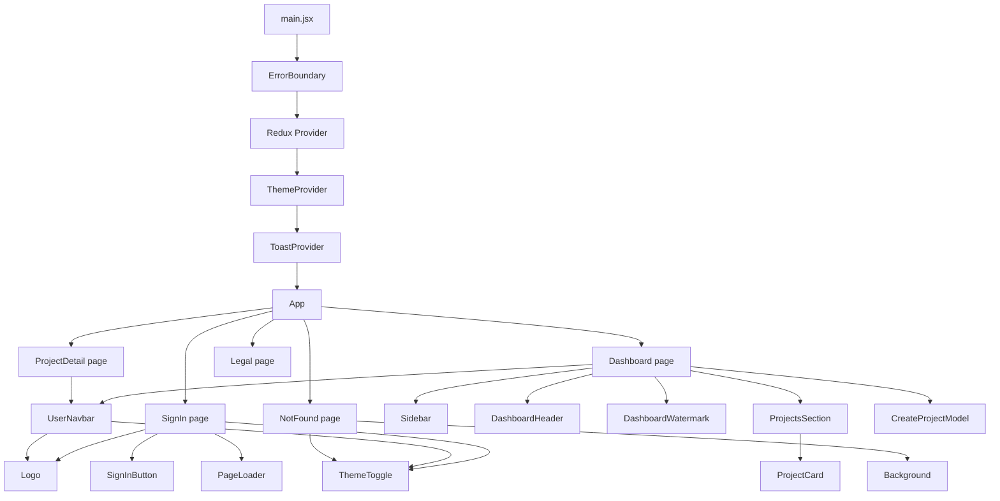

# Components

This page is an inventory of the React components: what each one renders, what
props it takes, and the behavior worth knowing. The app has no component library;
most visual pieces are local components composed with Tailwind classes.

## Component tree



## Page components

| Component | File | Responsibility |
| --- | --- | --- |
| `Dashboard` | `src/pages/Dashboard.jsx` | Loads project lists, switches Projects/Starred, hosts create modal. |
| `SignIn` | `src/pages/SignIn.jsx` | Google popup, token exchange, inline error, redirect. |
| `ProjectDetail` | `src/pages/ProjectDetail.jsx` | Fetches one project, shows metadata, star/delete actions. |
| `Legal` | `src/pages/Legal.jsx` | Terms and Privacy content, selected by `kind`. |
| `NotFound` | `src/pages/NotFound.jsx` | 404 page with decorative background. |

### `Dashboard`

State and behavior:

- `activeSession`: `'projects'` or `'starred'`.
- `openModel`: controls `CreateProjectModel`.
- `inFlight` ref: prevents duplicate fetches for the same list.
- Loads the active list when the user is available.
- Passes loading/error/retry data down to `ProjectsSection`.
- Renders the create modal only when open.

Layout:

```text
UserNavbar
└── Sidebar | scrollable main
    ├── DashboardWatermark (behind content)
    ├── DashboardHeader
    └── ProjectsSection
```

### `SignIn`

- Reads `authChecked` and `userData` from Redux.
- Shows a full-page "Checking session" loader until the startup check ends.
- Redirects already-signed-in users to `location.state.from` or `/`.
- Gets the `from` path from `ProtectedRoute`.
- Cancels silently when the popup is closed.
- Shows an inline `role="alert"` message for other failures.

### `ProjectDetail`

- Reads `id` from `useParams`.
- Fetches the project on mount and when `reloadKey` changes.
- Uses a `cancelled` flag so a late response cannot update an unmounted page.
- Tracks `loadedId` to distinguish "loading a new id" from "showing the previous
  project".
- Handles `404` separately from other errors.
- Star action is optimistic; failure rolls back and shows a toast.
- Delete action has an inline two-step confirmation, then navigates to `/`.
- Formats dates with `toLocaleDateString` (year, short month, day) or `—`.

`loading` is derived as `loadedId !== id`, not a separate boolean. That avoids a
flash of the previous project when navigating between detail pages.

## Layout components

### `UserNavbar`

Props: none.

- Shows the logo and "NexPulse".
- Theme toggle.
- User menu button with initials and truncated name (name hidden on small
  screens).
- Menu contains avatar, name, email, and Logout.
- Closes on outside click and Escape.
- `aria-haspopup="menu"`, `aria-expanded`, and `role="menu"` are present.
- Logout calls the API, then always clears user and project state.

Initials logic:

```js
name.split(/\s+/).filter(Boolean).map((w) => w[0]).join("").slice(0, 2).toUpperCase()
```

Empty or missing names fall back to `"Guest"` and `"?"`.

### `Sidebar`

Props: `activeSession`, `setActiveSession`.

- Desktop-only (`hidden ... sm:flex`).
- Two nav buttons: Projects and Starred.
- Uses `aria-current="page"` for the active view.
- Upgrade card calls `pushToast` with an info message; no payment flow exists.
- Uses `motion.button` for a small press animation.

Mobile: the sidebar disappears and `ProjectsSection` shows two tab buttons
instead.

### `DashboardHeader`

Props: `userData`, `onCreateProject`.

- Greets the user by first name (`"User"` fallback).
- "New Project" button opens the modal.
- Purely presentational.

### `DashboardWatermark`

- Large, low-opacity logo and wordmark centered behind dashboard content.
- Hidden below `md`.
- `pointer-events-none` so it never blocks clicks.

### `Background`

- Decorative grid, blurred color blobs, and a radial vignette.
- Used only by `NotFound`.
- All layers are pointer-transparent.

### `PageLoader`

Props: `label` (default `"Loading"`).

- Full-viewport spinner.
- `aria-label` is the label, so screen readers get "Loading" or "Checking
  session".

### `Logo`

Props: `className` (default `h-6 w-6`), `variant` (`"color"` or `"white"`).

- Imports `logo.svg` and `logo-white.svg`.
- Renders an `` with `alt="NexPulse"` and `draggable="false"`.
- The app currently uses the color variant everywhere; the white variant exists
  for dark surfaces.

## Project components

### `ProjectsSection`

Props:

| Prop | Meaning |
| --- | --- |
| `activeSession` | Current tab. |
| `setActiveSession` | Tab switcher. |
| `loadingProjects` | Loading state for the active list. |
| `projectError` | Error message for the active list. |
| `visibleProjects` | The list to render. |
| `onCreateProject` | Opens the create modal. |
| `onRetry` | Forces a refetch. |

Renders one of four states:

1. loading spinner
2. error panel with retry
3. empty state with a create button (only for the all-projects tab)
4. grid of `ProjectCard`

The heading says "Recent Projects" or "Starred Projects". Mobile tabs appear
below `sm`.

### `ProjectCard`

Props: `project`.

- Whole card is clickable; clicks on buttons or links are ignored by
  `event.target.closest("button, a")`.
- Name is a `Link` to `/project/:id`.
- Description is clamped to two lines; empty description shows "No description".
- Star button is always present for starred projects; otherwise it appears on
  hover or focus.
- Delete uses an inline confirm (Cancel / Yes) and stops click propagation.
- Star and delete call the API, update Redux, and show toasts on failure.
- Has `aria-label` on icon-only buttons.
- Motion: fade/rise on mount, lift on hover, scale on star tap.

### `CreateProjectModel`

Props: `openModel`, `onClose`.

- Despite the name, it is a modal dialog.
- Name input is required; submit disabled while empty or loading.
- `maxLength` is 120 for name and 2000 for description, matching the backend.
- On success: add to Redux, success toast, reset fields, close.
- On failure: show the backend message or a generic inline error.
- Focus moves to the name input when opened.
- Tab is trapped between the first and last focusable elements.
- Escape and backdrop click close it, but not while submitting.
- Body scroll is locked while open.
- Focus returns to the previously focused element on close.
- Uses `role="dialog"`, `aria-modal="true"`, and `aria-labelledby`.
- The close button is disabled while loading.

Important: parent and child both check `openModel`. The parent does not render the
component when closed, so the child's early return is effectively redundant but
harmless.

## Auth and UI components

### `ProtectedRoute`

Props: `children`.

- Shows the session loader while `authChecked` is false.
- Redirects to `/signin` with `state.from` when no user.
- Otherwise renders children.

See [Routing and Auth](./routing-and-auth.md).

### `SignInButton`

Props: `onSignIn`, `loading`.

- Google icon from `react-icons/fc`.
- Label switches to "Signing you in…".
- Disabled while loading.
- Full width, 50px tall, visible focus ring.

### `ThemeToggle`

Props: `className` (optional extra classes).

- Uses `useTheme()`.
- Shows sun in dark mode and moon in light mode.
- Icon-only button with `aria-label` and `title`.
- Used in the navbar, sign-in page, legal header, and not-found page.

### `Toast` / `ToastProvider`

`Toast.jsx` exports the provider, not a standalone `Toast` component. It also
defines the context in `hooks/toastContext.js`.

- Holds `{ id, message, variant }` entries.
- Variants: success (check), error (warning), info (info).
- Auto-dismiss after 4 seconds by default.
- Dismiss button on every toast.
- Bottom center on mobile, bottom right on larger screens.
- `aria-live="polite"` container; error toasts use `role="alert"`.

Usage:

```js
const { pushToast } = useToast()
pushToast('Project deleted.', { variant: 'success' })
```

### `ErrorBoundary`

Class component, no props beyond `children`.

- Catches render/lifecycle errors below it.
- Logs the error and component stack.
- Shows a fallback with a Reload button.
- Does not catch errors in event handlers or async code; those are handled by
  try/catch and toasts.

## Hooks and providers

| Export | File | Purpose |
| --- | --- | --- |
| `ThemeProvider` | `hooks/ThemeProvider.jsx` | Theme state, `<html>` class, `localStorage`. |
| `useTheme` | `hooks/themeContext.js` | Throws if used outside the provider. |
| `ToastProvider` | `components/Toast.jsx` | Toast queue and rendering. |
| `useToast` | `hooks/toastContext.js` | Throws if used outside the provider. |

Context modules are separate from provider components so React Fast Refresh can
treat the provider files as component-only modules.

## Assets

| Asset | Used by |
| --- | --- |
| `src/assets/logo.svg` | `Logo` default. |
| `src/assets/logo-white.svg` | `Logo variant="white"` (not currently used). |
| `src/assets/favicon.svg` | `index.html` icon and Apple touch icon. |
| `src/assets/hero.png` | Unused. |
| `src/assets/react.svg` | Unused. |
| `src/assets/vite.svg` | Unused. |

## Styling conventions in components

- Utility classes are written inline; there are no CSS modules or styled
  components.
- Color utilities come from theme tokens such as `bg-panel`, `text-muted`,
  `border-line-dark`, and `bg-brand-600`.
- Every page/component that can be shown in both themes pairs light and `dark:`
  classes.
- Focus states use `focus-visible:ring-2 focus-visible:ring-brand-400/60`.
- Motion package animations are used for cards, buttons, modal, and toasts are
  plain CSS transitions.

See [Styling and Theme](./styling-and-theme.md).

## Accessibility notes

Present:

- semantic `header`, `main`, `aside`, `nav`
- `aria-current` on sidebar navigation
- `aria-expanded`/`aria-haspopup` on the user menu
- dialog role, modal flag, labelled title, focus trap, Escape, focus restore
- `aria-pressed` on the detail star button
- `aria-label` on icon-only buttons and spinners
- `role="alert"` for form errors and error toasts
- visible focus rings on interactive elements

Gaps:

- `ProjectCard` is a clickable `div` with an inner link; keyboard users can use
  the link, but the whole card is not itself a button.
- No skip-to-content link.
- No reduced-motion guard for Motion animations.
- The toast close button is small.
- Some hover-only controls (star/delete on cards) rely on focus visibility, which
  is provided, but touch users need the always-visible star only after starring.

## Related pages

- [Routing and Auth](./routing-and-auth.md)
- [State Management](./state-management.md)
- [Styling and Theme](./styling-and-theme.md)
