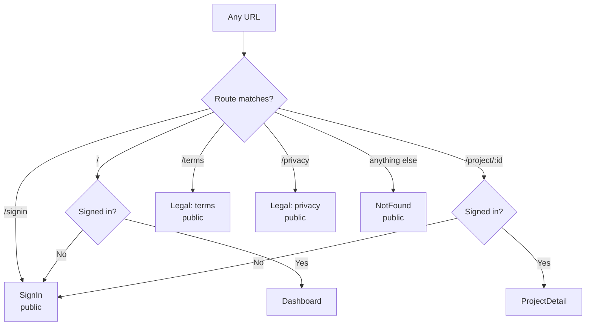
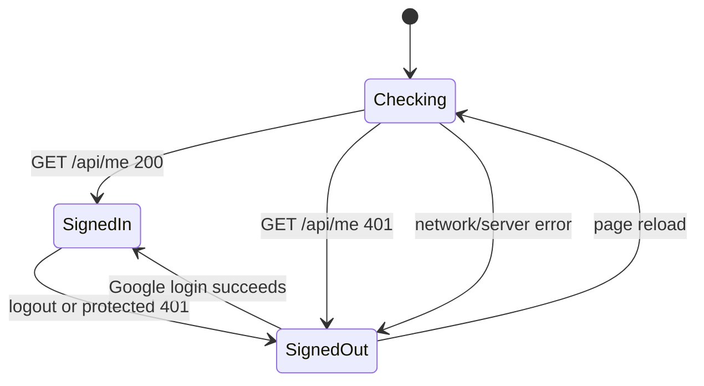
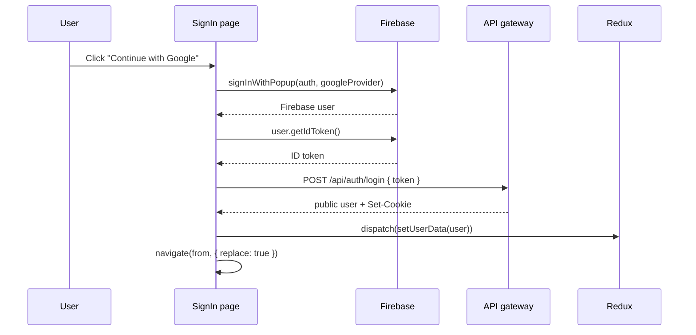
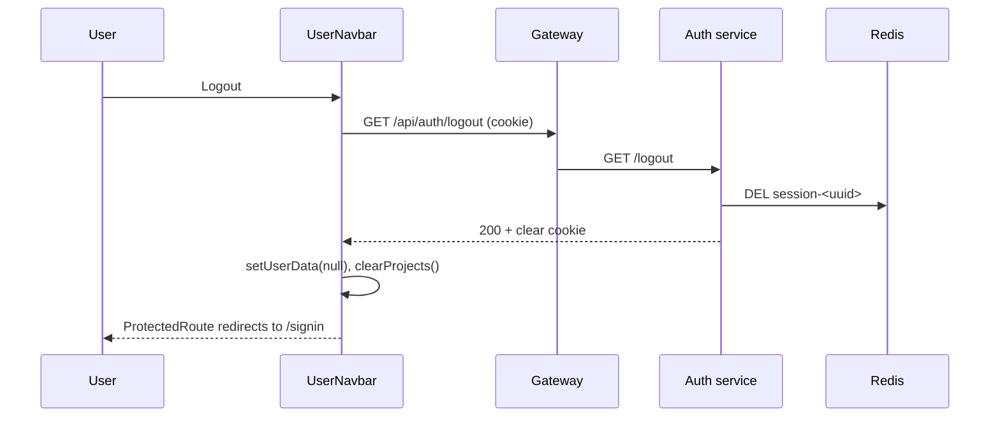

# Routing and Auth

The frontend uses React Router for navigation and a server-side session for
authentication. This page covers both, because they meet at the protected route
boundary.

## Route map



| Path | Element | Access |
| --- | --- | --- |
| `/signin` | `SignIn` | Public. Signed-in users are redirected away. |
| `/` | `Dashboard` inside `ProtectedRoute` | Requires a session. |
| `/project/:id` | `ProjectDetail` inside `ProtectedRoute` | Requires a session. |
| `/terms` | `Legal kind="terms"` | Public. |
| `/privacy` | `Legal kind="privacy"` | Public. |
| `*` | `NotFound` | Public. |

The router setup is in `frontend/src/App.jsx`:

```jsx
<BrowserRouter>
  <Suspense fallback={<PageLoader />}>
    <Routes>
      <Route path='/signin' element={<SignIn />} />
      <Route path='/' element={<ProtectedRoute><Dashboard /></ProtectedRoute>} />
      <Route path='/project/:id' element={<ProtectedRoute><ProjectDetail /></ProtectedRoute>} />
      <Route path='/terms' element={<Legal kind='terms' />} />
      <Route path='/privacy' element={<Legal kind='privacy' />} />
      <Route path='*' element={<NotFound />} />
    </Routes>
  </Suspense>
</BrowserRouter>
```

## Lazy loading

Every page is loaded on demand:

```js
const Dashboard = lazy(() => import('./pages/Dashboard'))
const SignIn = lazy(() => import('./pages/SignIn'))
const ProjectDetail = lazy(() => import('./pages/ProjectDetail'))
const Legal = lazy(() => import('./pages/Legal'))
const NotFound = lazy(() => import('./pages/NotFound'))
```

`Suspense` shows `PageLoader` while a chunk downloads. The loader is a full-page
spinner with an accessible label ("Loading" by default).

## Session restore

Authentication survives a refresh through the `httpOnly` session cookie. The
cookie cannot be read by JavaScript, so the app asks the backend who the user is:

```js
useEffect(() => {
  const fetchCurrentUser = async () => {
    try {
      const data = await me()
      if (data) dispatch(setUserData(data))
    } catch (error) {
      if (error.response?.status !== 401) {
        console.error(`[me] ${error.message}`)
      }
    } finally {
      dispatch(setAuthChecked(true))
    }
  }
  fetchCurrentUser()
}, [dispatch])
```

State transitions:



`authChecked` starts as `false`. `ProtectedRoute` shows `PageLoader` until the
first `/api/me` call finishes, so a signed-in user does not flash the sign-in
page on reload.

A `401` from `/api/me` is expected when signed out, so it is not logged. Other
errors are logged to the console; the UI still settles into the signed-out state.

## `ProtectedRoute`

```jsx
function ProtectedRoute({ children }) {
  const { userData, authChecked } = useSelector((state) => state.user)
  const location = useLocation()

  if (!authChecked) {
    return <PageLoader label='Checking session' />
  }

  if (!userData) {
    return (
      <Navigate
        to='/signin'
        replace
        state={{ from: `${location.pathname}${location.search}` }}
      />
    )
  }

  return children
}
```

Behavior:

| `authChecked` | `userData` | Result |
| --- | --- | --- |
| `false` | anything | Full-page "Checking session" loader |
| `true` | user object | Render the page |
| `true` | `null` | Redirect to `/signin`, remember the attempted path |

The redirect uses `replace`, so the protected URL is not left in history. The
attempted path is stored in `location.state.from`.

## Sign-in page

`SignIn` reads the attempted path:

```js
const from = location.state?.from || '/'
```

It also handles the case where the user is already signed in:

```jsx
if (!authChecked) {
  return <PageLoader label='Checking session' />
}

if (userData) {
  return <Navigate to={from === '/signin' ? '/' : from} replace />
}
```

So visiting `/signin` while signed in sends the user back to the page they came
from, or to `/` by default.

### Login sequence



### Error handling

```js
try {
  const result = await signInWithPopup(auth, googleProvider)
  const token = await result.user.getIdToken()
  const data = await login(token)
  dispatch(setUserData(data))
  navigate(from, { replace: true })
} catch (error) {
  if (
    error?.code === 'auth/popup-closed-by-user' ||
    error?.code === 'auth/cancelled-popup-request'
  ) {
    return
  }
  console.error(`[login] ${error.message}`)
  setLoginError('Sign-in failed. Check your connection and try again.')
} finally {
  setLoading(false)
}
```

- Closing the popup is not an error; it returns silently.
- Any other failure shows an inline alert.
- `loading` disables the button and changes its label to "Signing you in…".
- The button never stays stuck because `finally` always runs.

## Logout

`UserNavbar` calls the logout endpoint and clears client state:

```js
const handleLogout = async () => {
  setMenuOpen(false)
  try {
    await logout()
  } finally {
    dispatch(setUserData(null))
    dispatch(clearProjects())
  }
}
```



The `finally` block clears local state even if the API call fails. That is
deliberate: from the user's point of view, pressing logout should always sign
them out of the UI.

Current behavior: the frontend does **not** call Firebase's `signOut()`. It ends
the server session and clears Redux; Firebase's client-side auth object is left
alone. This is a minor gap, not a session-security issue, because the backend no
longer accepts the cookie.

## Automatic sign-out on `401`

The axios response interceptor handles an expired or deleted session during
normal use:

```js
api.interceptors.response.use(
  (response) => response,
  (error) => {
    const status = error.response?.status
    const url = error.config?.url || ''
    const isAuthProbe =
      url.includes('/api/me') || url.includes('/api/auth/login')

    if (status === 401 && !isAuthProbe && store.getState().user.userData) {
      store.dispatch(setUserData(null))
      store.dispatch(clearProjects())
    }

    return Promise.reject(error)
  },
)
```

Why the exceptions:

- `/api/me` returning `401` is how the app learns it is signed out at startup.
- `/api/auth/login` returning `401` is a login failure, not a dropped session.

For any other `401`, if a user was signed in, the interceptor resets the store.
`ProtectedRoute` then redirects to `/signin` on the next render.

## Auth state reference

| Situation | Redux `userData` | Visible result |
| --- | --- | --- |
| First load, `/api/me` in flight | `null`, `authChecked: false` | "Checking session" loader |
| No cookie | `null`, `authChecked: true` | `/signin` for protected routes |
| Valid cookie | user object | Requested page |
| Expired session during a project call | cleared | `/signin` |
| Login succeeds | user object | Attempted page or `/` |
| Login popup closed | unchanged | Stays on `/signin` |
| Logout | `null`, projects cleared | `/signin` |

## Public pages

- `/terms` and `/privacy` render the same `Legal` component with different
  content. Both link back to `/`, which redirects to `/signin` when signed out.
- `NotFound` renders for any unmatched path. It is public and links to `/`.

## Deployment note

`BrowserRouter` uses the History API. The static host must serve `index.html` for
unknown paths:

```text
/project/6640... -> index.html -> React Router reads the path
```

Without that rewrite, refreshing `/project/:id` returns a server `404` before
React runs. Configure the rewrite in the host or reverse proxy.

## Known gaps

- No role-based routes or admin area.
- No route transition animation.
- No error route; a rendering error is caught by `ErrorBoundary`, not a route.
- No `StrictMode`, so development double-render checks are disabled.
- `/signin` is a full page, not a modal over the dashboard.
- The attempted path is kept only in router state, so a full page reload during
  sign-in loses it.
