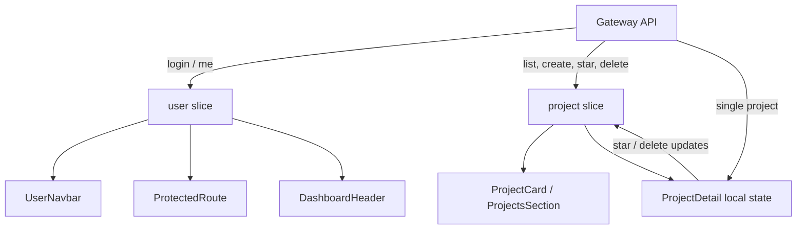
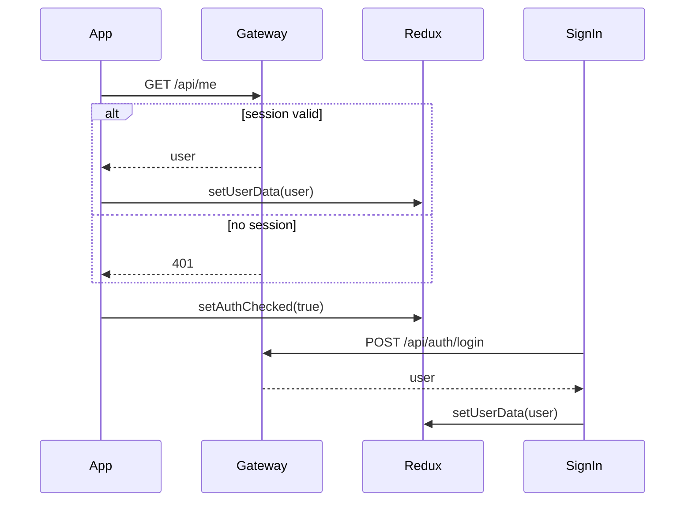
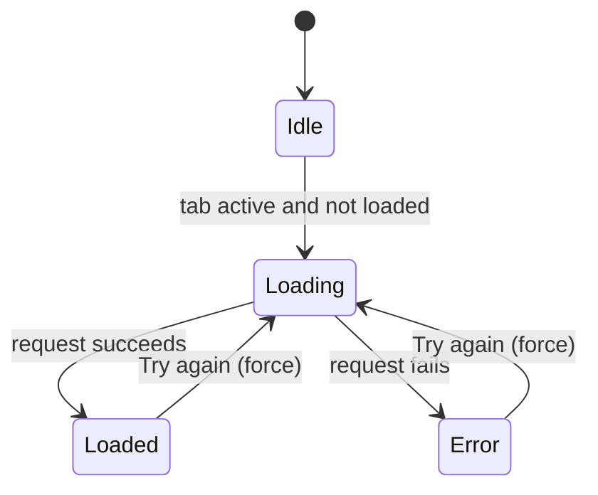
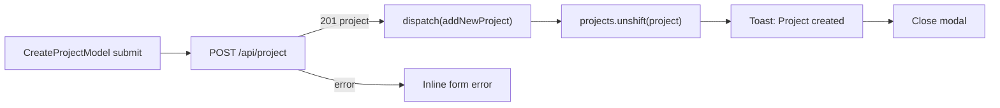
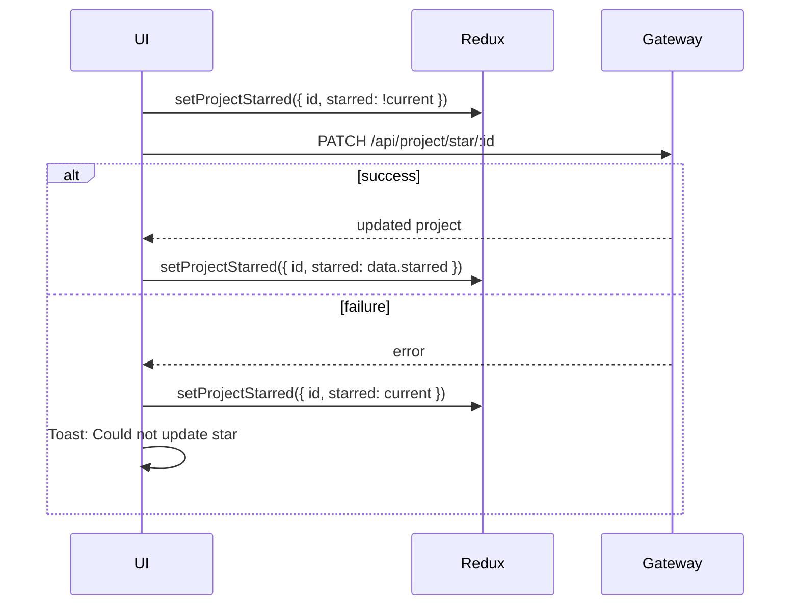

# State Management

NexPulse mixes three kinds of state:

| Kind | Tool | Examples |
| --- | --- | --- |
| Shared app state | Redux Toolkit | signed-in user, project lists, loading/error flags |
| UI-wide state | React context | theme, toast queue |
| Local state | `useState` / `useRef` | form fields, modal open, delete confirmation, request guards |

There is no RTK Query, React Query, SWR, Zustand, or persisted store. Data is
fetched by plain async functions and written into slices by hand.

## Provider tree

```jsx
<ErrorBoundary>
  <Provider store={store}>
    <ThemeProvider>
      <ToastProvider>
        <App />
      </ToastProvider>
    </ThemeProvider>
  </Provider>
</ErrorBoundary>
```

Redux is outside the theme and toast providers, so any of them can read the
store. Only axios, outside React, also imports the store directly.

## Redux store

```js
export const store = configureStore({
  reducer: {
    user: userReducer,
    project: projectReducer,
  },
});
```

### `user` slice

`frontend/src/redux/userSlice.js`

| Field | Initial | Meaning |
| --- | --- | --- |
| `userData` | `null` | Public user `{ _id, name, email, avatar }` or `null`. |
| `authChecked` | `false` | Has the startup `/api/me` check finished? |

Actions:

| Action | Payload | Effect |
| --- | --- | --- |
| `setUserData` | user object or `null` | Replaces the signed-in user. |
| `setAuthChecked` | boolean | Marks the startup check complete. |

`authChecked` is separate from `userData` on purpose. `userData: null` alone
cannot distinguish "not checked yet" from "checked and signed out".

### `project` slice

`frontend/src/redux/projectSlice.js`

| Field | Initial | Meaning |
| --- | --- | --- |
| `projects` | `[]` | All owned projects. |
| `starredProjects` | `[]` | Starred projects. |
| `projectsLoaded` | `false` | Has the all-projects list been fetched? |
| `starredLoaded` | `false` | Has the starred list been fetched? |
| `loadingProjects` | `false` | All-projects request in flight. |
| `loadingStarred` | `false` | Starred request in flight. |
| `projectsError` | `null` | Human-readable list error. |
| `starredError` | `null` | Human-readable starred error. |

Actions:

| Action | Payload | Effect |
| --- | --- | --- |
| `setProjects` | array | Replaces `projects`, marks loaded, clears loading/error. |
| `setStarredProjects` | array | Replaces `starredProjects`, marks loaded, clears loading/error. |
| `setLoadingProjects` | boolean | Sets loading; starting a request clears the error. |
| `setLoadingStarred` | boolean | Same for starred. |
| `setProjectsError` | string | Stores an error and stops loading. |
| `setStarredError` | string | Same for starred. |
| `addNewProject` | project | Prepends to `projects`. |
| `setProjectStarred` | `{ id, starred }` | Updates both lists and inserts/removes in starred. |
| `setDeleteProject` | id | Removes from both lists. |
| `clearProjects` | none | Resets the whole project slice. |

`setProjects` and `setStarredProjects` guard against non-arrays by storing `[]`.

## Who owns what



- `ProjectDetail` fetches its own full record and keeps it in local state. It
  does not select a project from the list.
- Star and delete actions are mirrored into Redux so the dashboard stays in sync.
- The dashboard list is the source for cards; there is no per-card fetching.

## Startup and login



The login page does not set `authChecked`; it is already `true` by the time the
sign-in page can render (the page waits on it).

## Loading project lists

`Dashboard` loads the active tab:

```js
const loadProjects = useCallback(
  async (session, { force = false } = {}) => {
    const isProjects = session === 'projects'
    if (!force && (isProjects ? projectsLoaded : starredLoaded)) return
    if (inFlight.current[session]) return
    // ...
  },
  [dispatch, projectsLoaded, starredLoaded],
)
```

Two guards prevent duplicate requests:

1. **Loaded flag** — do not refetch a list that is already loaded.
2. **`inFlight` ref** — do not start a second request for the same list while
   one is running.



Error text is generic in the slice (`Could not load projects.`), while the real
error is logged to the console. The error panel has a retry button that calls
`loadProjects(activeSession, { force: true })`.

### Why the loaded flags matter

The dashboard is mounted once per visit. Switching between Projects and Starred
should not refetch a list each time. The flags make the second visit instant.

The trade-off is staleness. The frontend does not know that the backend
invalidated its Redis cache after another action, so it keeps showing its copy
until a reload or a forced retry.

## Creating a project



- The form trims the name and description.
- The submit button is disabled when the name is empty.
- The backend's `message` is shown if present; otherwise a generic error appears.
- `addNewProject` prepends, matching the backend's `updatedAt` sort for a new
  record.
- The modal closes only after success.

The starred list is not touched. A new project starts with `starred: false`.

## Star toggling

Both the card and the detail page use optimistic updates:



`setProjectStarred` does three things:

1. Updates the matching project in `projects`.
2. Updates the matching project in `starredProjects`.
3. If newly starred, adds the project to `starredProjects`; if unstarred, removes
   it.

The detail page also updates its local `project.starred` immediately, then
reconciles with the server response. On failure it rolls back both local and
Redux state.

### Edge case

If a project is starred from the all-projects list before the Starred tab has
ever loaded, `setProjectStarred` inserts that one project into
`starredProjects` and sets `starredLoaded = true`. The Starred tab will then show
only that project and will not fetch the full starred list, because the loaded
flag is already true. Reloading the page corrects it. This is a known
consequence of the current slice logic.

## Deleting a project

- `ProjectCard` asks for confirmation inline, then calls the API.
- `ProjectDetail` asks for confirmation, then calls the API and navigates to `/`.
- On success, `setDeleteProject(id)` removes the project from both lists.
- A success toast is shown.
- On failure, the project stays and an error toast appears.

`ProjectDetail` does not clear the project from its local state before
navigating; the route unmounts, so that is fine.

## Logout and forced sign-out

Two paths clear project state:

1. **User clicks Logout** in `UserNavbar`: call the API, then in `finally`
   dispatch `setUserData(null)` and `clearProjects()`.
2. **A protected request returns `401`**: the axios interceptor dispatches the
   same two actions, but only if a user was previously present and the failing URL
   is not `/api/me` or `/api/auth/login`.

Clearing projects prevents the next user on the same tab from briefly seeing the
previous user's data.

## Theme state

`ThemeProvider` is a context, not Redux, because only UI styling needs it.

```js
const [theme, setTheme] = useState(getInitialTheme)

useEffect(() => {
  const root = document.documentElement
  root.classList.toggle('dark', theme === 'dark')
  root.style.colorScheme = theme
  localStorage.setItem('theme', theme)
}, [theme])
```

- Default is dark unless `localStorage.theme === 'light'`.
- The `dark` class goes on `<html>`.
- `colorScheme` keeps native controls consistent.
- The choice persists in `localStorage`.
- `index.html` has an inline script that applies the class before React mounts to
  avoid a flash of the wrong theme.

The context value:

```js
{ theme, isDark: theme === 'dark', toggleTheme }
```

## Toast state

`ToastProvider` keeps an array of toasts in local state and exposes:

```js
{ pushToast(message, { variant, duration }), dismissToast(id) }
```

- Variants: `success`, `error`, `info`.
- Default duration: 4000 ms.
- `duration: 0` keeps a toast until dismissed.
- Each toast gets a monotonically increasing id.
- Timers are stored in a ref and cleared on unmount.
- The container has `aria-live="polite"`; error toasts use `role="alert"`.

Toasts are used for create/delete/star failures and success, and for the
placeholder "Upgrade plans are coming soon" message.

## Local component state

| Component | State | Why local |
| --- | --- | --- |
| `SignIn` | `loading`, `loginError` | Only that form needs it. |
| `Dashboard` | `openModel`, `activeSession`, `inFlight` ref | View state and request guard. |
| `ProjectDetail` | project, loaded id, error, not found, reload key, star/delete flags | Page-specific fetch and confirmations. |
| `CreateProjectModel` | name, description, loading, error | Form state. |
| `ProjectCard` | star/delete loading, confirm delete | Per-card actions. |
| `UserNavbar` | menu open | Dropdown state. |

## Current limitations

- No cache normalization. The same project exists as separate objects in
  `projects`, `starredProjects`, and detail local state.
- No automatic refetch on focus or reconnect.
- No request cancellation when leaving a page. `ProjectDetail` uses a `cancelled`
  flag to ignore late results, but the HTTP request still runs.
- No persisted Redux state; only the theme survives a reload.
- No optimistic create or delete; only star toggling is optimistic.
- The loaded flags can become stale after backend cache invalidation.
- Starring before the starred list loads can leave the starred tab incomplete
  until reload.
- No global error state; failures are handled per feature.
- `clearProjects` resets the slice by returning the initial object, so any future
  field added there is cleared automatically.

## Related pages

- [Routing and Auth](./routing-and-auth.md)
- [Components](./components.md)
- [Backend API Reference](../backend/api-reference.md)
