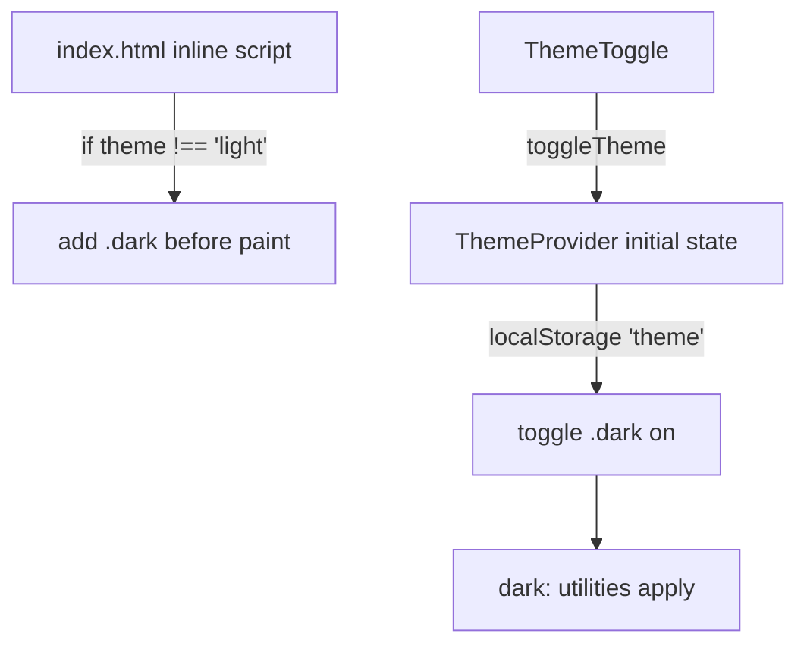

# Styling and Theme

NexPulse uses Tailwind CSS v4 with a CSS-first configuration. There is no
`tailwind.config.js`; design tokens live in `frontend/src/index.css` and are
consumed as normal utility classes.

## How Tailwind is wired

`frontend/vite.config.js`:

```js
import react from '@vitejs/plugin-react'
import { defineConfig } from 'vite'
import tailwindcss from '@tailwindcss/vite'

export default defineConfig({
  plugins: [react(), tailwindcss()],
})
```

`frontend/src/index.css` starts with:

```css
@import "tailwindcss";

@custom-variant dark (&:where(.dark, .dark *));

@theme {
  /* tokens */
}
```

- The Vite plugin scans source files and generates the CSS.
- `@import "tailwindcss"` brings in preflight and utilities.
- `@custom-variant dark` makes every `dark:` utility depend on an ancestor with
  the `dark` class.
- `@theme` defines tokens that become utilities, such as `bg-panel` and
  `text-mist-muted`.

## Theme selection

Theme is controlled by a class on `<html>`:

```html
<html class="dark">
```

Flow:



### Before React runs

`index.html` contains a blocking inline script:

```html
<script>
  try {
    var theme = localStorage.getItem("theme");
    if (theme !== "light") document.documentElement.classList.add("dark");
  } catch (e) {}
</script>
```

This prevents a flash of the wrong theme on reload. If storage is unavailable,
the script fails silently and the app defaults to dark.

### Runtime

`ThemeProvider`:

```js
const getInitialTheme = () => {
  if (typeof window === 'undefined') return 'dark'
  return window.localStorage.getItem('theme') === 'light' ? 'light' : 'dark'
}

const [theme, setTheme] = useState(getInitialTheme)

useEffect(() => {
  const root = document.documentElement
  const isDark = theme === 'dark'
  root.classList.toggle('dark', isDark)
  root.style.colorScheme = theme
  window.localStorage.setItem('theme', theme)
}, [theme])
```

Rules:

- Default is **dark**.
- Only an explicit stored `"light"` switches to light.
- The OS `prefers-color-scheme` is not read.
- The preference is stored under `localStorage.theme`.
- `colorScheme` makes scrollbars and native controls match.
- The toggle is available on the sign-in page, legal pages, not-found page, and
  the dashboard navbar.

## Color tokens

Defined under `@theme` in `src/index.css`:

### Dark surfaces

| Token | Value | Typical use |
| --- | --- | --- |
| `ink-950` | `#101116` | App/page background in dark mode |
| `ink-900` | `#14161D` | Navbar and sidebar |
| `ink-850` | `#181A22` | Cards and panels |
| `ink-800` | `#20232D` | Inputs and hover surfaces |
| `ink-700` | `#262934` | Secondary hover surfaces |

### Light surfaces

| Token | Value | Typical use |
| --- | --- | --- |
| `surface` | `#F7F8FC` | Page background |
| `panel` | `#FFFFFF` | Cards, navbar, sidebar |
| `hover` | `#F1F2F7` | Hover background |
| `line` | `#E1E3EC` | Default borders |
| `line-strong` | `#D5D7E3` | Stronger card hover border |
| `line-dark` | `#343643` | Borders in dark mode |

### Text

| Token | Value | Typical use |
| --- | --- | --- |
| `graphite` | `#20212A` | Primary text, light mode |
| `muted` | `#55596B` | Body text, light mode |
| `subtle` | `#70758A` | Secondary text, light mode |
| `faint` | `#9295A7` | Labels and hints, light mode |
| `mist` | `#F5F3FA` | Primary text, dark mode |
| `mist-muted` | `#B5B6C5` | Body text, dark mode |

### Brand

| Token | Value |
| --- | --- |
| `brand-300` | `#67e8f9` |
| `brand-400` | `#22d3ee` |
| `brand-500` | `#06b6d4` |
| `brand-600` | `#0891b2` |
| `brand-700` | `#0e7490` |

The brand palette is cyan. Primary buttons use `bg-brand-600` with
`hover:bg-brand-700`. Focus rings use `brand-400/60`.

Some semantic colors are used directly rather than tokenized:

- red for errors and destructive actions
- amber for stars
- emerald for success toasts
- indigo and fuchsia in the decorative `Background` blobs

## Typography

Tokens:

```css
--font-sans: "Inter", ui-sans-serif, system-ui, -apple-system, "Segoe UI", sans-serif;
--font-mono: "JetBrains Mono", ui-monospace, SFMono-Regular, Menlo, monospace;
```

The fonts are loaded from Google Fonts in `index.html` with preconnects for
`fonts.googleapis.com` and `fonts.gstatic.com`. Weights: Inter 400/500/600/700,
JetBrains Mono 400/500.

Base styles set:

- `font-family: var(--font-sans)`
- antialiasing
- optimized legibility
- smooth scrolling
- custom selection color
- custom WebKit scrollbar

The app uses tight tracking for headings (`tracking-tight`), uppercase
micro-labels (`text-[12px] uppercase tracking-wide`), and arbitrary pixel sizes
such as `text-[13.5px]` where the design needs precision.

## Base layer

```css
@layer base {
  html { -webkit-text-size-adjust: 100%; scroll-behavior: smooth; }
  body { margin: 0; min-height: 100dvh; background-color: var(--color-ink-950); ... }
}
```

Note that `body` starts dark. Individual pages set their own background:

- light: `bg-surface text-graphite`
- dark: `dark:bg-ink-950 dark:text-mist`

This is why the sign-in, dashboard, detail, legal, and not-found pages all repeat
the pair. The body color mainly prevents a white flash before a page paints.

## Custom utilities

Defined with Tailwind v4 `@utility`:

| Utility | Effect |
| --- | --- |
| `bg-grid` | 56px white grid lines at 5% opacity. |
| `bg-dots` | 22px white dot pattern at 12% opacity. |
| `text-gradient` | White-to-lavender clipped text gradient. |
| `glass-panel` | Translucent white panel with blur and saturation. |
| `ring-hairline` | Inset highlight plus deep drop shadow. |

Current usage:

- `bg-grid` is used by `Background` on the 404 page.
- `text-gradient`, `bg-dots`, `glass-panel`, and `ring-hairline` remain available
  but are not used by the current pages.

## Animation tokens

`@theme` defines animation utilities:

| Utility | Keyframes | Used by |
| --- | --- | --- |
| `animate-aurora` | `aurora` 20s | `Background` blobs. |
| `animate-aurora-slow` | `aurora` 32s reverse | `Background` blob. |
| `animate-float` | `float` 8s | Not currently used. |
| `animate-shimmer` | `shimmer` 2.4s | Not currently used. |
| `animate-caret` | `caret` 1.05s | Not currently used. |
| `animate-rise` | `rise` 0.7s | Not currently used. |
| `animate-menu-in` | `menuIn` 0.16s | User navbar dropdown. |

The `motion` package handles most UI motion instead:

- cards: fade/rise and hover lift
- star button: tap scale
- sidebar buttons: tap scale
- modal: backdrop fade and panel rise/scale

No reduced-motion guard is implemented. Users who request reduced motion at the
OS level still get these animations.

## Dark mode pattern

Almost every component pairs a light class with a `dark:` class:

```jsx
className='border border-line bg-panel text-graphite dark:border-line-dark dark:bg-ink-850 dark:text-mist'
```

Common pairs:

| Purpose | Light | Dark |
| --- | --- | --- |
| Page | `bg-surface` | `dark:bg-ink-950` |
| Panel/card | `bg-panel` | `dark:bg-ink-850` |
| Nav/sidebar | `bg-panel` | `dark:bg-ink-900` |
| Input | `bg-hover` | `dark:bg-ink-800` |
| Border | `border-line` | `dark:border-line-dark` |
| Primary text | `text-graphite` | `dark:text-mist` |
| Body text | `text-muted` | `dark:text-mist-muted` |
| Hint text | `text-subtle` / `text-faint` | `dark:text-faint` |

The `dark` variant is class-based, not media-query-based, because the user
chooses the theme explicitly.

## Responsive design

Breakpoints are Tailwind defaults:

| Prefix | Min width | Used for |
| --- | --- | --- |
| `sm` | 640px | Sidebar appears; navbar name appears; mobile tabs disappear; grids go 2 columns. |
| `md` | 768px | Dashboard watermark appears. |
| `lg` | 1024px | Detail page becomes a 3-column grid. |
| `xl` | 1280px | Dashboard grid goes to 4 columns. |

Examples:

- The sidebar is `hidden ... sm:flex`; mobile users switch tabs from
  `ProjectsSection`.
- `ProjectCard` grid: 1 column, then 2 at `sm`, then 4 at `xl`.
- The create dialog is `w-full max-w-md` and adds page padding.
- The dashboard main area is the scroll container, not the window, so the navbar
  and sidebar stay fixed.

## Sizing and layout conventions

- Page height uses `min-h-dvh` for full-screen pages.
- The dashboard uses `h-screen` with `overflow-hidden` and an inner
  `overflow-y-auto` content area.
- Widths use `max-w-100` (sign-in card), `max-w-md` (modal), `max-w-3xl`
  (legal text), `max-w-5xl` (detail page).
- Spacing is usually multiples of 0.5 (`p-3.5`, `mt-1.5`, `gap-2.5`).
- Radii are mostly `rounded-lg` for controls and `rounded-xl`/`rounded-[28px]` for
  larger surfaces.
- Shadows are subtle in light mode and much deeper in dark mode.

Tailwind v4 syntax appears in a few places:

- `bg-linear-to-br` for gradients (v4 renamed `bg-gradient-to-*`)
- `mask-[radial-gradient(...)]` for arbitrary masks
- `shadow-[...]` and `w-[72rem]` for arbitrary values

## Focus and interaction

The common focus recipe:

```text
focus-visible:outline-none focus-visible:ring-2 focus-visible:ring-brand-400/60
```

Destructive controls use red rings. Disabled controls use opacity and
`cursor-not-allowed` or `cursor-wait`. Hover-only controls such as the card star
and delete buttons also use `focus:opacity-100` so keyboard users can reveal
them.

## Adding a new color or animation

1. Add the token under `@theme` in `src/index.css`.
2. Use it as a utility, e.g. `--color-ocean-500` becomes `bg-ocean-500`.
3. For animation, define `--animate-name` and the matching `@keyframes`.

Do not add a `tailwind.config.js` unless the project deliberately moves away from
CSS-first configuration.

## Known styling gaps

- No dark-mode contrast audit.
- No reduced-motion support.
- Several unused utilities and keyframes remain from earlier designs.
- Some colors are hard-coded Tailwind palette values (red, amber, zinc, indigo,
  fuchsia) instead of project tokens.
- The body background is always dark before a page paints; light-mode users can
  briefly see dark edges during load.
- No design-token documentation outside this file and `index.css`.

## Related pages

- [Components](./components.md)
- [Frontend Overview](./README.md)
