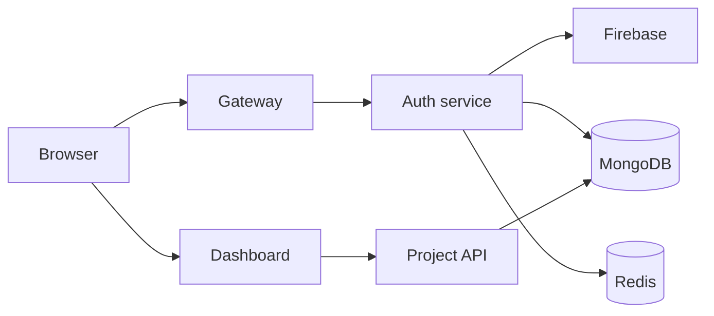

# Getting Started

This is the quickest way to run NexPulse on your machine.

The app is split into a few small services, so you will usually keep 4 terminals
open at the same time: one for auth, one for the project service, one for the
gateway, and one for the frontend.

## What you need

- Node.js and npm
- A MongoDB database
- Redis running locally
- A Firebase project with Google sign-in enabled

## 1) Start Redis

This repo includes a Docker compose file for local Redis:

```bash
docker compose -f backend/docker-compose.yml up -d
```

If Docker is not available, run Redis another way and make sure it listens on
`localhost:6379`.

## 2) Configure the auth service

Create `backend/services/auth/.env`:

```env
PORT=8001
MONGODB_URI=mongodb+srv://<user>:<password>@<cluster>/<db>
REDIS_URL=redis://localhost:6379
```

Also make sure this file exists:

`backend/services/auth/serviceAccountKey.json`

That file is the Firebase admin secret used to verify tokens on the server.

Start the auth service:

```bash
cd backend/services/auth
npm install
npm run dev
```

It should print something like:

```text
Auth running at 8001
DB Connected
```

## 3) Configure the project service

Create `backend/services/project/.env`:

```env
PORT=8002
MONGODB_URI=mongodb+srv://<user>:<password>@<cluster>/<db>
REDIS_URL=redis://localhost:6379
```

Then start it:

```bash
cd backend/services/project
npm install
npm run dev
```

You should see:

```text
Project service running at 8002
DB Connected
```

## 4) Configure the gateway

Create `backend/gateway/.env`:

```env
PORT=8000
FRONTEND_URL=http://localhost:5173
AUTH_SERVICE=http://localhost:8001
PROJECT_SERVICE=http://localhost:8002
```

Start the gateway:

```bash
cd backend/gateway
npm install
npm run dev
```

You should see:

```text
gateway running at 8000
```

## 5) Configure the frontend

Create `frontend/.env.local`:

```env
VITE_SERVER_URL=http://localhost:8000
VITE_FIREBASE_API_KEY=your_firebase_web_api_key
```

Then start the frontend:

```bash
cd frontend
npm install
npm run dev
```

Open the local Vite URL, usually:

```text
http://localhost:5173
```

## 6) Log in and test the app

Open the app in the browser and click the Google sign-in button.

After login, the app should do this:



If the login works, the browser gets a session cookie and the dashboard loads
project data. If it does not work, check:

- Redis is running
- MongoDB is reachable
- Firebase secret file exists
- `.env` values are correct
- the frontend server URL matches the gateway URL

## Common issues

### The app loads, but login fails

Check that:

- the Firebase admin key file exists
- `serviceAccountKey.json` is valid JSON
- the auth service is running on port `8001`

### The dashboard is blank after sign-in

Check that:

- the gateway is running on `8000`
- the browser is sending cookies with credentials enabled
- the session cookie is being set by the auth service

### Project data does not appear

Check that:

- the project service is running on `8002`
- the gateway is forwarding `/api/project` requests
- the project service has a valid MongoDB connection

## Good rule to remember

The browser never talks directly to the auth or project service. It only talks
through the gateway.

That keeps the frontend simple and keeps the important logic on the backend.
    B["Browser<br>(Google popup)"] -->|"POST /api/auth/login"| G[Gateway]
    G -->|"POST /login<br>(prefix stripped)"| A[Auth service]
    A --> M[("MongoDB<br>users")]
    A --> R[("Redis<br>session")]
```

You can also check the backend without the browser, using the gateway path
directly:

```
http://localhost:8000/api/auth/
```

The gateway forwards it to the auth service, so you'll see the auth service's
message coming back.

## The four terminals at a glance

Redis runs in the background (via Docker), so it isn't one of the terminals —
but it does need to be up.

| Terminal | Folder | Command | Port |
| --- | --- | --- | --- |
| 1 | `backend/services/auth` | `npm run dev` | `8001` |
| 2 | `backend/services/project` | `npm run dev` | `8002` |
| 3 | `backend/gateway` | `npm run dev` | `8000` |
| 4 | `frontend` | `npm run dev` | `5173` |
| — | `backend` | `docker compose up -d` (Redis) | `6379` |

## Environment files

Each app reads settings from its own environment file. These are git-ignored so
secrets and machine-specific settings stay on your machine.

**`backend/gateway/.env`**

```
PORT=8000
FRONTEND_URL=http://localhost:5173
AUTH_SERVICE=http://localhost:8001
PROJECT_SERVICE=http://localhost:8002
```

**`backend/services/auth/.env`**

```
PORT=8001
MONGODB_URI=<your MongoDB connection string>
REDIS_URL=redis://localhost:6379
```

**`backend/services/project/.env`**

```
PORT=8002
MONGODB_URI=<your MongoDB connection string>
REDIS_URL=redis://localhost:6379
```

**`frontend/.env.local`**

```
VITE_SERVER_URL=http://localhost:8000
VITE_FIREBASE_API_KEY=<your Firebase web API key>
```

If a service won't start, or can't reach another service, these files are the
first place to look. A wrong port or URL here causes most connection problems.

## Secrets

Three things never belong in Git, and all three are ignored:

| File | Contains | Ignored? |
| --- | --- | --- |
| `backend/**/.env` | Ports, MongoDB URI, Redis URL | Yes |
| `backend/services/auth/serviceAccountKey.json` | Firebase credentials | Yes |
| `frontend/.env.local` | Firebase web key | Yes (via `frontend/.gitignore`) |

**About `serviceAccountKey.json`:** it's a Firebase credential, and anyone
holding it can act as your Firebase project. If it ever gets committed by
accident, treat it as leaked — revoke it in the Firebase console and issue a new
one. Rotating beats apologizing.

## Common problems

**"npm is not recognized"**
Node.js isn't installed, or isn't on your PATH. Install it from
[nodejs.org](https://nodejs.org), then reopen your terminal so it picks up the
new command.

**"Port already in use"**
Something else is using that port. Stop that program, or change `PORT` in the
relevant `.env` file and restart.

**The auth service exits immediately on start**
Almost always the Firebase key. `serviceAccountKey.json` is missing, malformed,
or has been revoked. Firebase is initialized at import time, so a bad key throws
before the server starts listening — which is deliberate: failing loudly beats
failing mysteriously later.

**"DB Connected" never appears**
`MONGODB_URI` is missing or wrong in that service's `.env`, or your network can't
reach the cluster. The service keeps running either way — it catches the error
and logs it — but it won't be able to save data. Both the auth service and the
project service connect this way.

**`[redis] ECONNREFUSED` in the auth terminal**
Redis isn't running. Start it with
`docker compose -f backend/docker-compose.yml up -d`. The warning appears only
once, and login still works without it — sessions just aren't created until
Redis is back. Also check that `REDIS_URL` in the auth `.env` starts with
`redis://`, not `http://`.

**`/api/auth/...` returns an error instead of reaching auth**
Check that the gateway is running, and that `AUTH_SERVICE` in the gateway's
`.env` matches where the auth service actually is.

**`/api/project/...` returns an error instead of reaching the project service**
Check that the project service is running, and that `PROJECT_SERVICE` in the
gateway's `.env` matches where it actually is. A `401` here is different: it
means the request reached the gateway but the session cookie was missing or
expired — sign in again.

**The Google popup opens but nothing happens after**
Open the browser console. The most common cause is a mismatch between the
Firebase web key in `frontend/.env.local` and the project the backend is
configured for.

**Changes don't show up**
All three use a watcher that restarts on save. If something looks stale, check
that the terminal didn't crash — scroll up and look for errors.
