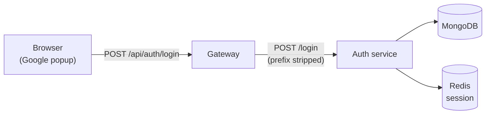

# Getting Started

This guide gets the whole NexPulse stack running on your own machine — the auth
service, the gateway, and the frontend. No prior experience assumed beyond being
able to open a terminal.

If any word here is unfamiliar — "service", "port", "environment variable" —
the [Glossary](./concepts/glossary.md) explains it in everyday language.

## What you'll need

| Tool | Why you need it | Check with |
| --- | --- | --- |
| **Node.js** (v18 or newer) | Runs the backend and the frontend build tooling. | `node --version` |
| **npm** | Installs project dependencies. Bundled with Node.js. | `npm --version` |
| **MongoDB** | Stores user records. | a running cluster, or `mongod --version` |
| **Redis** | Stores login sessions. | `docker compose version` (easiest way to run it) |
| **A Firebase project** | Handles the actual Google sign-in. | — |

You'll also need two secrets for the backend: a **MongoDB connection string** and
a **Firebase service account key**. Neither is in Git — see
[Secrets](#secrets) below.

## The one idea to understand first

The project is split into **separate apps**, each in its own folder with its own
dependencies. That means:

- You run `npm install` **once per app**, not once for the project.
- Each app gets **its own terminal window**, because each keeps running.

Right now that's three apps, so three terminals. It feels odd the first time;
it's completely normal for a multi-app project.

## Step 1 — Get the code

```bash
git clone <repository-url>
cd NexPulse
```

## Step 2 — Configure the backend

The auth service needs a `.env` file. Create
`backend/services/auth/.env`:

```
PORT=8001
MONGODB_URI=mongodb+srv://<user>:<password>@<cluster>/<db>
REDIS_URL=redis://localhost:6379
```

And make sure `backend/services/auth/serviceAccountKey.json` exists — this is
your Firebase service account key, downloaded from the Firebase console.

## Step 3 — Start the auth service

```bash
cd backend/services/auth
npm install
npm run dev
```

What those do:

- `cd backend/services/auth` — go into the auth service folder.
- `npm install` — download its dependencies (run this once).
- `npm run dev` — start it. `nodemon` restarts it automatically when you save a
  file.

You should see:

```
Auth running at 8001
DB Connected
```

Confirm it's alive by opening `http://localhost:8001/`:

```json
{ "message": "Hello from Auth" }
```

**Leave this terminal running.**

## Step 4 — Start Redis

Sessions are stored in Redis, and it needs to be running before (or while) the
auth service starts. The easiest way is the compose file included in the repo:

```bash
docker compose -f backend/docker-compose.yml up -d
```

Confirm it's up:

```
docker compose -f backend/docker-compose.yml ps
```

No Docker? Any Redis server on `localhost:6379` works — for example on WSL,
`sudo apt install redis-server`, then `sudo service redis-server start`.

If Redis isn't running, the auth service still starts — it logs one warning
(`[redis] ECONNREFUSED — sessions will not persist…`) and login works, just
without creating a session.

## Step 5 — Start the gateway

The gateway also reads a `.env` file. Create `backend/gateway/.env`:

```
PORT=8000
FRONTEND_URL=http://localhost:5173
AUTH_SERVICE=http://localhost:8001
```

Now open a **second** terminal — keep the first one running.

```bash
cd backend/gateway
npm install
npm run dev
```

You should see:

```
gateway running at 8000
```

Check `http://localhost:8000/`:

```json
{ "message": "Hello from gateway" }
```

**Leave this terminal running too.**

## Step 6 — Start the frontend

Open a **third** terminal.

Create `frontend/.env.local` with your own settings:

| Variable | Points at |
| --- | --- |
| `VITE_SERVER_URL` | The gateway — `http://localhost:8000` |
| `VITE_FIREBASE_API_KEY` | Your Firebase web API key |

Then:

```bash
cd frontend
npm install
npm run dev
```

Vite prints the address it's serving on — usually `http://localhost:5173`.

**Remember:** anything prefixed `VITE_` is baked into the browser bundle and is
therefore **public**. That's fine for a Firebase web key, but never put a server
secret here.

## Step 7 — Confirm the whole thing works

Open `http://localhost:5173`. You should see one button: **Continue with
Google**.

Click it. A Google sign-in popup appears. Sign in, and the browser console
should log the response your backend sent back.

That single click exercised every layer:



You can also check the backend without the browser, using the gateway path
directly:

```
http://localhost:8000/api/auth/
```

The gateway forwards it to the auth service, so you'll see the auth service's
message coming back.

## The three terminals at a glance

Redis runs in the background (via Docker), so it isn't one of the three
terminals — but it does need to be up.

| Terminal | Folder | Command | Port |
| --- | --- | --- | --- |
| 1 | `backend/services/auth` | `npm run dev` | `8001` |
| 2 | `backend/gateway` | `npm run dev` | `8000` |
| 3 | `frontend` | `npm run dev` | `5173` |
| — | `backend` | `docker compose up -d` (Redis) | `6379` |

## Environment files

Each app reads settings from its own environment file. These are git-ignored so
secrets and machine-specific settings stay on your machine.

**`backend/gateway/.env`**

```
PORT=8000
FRONTEND_URL=http://localhost:5173
AUTH_SERVICE=http://localhost:8001
```

**`backend/services/auth/.env`**

```
PORT=8001
MONGODB_URI=<your MongoDB connection string>
REDIS_URL=redis://localhost:6379
```

**`frontend/.env.local`**

```
VITE_SERVER_URL=http://localhost:8000
VITE_FIREBASE_API_KEY=<your Firebase web API key>
```

If a service won't start, or can't reach another service, these files are the
first place to look. A wrong port or URL here causes most connection problems.

## Secrets

Three things never belong in Git, and all three are ignored:

| File | Contains | Ignored? |
| --- | --- | --- |
| `backend/**/.env` | Ports, MongoDB URI, Redis URL | Yes |
| `backend/services/auth/serviceAccountKey.json` | Firebase credentials | Yes |
| `frontend/.env.local` | Firebase web key | Yes (via `frontend/.gitignore`) |

**About `serviceAccountKey.json`:** it's a Firebase credential, and anyone
holding it can act as your Firebase project. If it ever gets committed by
accident, treat it as leaked — revoke it in the Firebase console and issue a new
one. Rotating beats apologizing.

## Common problems

**"npm is not recognized"**
Node.js isn't installed, or isn't on your PATH. Install it from
[nodejs.org](https://nodejs.org), then reopen your terminal so it picks up the
new command.

**"Port already in use"**
Something else is using that port. Stop that program, or change `PORT` in the
relevant `.env` file and restart.

**The auth service exits immediately on start**
Almost always the Firebase key. `serviceAccountKey.json` is missing, malformed,
or has been revoked. Firebase is initialized at import time, so a bad key throws
before the server starts listening — which is deliberate: failing loudly beats
failing mysteriously later.

**"DB Connected" never appears**
`MONGODB_URI` is missing or wrong in `backend/services/auth/.env`, or your
network can't reach the cluster. The service keeps running either way — it
catches the error and logs it — but it won't be able to save users.

**`[redis] ECONNREFUSED` in the auth terminal**
Redis isn't running. Start it with
`docker compose -f backend/docker-compose.yml up -d`. The warning appears only
once, and login still works without it — sessions just aren't created until
Redis is back. Also check that `REDIS_URL` in the auth `.env` starts with
`redis://`, not `http://`.

**`/api/auth/...` returns an error instead of reaching auth**
Check that the gateway is running, and that `AUTH_SERVICE` in the gateway's
`.env` matches where the auth service actually is.

**The Google popup opens but nothing happens after**
Open the browser console. The most common cause is a mismatch between the
Firebase web key in `frontend/.env.local` and the project the backend is
configured for.

**Changes don't show up**
All three use a watcher that restarts on save. If something looks stale, check
that the terminal didn't crash — scroll up and look for errors.
