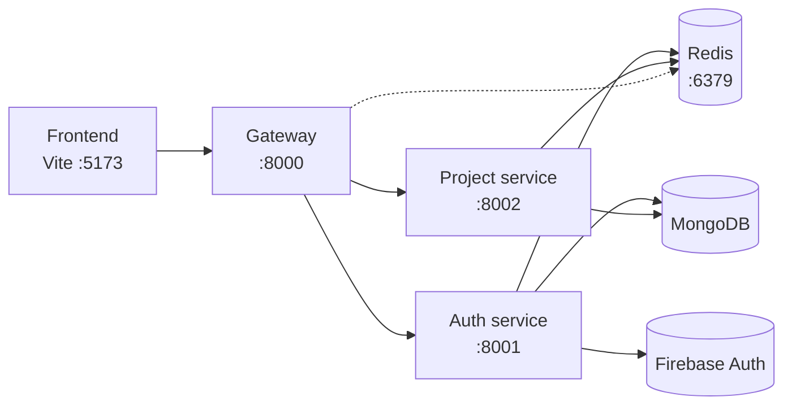
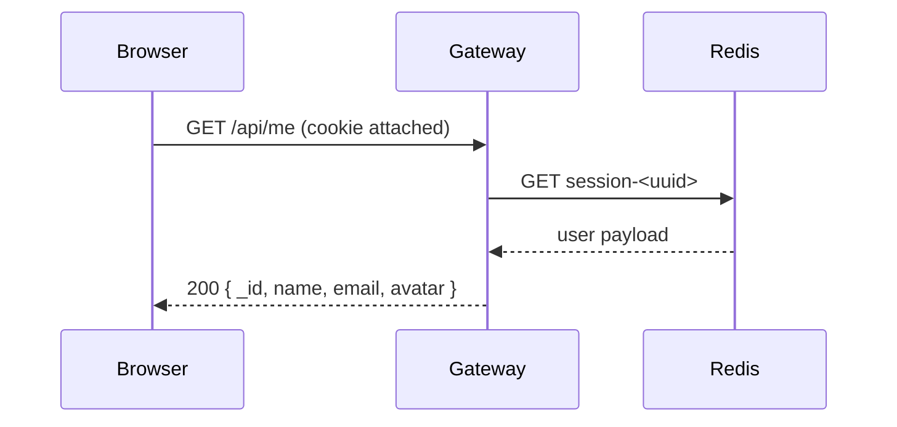
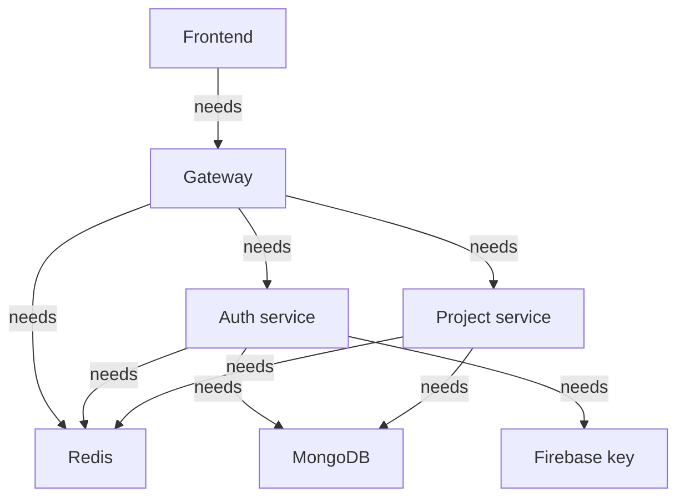

# Getting Started

This page walks you from a fresh clone to a working sign-in and dashboard. It is
deliberately step by step. If a step fails, the
[troubleshooting guide](./guides/troubleshooting.md) covers the common causes.

## What you are starting

NexPulse is not one program. It is four Node processes plus Redis:



Redis is started with Docker (or locally). MongoDB and Firebase are external
services. You will usually keep four terminals open for the Node programs.

## Requirements

| Requirement | Why |
| --- | --- |
| Node.js 18 or newer | The backend uses ES modules and modern syntax such as JSON import attributes. |
| npm | Installs each package's dependencies. |
| MongoDB | Stores users and projects. A local install, Docker container, or MongoDB Atlas cluster all work. |
| Redis | Stores sessions and the project cache. |
| Firebase project | Provides Google sign-in and server-side token verification. |
| Docker (optional) | The repository includes a Compose file that starts Redis. |

## 1. Start Redis

From the repository root:

```bash
docker compose -f backend/docker-compose.yml up -d
```

Check it is up:

```bash
docker compose -f backend/docker-compose.yml ps
```

The Compose file starts a single `redis` service on port `6379`. If you do not
use Docker, run Redis another way and make sure `REDIS_URL` points to it.

## 2. Install the shared Redis client

All three backend programs import `backend/shared/redis/redis.js`. That file
imports `ioredis`, and `backend/shared/` has its own `package.json`, so its
dependencies must be installed separately:

```bash
cd backend/shared
npm install
```

Skipping this step is a common cause of `Cannot find package 'ioredis'` when a
backend service starts.

## 3. Create the Firebase server key

The auth service loads a service account key at import time:

```text
backend/services/auth/serviceAccountKey.json
```

Create it from the Firebase console:

1. Open your Firebase project.
2. Go to **Project settings → Service accounts**.
3. Choose **Generate new private key**.
4. Save the downloaded JSON file as `serviceAccountKey.json` in that exact path.

This file is a secret. It is git-ignored and must never be committed. If it
leaks, revoke it in Firebase and generate a new one.

Also enable **Google** as a sign-in provider under **Authentication → Sign-in
method**.

## 4. Configure the auth service

Copy the example file:

```bash
cd backend/services/auth
copy .env.example .env
```

Then edit `.env`:

```env
PORT=8001
MONGODB_URI=mongodb://127.0.0.1:27017/nexpulse
REDIS_URL=redis://localhost:6379
NODE_ENV=development
```

- `MONGODB_URI` can be a local MongoDB URI or an Atlas connection string.
- `REDIS_URL` must start with `redis://`, not `http://`.
- In production, set `NODE_ENV=production` so the session cookie becomes
  `Secure` and `SameSite=None`.

Install and start:

```bash
npm install
npm run dev
```

Expected output:

```text
Auth running at 8001
DB Connected
redis connected
```

The order can vary. `DB Connected` appears only when MongoDB is reachable.
`redis connected` appears when the shared client connects.

## 5. Configure the project service

```bash
cd backend/services/project
copy .env.example .env
```

Edit `.env`:

```env
PORT=8002
MONGODB_URI=mongodb://127.0.0.1:27017/nexpulse
REDIS_URL=redis://localhost:6379
NODE_ENV=development
```

Use the same database as the auth service so the `owner` field can reference a
user id. Install and start:

```bash
npm install
npm run dev
```

Expected output:

```text
Project service running at 8002
DB Connected
redis connected
```

## 6. Configure the gateway

```bash
cd backend/gateway
copy .env.example .env
```

Edit `.env`:

```env
PORT=8000
FRONTEND_URL=http://localhost:5173
AUTH_SERVICE=http://localhost:8001
PROJECT_SERVICE=http://localhost:8002
REDIS_URL=redis://localhost:6379
NODE_ENV=development
```

The gateway imports the shared Redis client too, because its `protect`
middleware checks sessions. Start it:

```bash
npm install
npm run dev
```

Expected output:

```text
gateway running at 8000
```

## 7. Configure the frontend

```bash
cd frontend
copy .env.example .env.local
```

Edit `.env.local`:

```env
VITE_SERVER_URL=http://localhost:8000
VITE_FIREBASE_API_KEY=your-firebase-web-api-key
```

- `VITE_SERVER_URL` must point at the gateway, not the auth or project service.
- `VITE_FIREBASE_API_KEY` comes from **Firebase console → Project settings →
  General → Your apps**. It is a public browser key, so it is safe in the
  frontend bundle. Do not put the service account key here.

Install and start:

```bash
npm install
npm run dev
```

Vite prints the local URL, usually `http://localhost:5173`.

## 8. Sign in and verify

Open `http://localhost:5173`. You should see the sign-in card. Click
**Continue with Google**, choose an account, and you should land on the
dashboard with your name in the navbar.

Verify the main flows:

| Check | Expected result |
| --- | --- |
| Sign in | You land on `/` with a welcome message and project grid. |
| Reload the page | You stay signed in; the app calls `/api/me` and restores the user. |
| Create project | A new card appears and a success toast is shown. |
| Star a project | The star turns amber and the project appears under **Starred**. |
| Open a project | You land on `/project/:id` and see its details. |
| Delete a project | You are asked to confirm, then the card disappears. |
| Theme toggle | Light/dark mode changes and survives a reload. |
| Logout | The session cookie is cleared and you return to the signed-in flow. |

### What happens during sign-in

```mermaid
sequenceDiagram
    participant B as Browser
    participant F as Firebase
    participant G as Gateway :8000
    participant A as Auth service :8001
    participant M as MongoDB
    participant R as Redis

    B->>F: User clicks Google sign-in
    F-->>B: Short-lived ID token
    B->>G: POST /api/auth/login { token }
    G->>A: POST /login (prefix stripped)
    A->>F: verifyIdToken(token)
    F-->>A: Valid identity
    A->>M: Find user or create one
    A->>R: SET session-<uuid> EX 7 days
    A-->>G: 200 public user + Set-Cookie
    G-->>B: Response; browser stores httpOnly cookie
```

After that, the browser sends the session cookie on later requests. The gateway
checks it before forwarding anything to the project service.

The gateway's `/api/me` endpoint is what makes a reload work:



## 9. Check the services directly

Health endpoints answer without a session:

| URL | Response |
| --- | --- |
| `http://localhost:8000/` | `{ "message": "Hello from gateway" }` |
| `http://localhost:8001/` | `{ "message": "Hello from Auth" }` |
| `http://localhost:8002/health` | `{ "message": "Hello from Project Service" }` |

The gateway can also forward to auth:

```bash
curl http://localhost:8000/api/auth/
```

You should see the auth service's health response. That proves the proxy path
works.

To prove the auth gate is active, call a protected route without a cookie:

```bash
curl -i http://localhost:8000/api/project
```

Expected: `401 Unauthorized` with `{ "message": "unauthorized" }`.

## The five processes at a glance

| Terminal | Folder | Command | Port |
| --- | --- | --- | --- |
| 1 | `backend/services/auth` | `npm run dev` | `8001` |
| 2 | `backend/services/project` | `npm run dev` | `8002` |
| 3 | `backend/gateway` | `npm run dev` | `8000` |
| 4 | `frontend` | `npm run dev` | `5173` |
| — | `backend` | `docker compose up -d` (Redis) | `6379` |

`backend/shared` is not a running process, but its `npm install` must be done
once before any backend service starts.

## Environment summary

Every app reads its own environment file. The full reference, including which
app uses which variable, is in
[Environment Variables](./reference/environment-variables.md).

| File | Purpose |
| --- | --- |
| `backend/gateway/.env` | Gateway port, frontend origin, service URLs, Redis URL |
| `backend/services/auth/.env` | Auth port, MongoDB, Redis, environment |
| `backend/services/project/.env` | Project port, MongoDB, Redis, environment |
| `frontend/.env.local` | Gateway URL and Firebase web API key |
| `backend/services/auth/serviceAccountKey.json` | Firebase server credentials |

The `.env` files are git-ignored. `.env.example` files are committed and show the
expected shape without secrets.

## How the pieces depend on each other



If a request fails, start at the layer that is closest to the failure:

- Sign-in fails → check Firebase config and the auth service.
- Dashboard says "Could not load projects" → check the gateway, project service,
  MongoDB, and Redis.
- Everything says unauthorized → check Redis and the session cookie.
- Nothing loads at all → check Vite and the gateway URL.

## Common first-run problems

Short version:

- **`Cannot find package 'ioredis'`** — run `npm install` in `backend/shared`.
- **Auth service exits immediately** — `serviceAccountKey.json` is missing or
  malformed.
- **`DB Connected` never appears** — `MONGODB_URI` is wrong or unreachable.
- **`[redis] ECONNREFUSED`** — Redis is not running, or `REDIS_URL` uses the
  wrong scheme.
- **401 on every project call** — you are not signed in, the cookie is missing,
  or Redis was restarted and lost the session.
- **CORS error in the browser** — `FRONTEND_URL` in the gateway `.env` does not
  match the URL Vite is using.

The [troubleshooting guide](./guides/troubleshooting.md) explains each of these
with more detail.

## Next steps

- Read [Architecture](./concepts/architecture.md) to understand why the app is
  split this way.
- Read [API Reference](./backend/api-reference.md) to see every endpoint.
- Read [Contributing](./guides/contributing.md) before making changes.
