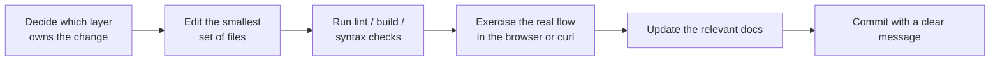
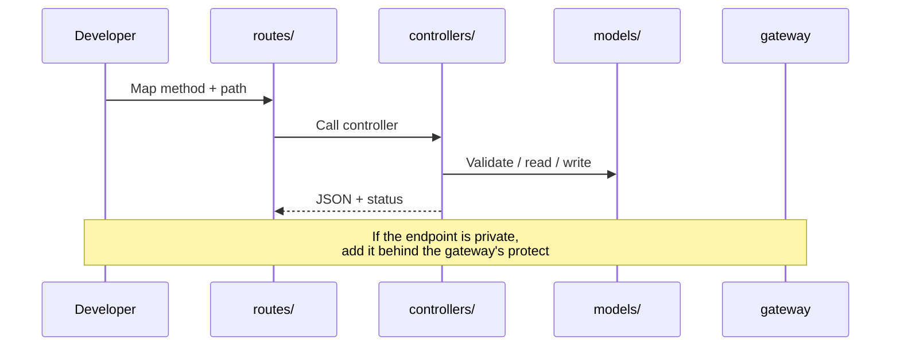

# Contributing

This page explains how to make a change that fits the project: where code goes,
how to verify it, and how to keep the docs honest.

## Before you start

- Read [Architecture](../concepts/architecture.md) so you know which layer owns
  the behavior you want to change.
- Read [Getting Started](../getting-started.md) and make sure the app runs.
- Check the [Roadmap](../roadmap.md) to see whether the work is already planned
  or deliberately deferred.

## The shape of a change



## Where code belongs

| Change | Location |
| --- | --- |
| A new backend route | `backend/services/<service>/routes/` + controller |
| Business logic | `backend/services/<service>/controllers/` |
| Data shape or validation | `backend/services/<service>/models/` |
| Shared backend behavior | `backend/gateway/` or `backend/shared/` |
| Frontend screen | `frontend/src/pages/` |
| Reusable UI piece | `frontend/src/components/` |
| API call | `frontend/src/features/` |
| Shared app state | `frontend/src/redux/` |
| Theme or toast provider | `frontend/src/hooks/` and `frontend/src/components/` |
| Styling tokens | `frontend/src/index.css` |
| Setup or behavior docs | `docs/` |

Keep the backend layering: **route → controller → model**. A route should only
map a URL to a function. A controller does the work. A model defines and
validates data.

## Backend conventions

- Use ES modules (`import` / `export`). Every package has `"type": "module"`.
- Load configuration from `process.env`, never hard-code URLs, ports, or secrets.
- Return JSON errors as `{ "message": "..." }`.
- Do not leak internal error details to the client; log them on the server.
- Validate ids with `mongoose.Types.ObjectId.isValid`.
- Scope project queries by `owner: userId`. Never fetch a project by id alone.
- Project routes receive identity from the gateway's `x-user-id` header. Do not
  add cookie parsing to the project service.
- If a write changes project data, invalidate both cache keys:
  `projects-<userId>` and `starred-projects-<userId>`.
- Redis failures for the cache should not take down a request. The current
  helpers log a warning and continue.
- New services should follow the existing folder shape:
  `config/`, `controllers/`, `models/`, `routes/`, `index.js`.

### Adding a backend endpoint



Steps:

1. Add the handler in the service controller.
2. Add the route in the service route file.
3. If it must be private, add or adjust the gateway mount. The project service is
   already mounted behind `protect`.
4. Add the function to `frontend/src/features/` if the UI needs it.
5. Document the endpoint in [API Reference](../backend/api-reference.md).

## Frontend conventions

- Use function components and hooks.
- Keep pages in `pages/` and reusable pieces in `components/`.
- Put every backend call in `features/`; components should not call `api`
  directly.
- Use the shared `api` client from `utils/axios.js`. Do not create new axios
  instances.
- Use the Redux slices for state that outlives one component. Local UI state can
  stay in `useState`.
- Update Redux optimistically for star/delete, but roll back on failure and show
  a toast. Follow the existing `ProjectCard` and `ProjectDetail` pattern.
- Use `lucide-react` for new icons where it fits; the project also has
  `react-icons` in a few older components.
- Use Tailwind utilities and the design tokens in `index.css`. Avoid raw hex
  colors in new JSX when a token exists.
- Every new page must be reachable from `App.jsx`. Protected pages go inside
  `ProtectedRoute`.
- Keep accessibility basics: labels, button types, `aria-*` where needed, and
  keyboard behavior (the create-project dialog is a good example).

### Adding a page

1. Create `frontend/src/pages/YourPage.jsx`.
2. Lazy-load it in `App.jsx` if it is not needed on first paint.
3. Add a `<Route>`.
4. If it requires login, wrap it in `<ProtectedRoute>`.
5. Add a link from an existing screen.
6. Document it in [Frontend Components](../frontend/components.md) and, if it
   changes the auth flow, in
   [Routing and Auth](../frontend/routing-and-auth.md).

## Quality checks

There is no automated test suite or CI configuration in the repository yet.
Run these checks manually before committing:

```bash
# Frontend lint
cd frontend
npm run lint

# Frontend production build
npm run build

# Backend syntax checks (repeat for changed files)
cd backend/gateway
node --check index.js

cd backend/services/auth
node --check index.js

cd backend/services/project
node --check index.js
```

Then test the real behavior:

- Sign in, reload, create, star, open, delete, and log out.
- Confirm the browser console has no unexpected errors.
- Confirm the gateway and service terminals do not log errors.

If you add a test suite later, document the command in
[Scripts](../reference/scripts.md) and update this page.

## Documentation rules

- Write in plain English. Explain the "why", not only the "what".
- Use Mermaid for flow, sequence, and relationships. Use text blocks for folder
  trees.
- Link to related pages instead of repeating whole sections.
- Describe what the code does today. Put future work in
  [Roadmap](../roadmap.md).
- When you change behavior, update the affected page in the same change.
- Keep code references as `path/file.js:line` when pointing at a specific spot.
- Do not include real secrets, API keys, connection strings, or service account
  contents.

## Commit messages

The repository uses short conventional-style messages, for example:

```text
feat: add project detail page
fix: handle expired session on project load
docs: rewrite backend API reference
```

A good commit message says what changed, not "updates". If a commit contains two
unrelated changes, split it.

## A checklist for every change

- [ ] The change belongs in the layer I edited.
- [ ] No secrets or `.env` values were added to source.
- [ ] Existing behavior still works.
- [ ] Backend errors return `{ message }` and log details server-side.
- [ ] Project queries are scoped to the authenticated owner.
- [ ] Cache is invalidated on project writes.
- [ ] Frontend calls go through `features/` and the shared axios client.
- [ ] Loading, empty, error, and success states are handled.
- [ ] Lint/build/syntax checks pass.
- [ ] Relevant docs are updated.
