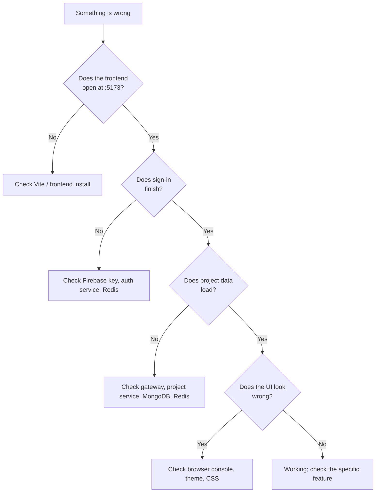

# Troubleshooting

When NexPulse does not work, the fastest approach is to find out **which layer**
is failing. Do not change several things at once. Check one layer, confirm it,
then move outward.



## First checks that solve most problems

1. Confirm every process is still running. Scroll up in each terminal and look
   for a crash.
2. Confirm ports `5173`, `8000`, `8001`, `8002`, and `6379` are the ones in use.
3. Confirm `backend/shared` has had `npm install` run.
4. Confirm each `.env` file exists and points at the right addresses.
5. Open the browser developer tools: **Console** and **Network** usually name
   the failing request and status code.

## Frontend

### The page does not open

**Symptom:** `http://localhost:5173` refuses to connect.

- Run `npm install` and `npm run dev` inside `frontend/`.
- Check the terminal for a Vite error.
- Another program may be using `5173`; Vite will print the actual port it chose.

### The page opens but is unstyled

- Confirm `npm install` completed; Tailwind comes through Vite.
- Hard-refresh the browser (`Ctrl+F5`).
- Check that `frontend/vite.config.js` still includes `react()` and
  `tailwindcss()`.
- Check the browser console for a CSS import error.

### The Google popup opens but login does nothing

- Open the browser console. Look for Firebase errors such as
  `auth/invalid-api-key`.
- Confirm `VITE_FIREBASE_API_KEY` in `frontend/.env.local` belongs to the same
  Firebase project as `serviceAccountKey.json`.
- Confirm Google sign-in is enabled in the Firebase console.
- Confirm the auth service is running on `8001` and the gateway on `8000`.
- Restart Vite after editing `.env.local`; Vite reads environment variables at
  startup.

### Sign-in is rejected with 401 or 500

`400` means the token was missing or not a string. `401` means Firebase verified
the token but it had no uid or email. `500` means verification failed or the
server hit an error; read the auth terminal.

- Check that the token is being sent in the request body as `{ "token": "..." }`.
- Check that the server key file is valid JSON and belongs to the same project.
- Check the auth service log for `[login] ...`.

### After login, the dashboard is empty or says "Could not load projects"

1. Confirm the project service is running on `8002`.
2. Confirm the gateway is running on `8000`.
3. In the browser Network tab, inspect the failing request:
   - `401` means the session cookie is missing, expired, or Redis lost it.
   - `503` means the gateway could not reach Redis.
   - `500` usually means the project service could not reach MongoDB.
4. Check `REDIS_URL` and `MONGODB_URI` in the project service `.env`.
5. Sign out and sign in again to create a fresh session.

### The star or delete button fails with a toast

The toast is deliberate; the UI rolls back the optimistic change. Check the
project service terminal. Common causes:

- Invalid project id (`400`).
- The project belongs to another user or no longer exists (`404`).
- MongoDB is unreachable (`500`).
- The session expired (`401`, after which the app clears the user).

### I am signed out on every reload

- Confirm `withCredentials: true` is still in `frontend/src/utils/axios.js`.
- Confirm the browser is accepting cookies for `localhost`.
- Confirm Redis is running. A session is stored in Redis; if Redis restarts
  without persistence, the session is gone.
- Confirm `FRONTEND_URL` matches the frontend origin exactly. A mismatch breaks
  the credentialed CORS exchange, so the browser may not store or send the
  cookie.

## Gateway

### `gateway running at 8000` never appears

- Run `npm install` in `backend/gateway`.
- Check for `EADDRINUSE` (port already in use). Stop the other process or change
  `PORT`.
- Check that `dotenv` is installed. It is declared in `package.json`; if the
  install is incomplete, the import fails.

### `/api/auth/...` returns 404 or a proxy error

- Check `AUTH_SERVICE` in `backend/gateway/.env`; it should be
  `http://localhost:8001`.
- Confirm the auth service is running.
- Remember that the gateway strips the mount prefix: `/api/auth/login` reaches
  the auth service as `/login`. Do not add `/api/auth` to the auth service's
  routes.

### `/api/project/...` returns 401 immediately

This is the auth gate working. The request never reached the project service.
Sign in again, or check Redis and the session cookie.

### `/api/project/...` returns 503

`protect` could not reach Redis. Start Redis and check `REDIS_URL` in the gateway
`.env`.

### Browser shows a CORS error

- `FRONTEND_URL` must be the exact origin, including scheme and port, for
  example `http://localhost:5173`.
- If Vite chose a different port, update `FRONTEND_URL` or force Vite to use
  `5173`.
- Credentialed requests require an exact origin; `*` is not allowed with
  `credentials: true`.

## Auth service

### It exits immediately at startup

The most likely cause is Firebase:

- `serviceAccountKey.json` is missing.
- The JSON is malformed.
- The key was revoked.
- The file is not at `backend/services/auth/serviceAccountKey.json`.

`config/firebase.js` runs at import time, so a bad key throws before the server
starts. That is intentional: fail loudly at startup instead of failing later on
the first login.

### `MONGODB_URI is not set` or `MongoDB connection failed`

- Check `backend/services/auth/.env`.
- Check the URI includes the database name if you expect one.
- For Atlas, confirm your current IP is allow-listed and the cluster is running.
- The service still starts when MongoDB fails; it just cannot load or save users.

### `[redis] ECONNREFUSED`

- Start Redis: `docker compose -f backend/docker-compose.yml up -d`.
- Check `REDIS_URL` starts with `redis://`.
- Login still returns `200` when Redis is down, but it cannot create a session.
  The browser will therefore behave as signed out on the next request.

### Logout does not clear the session

- Confirm the auth service has `cookie-parser` installed. It does in the current
  code.
- Confirm the request goes through the gateway at `/api/auth/logout`.
- Check Redis with `docker compose exec redis redis-cli KEYS 'session-*'`.
- Remember that logout is a `GET` request in the current API; a stale browser
  cache or a proxy could interfere in unusual setups.

## Project service

### `userid is required`

The request reached the project service without the gateway's `x-user-id`
header. This means one of:

- You called the project service directly instead of through the gateway.
- The gateway's `protect` middleware did not run.
- The session payload has no `_id`.

Always call project routes through `http://localhost:8000/api/project/...`.

### `Invalid id`

The `:id` in the URL is not a valid MongoDB ObjectId. Use the `_id` returned by
the list or create endpoint.

### `Project not found`

The id is valid but no project with that id belongs to the signed-in user.
Projects are always queried with `{ _id, owner: userId }`, so another user's
project is indistinguishable from a missing one.

### Project list looks stale

The list is cached in Redis for 5 minutes under `projects-<userId>` and
`starred-projects-<userId>`. Writes through this service invalidate both keys.
If data was changed by another process, the cache can be stale until it expires
or is cleared:

```bash
docker compose exec redis redis-cli DEL projects-<userId> starred-projects-<userId>
```

### `DB Connected` never appears

`MONGODB_URI` is missing or unreachable. The project service still starts, but
project create/list/fetch/star/delete requests fail. Fix the connection string
and restart.

## Redis

### Check that Redis is reachable

```bash
docker compose exec redis redis-cli ping
```

Expected: `PONG`.

### Inspect sessions and cache

```bash
# List session keys
docker compose exec redis redis-cli KEYS 'session-*'

# List project cache keys
docker compose exec redis redis-cli KEYS 'projects-*'
docker compose exec redis redis-cli KEYS 'starred-projects-*'

# Read a session
docker compose exec redis redis-cli GET session-<uuid>

# Delete one user's cache
docker compose exec redis redis-cli DEL projects-<userId> starred-projects-<userId>
```

Sessions expire after 7 days. Project caches expire after 5 minutes. A Redis
restart without persistence clears both; users simply sign in again and the next
read repopulates the cache.

## Ports and processes

| Port | Program | If it is busy |
| --- | --- | --- |
| `5173` | Vite | Stop the other process, or use the port Vite prints and update `FRONTEND_URL`. |
| `8000` | Gateway | Stop the other process or change `PORT` in its `.env`. |
| `8001` | Auth service | Stop the other process or change `PORT` in its `.env`. |
| `8002` | Project service | Stop the other process or change `PORT` in its `.env`. |
| `6379` | Redis | Stop the other Redis instance or change `REDIS_URL` everywhere. |

If you change a backend port, update every place that references it:

- Gateway `.env`: `AUTH_SERVICE`, `PROJECT_SERVICE`
- Frontend `.env.local`: only if the gateway port changes
- Auth/project `.env`: their own `PORT`

## Windows notes

The repository is developed on Windows. Commands in these docs are written in a
shell-neutral style, but a few notes help:

- In PowerShell, `copy .env.example .env` works; in Bash, use `cp`.
- Paths with spaces need quotes.
- If `npm` is not recognized, install Node.js and reopen the terminal.
- Docker Desktop must be running before `docker compose ...` works.

## When to clear state

If the app is behaving impossibly, reset the temporary state before changing
code:

1. Stop the frontend and backend processes.
2. Sign out is not enough if Redis is down; clear the session keys.
3. Clear the project cache.
4. Restart Redis.
5. Restart auth, project, gateway, then frontend in that order.
6. Hard-refresh the browser.

```bash
docker compose -f backend/docker-compose.yml restart
```

MongoDB data is persistent. Do not drop the database unless you intentionally
want to remove all users and projects.
