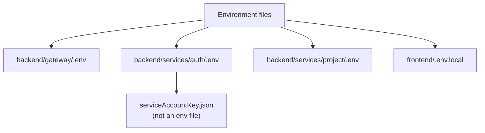

# Environment Variables

Each app reads its own environment file. The `.env` files are git-ignored;
`.env.example` files are committed and contain no secrets.

## Gateway

File: `backend/gateway/.env`

| Variable | Required | Default in code | Example | Purpose |
| --- | --- | --- | --- | --- |
| `PORT` | No | `8000` | `8000` | Gateway listen port. |
| `FRONTEND_URL` | No | `http://localhost:5173` | `https://app.example.com` | Exact allowed CORS origin. |
| `AUTH_SERVICE` | No | `http://localhost:8001` | `http://auth-service:8001` | Auth service base URL. |
| `PROJECT_SERVICE` | No | `http://localhost:8002` | `http://project-service:8002` | Project service base URL. |
| `REDIS_URL` | No | `redis://127.0.0.1:6379` | `redis://redis:6379` | Used by the shared Redis client for session checks. |
| `NODE_ENV` | No | undefined | `production` | Affects cookie flags in the auth service, not the gateway logic. |

Notes:

- `FRONTEND_URL` is used with `credentials: true`; it must be an exact origin,
  not `*`.
- The gateway imports the shared Redis client, so `REDIS_URL` matters here too.

## Auth service

File: `backend/services/auth/.env`

| Variable | Required | Default in code | Example | Purpose |
| --- | --- | --- | --- | --- |
| `PORT` | No | `8001` | `8001` | Auth service listen port. |
| `MONGODB_URI` | Yes | none | `mongodb://127.0.0.1:27017/nexpulse` | MongoDB connection string. |
| `REDIS_URL` | No | `redis://127.0.0.1:6379` | `redis://redis:6379` | Session storage. |
| `NODE_ENV` | No | undefined | `production` | Controls `secure` and `sameSite` on the session cookie. |

If `MONGODB_URI` is missing, the service logs `[auth] MONGODB_URI is not set` and
continues running; login attempts that need the database will fail.

### Firebase service account

File: `backend/services/auth/serviceAccountKey.json`

This is not an environment variable. It is a JSON credential file loaded by
`config/firebase.js` at import time. If it is missing or malformed, the auth
service crashes immediately. It is a secret and is git-ignored.

## Project service

File: `backend/services/project/.env`

| Variable | Required | Default in code | Example | Purpose |
| --- | --- | --- | --- | --- |
| `PORT` | No | `8002` | `8002` | Project service listen port. |
| `MONGODB_URI` | Yes | none | `mongodb://127.0.0.1:27017/nexpulse` | MongoDB connection string. |
| `REDIS_URL` | No | `redis://127.0.0.1:6379` | `redis://redis:6379` | Project-list cache. |
| `NODE_ENV` | No | undefined | `production` | Reserved; currently not used by this service's logic. |

Use the same database as the auth service so `owner` can reference a user `_id`.

## Frontend

File: `frontend/.env.local` (or `.env`)

| Variable | Required | Example | Purpose |
| --- | --- | --- | --- |
| `VITE_SERVER_URL` | Yes | `http://localhost:8000` | Base URL for every axios request. Must be the gateway. |
| `VITE_FIREBASE_API_KEY` | Yes | `AIza...` | Firebase web API key used by `firebase.js`. |

Important:

- **Anything prefixed `VITE_` is public.** Vite substitutes it into the browser
  bundle. Never put a server secret there.
- Vite reads these at startup; restart `npm run dev` after changing them.
- Production builds inline these values, so changing them requires a rebuild.

Firebase configuration in `frontend/firebase.js` also contains the project id,
auth domain, storage bucket, messaging sender id, app id, and measurement id.
Those identify the Firebase project and are safe to commit.

## Shared Redis client

File: `backend/shared/redis/redis.js` reads `process.env.REDIS_URL` directly.

| Variable | Default | Purpose |
| --- | --- | --- |
| `REDIS_URL` | `redis://127.0.0.1:6379` | Connection string for `ioredis`. |

`backend/shared/` has no `.env` file of its own. It inherits `process.env` from
the program that imports it. Load `dotenv/config` before importing the shared
client, which every backend entry point currently does.

## Environment matrix

| Variable | Gateway | Auth | Project | Frontend |
| --- | --- | --- | --- | --- |
| `PORT` | Yes | Yes | Yes | — |
| `FRONTEND_URL` | Yes | — | — | — |
| `AUTH_SERVICE` | Yes | — | — | — |
| `PROJECT_SERVICE` | Yes | — | — | — |
| `REDIS_URL` | Yes | Yes | Yes | — |
| `MONGODB_URI` | — | Yes | Yes | — |
| `NODE_ENV` | Yes | Yes | Yes | — |
| `VITE_SERVER_URL` | — | — | — | Yes |
| `VITE_FIREBASE_API_KEY` | — | — | — | Yes |

## Security classification

| Value | Public? | Where it belongs |
| --- | --- | --- |
| `VITE_FIREBASE_API_KEY` | Yes (browser key) | Frontend env |
| Firebase project id / app id | Yes | Frontend source |
| `MONGODB_URI` | No | Backend env / secret store |
| `REDIS_URL` with credentials | No | Backend env / secret store |
| `serviceAccountKey.json` | No | Auth service secret mount |
| Session id | Sensitive, but stored in an `httpOnly` cookie | Browser cookie only |

See [Security Model](../backend/security.md) for the reasoning.
