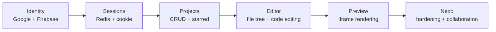
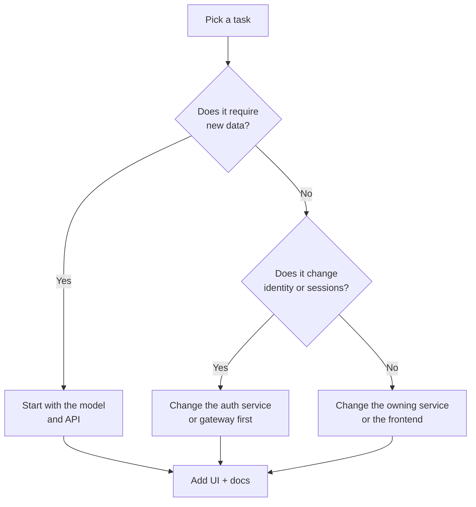

# Roadmap and Status

NexPulse includes authenticated project management, a file tree/editor, and a
in-editor preview. This page distinguishes those implemented capabilities
from the remaining product and operational work.

## Where the project is

### Done

| Area | Status |
| --- | --- |
| Google sign-in | Done, verified server-side. |
| Local user records | Done, stored in MongoDB. |
| Redis sessions | Done, 7-day TTL, `httpOnly` cookie. |
| Session restore | Done, `GET /api/me` on app start. |
| Gateway auth gate | Done, `protect` middleware. |
| Login rate limiting | Done, in-memory per-IP limiter. |
| Project create/list/star/delete | Done. |
| Project detail | Done, including star/delete and metadata. |
| Redis project cache | Done, 5-minute TTL, invalidated on writes. |
| Dashboard views | Done: all projects and starred projects. |
| Project files | Done: file/folder operations, import/export, soft-delete and restore. |
| Code editor | Done: project file editing and save flow. |
| In-editor preview | Done: sandboxed iframe preview of the project index.html, debounced reloads, asset inlining. |
| Loading/empty/error states | Done for the project views and detail page. |
| Theme | Done: light/dark, persisted in local storage. |
| Toasts | Done: success, error, info. |
| Error boundary | Done. |
| Legal pages | Done: terms and privacy. |
| 404 page | Done. |
| Documentation | This docs set. |

### Known limitations

These are real today, not hypothetical:

- **Project editing is partial.** Project names can be changed, but descriptions
  cannot yet be updated.
- **No search or pagination.** The dashboard loads all projects for the user.

- **Rate limiting is per gateway process.** Multiple gateway instances would each
  keep their own counters.
- **No email/account deletion flow.** Project deletion exists; account deletion
  does not.
- **No roles or sharing.** Projects are private to their owner. There is no
  collaboration or team model.
- **Test coverage is limited.** The frontend has tests, but
  there is no comprehensive backend integration or end-to-end suite.
- **No CI/CD.** Deployments are manual; see
  [Deployment Notes](./guides/deployment.md).
- **No refresh-token flow.** Firebase is used only at sign-in; the app then relies
  on the Redis session.
- **Cache invalidation assumes writes go through the project service.** Direct
  database changes do not clear project-list caches.

## Next milestones

### 1. Product capabilities

- Add project description editing.
- Add project search and pagination.
- Add sharing, roles, or collaboration only with an explicit authorization
  model.

### 2. Runtime and security hardening

- Move the rate limiter to Redis if the gateway scales horizontally.
- Add structured logging and request ids.
- Expand backend integration and end-to-end coverage, then add CI.
- Add account deletion and data export.
- Add cache versioning or event-based invalidation if more writers appear.
- Isolate preview asset loading and runtime behaviour with deployment-level
  resource, filesystem, and network controls.

## How to choose the next task

The safest order is always: data model → service logic → gateway route → frontend
API function → UI → docs.

## What not to assume

- The repository includes frontend and preview-service tests, but not a
  comprehensive backend integration or end-to-end suite.
- The repository does not include a production Compose file or CI pipeline.
- Internal services are not safe to expose publicly; preview also executes
  project-provided code.
- The browser is not trusted; identity is verified by the backend.
- `VITE_*` values are public.

See [Development Log](./development/README.md) for how the current state was
reached, and [Architecture](./concepts/architecture.md) for why the system is
split the way it is.
