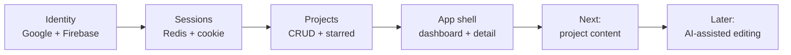
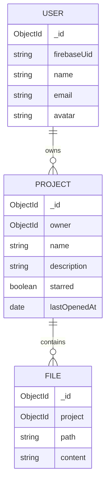
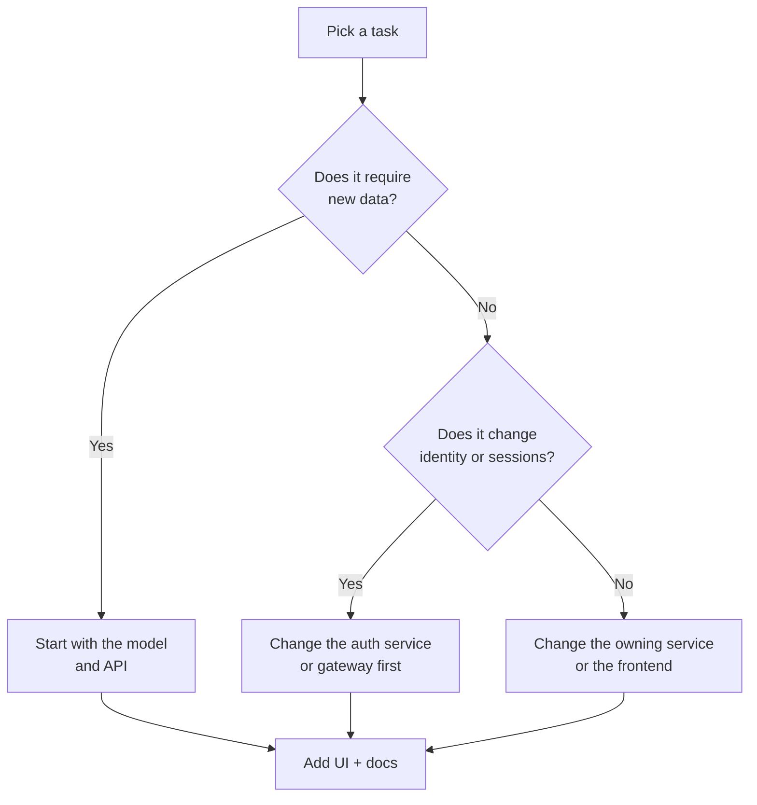

# Roadmap and Status

NexPulse is in a foundation phase. The account and project loop is real and
usable; the AI-assisted editor that the project is aiming at is not built yet.
This page separates what exists from what is planned, so the rest of the docs can
stay accurate about the present.

## Where the project is

### Done

| Area | Status |
| --- | --- |
| Google sign-in | Done, verified server-side. |
| Local user records | Done, stored in MongoDB. |
| Redis sessions | Done, 7-day TTL, `httpOnly` cookie. |
| Session restore | Done, `GET /api/me` on app start. |
| Gateway auth gate | Done, `protect` middleware. |
| Login rate limiting | Done, in-memory per-IP limiter. |
| Project create/list/star/delete | Done. |
| Project detail | Done, including star/delete and metadata. |
| Redis project cache | Done, 5-minute TTL, invalidated on writes. |
| Dashboard views | Done: all projects and starred projects. |
| Loading/empty/error states | Done for the project views and detail page. |
| Theme | Done: light/dark, persisted in local storage. |
| Toasts | Done: success, error, info. |
| Error boundary | Done. |
| Legal pages | Done: terms and privacy. |
| 404 page | Done. |
| Documentation | This docs set. |

### Known limitations

These are real today, not hypothetical:

- **No AI or code editor yet.** The project is a project workspace, not an IDE.
- **No project content model.** A project has a name, description, star, and
  timestamps. There are no files, folders, documents, or editor state.
- **No edit-project flow.** You can create, star, open, and delete, but you
  cannot rename a project or change its description after creation.
- **No search or pagination.** The dashboard loads all projects for the user.
- **Logout is a `GET`.** It works, but a state-changing action should be a
  `POST`/`DELETE` with CSRF protection for stricter deployments.
- **Rate limiting is per gateway process.** Multiple gateway instances would each
  keep their own counters.
- **No email/account deletion flow.** Project deletion exists; account deletion
  does not.
- **No roles or sharing.** Projects are private to their owner. There is no
  collaboration or team model.
- **No automated tests.** There is linting, a production build, and manual
  verification, but no unit, integration, or end-to-end suite.
- **No CI/CD.** Deployments are manual; see
  [Deployment Notes](./guides/deployment.md).
- **No refresh-token flow.** Firebase is used only at sign-in; the app then relies
  on the Redis session.
- **Cache invalidation assumes one writer.** Changes made directly in MongoDB or
  by another service will not clear the project cache.
- **No `<StrictMode>` in `frontend/src/main.jsx`.** React's development warnings
  are off.

## Next milestones

### 1. Project content

Add a `content` or `files` model so a project can hold something more than a name
and description. This is the first real step toward the editor.

`FILE` is a proposed model, not an existing one.

### 2. Editing and persistence

- Add an update endpoint for project metadata.
- Add file create/read/update/delete endpoints.
- Autosave editor state and show save status.
- Add optimistic updates where appropriate.

### 3. AI assistance

A dedicated service (for example `backend/services/ai`) can sit behind the
gateway, use the `x-user-id` identity, and keep provider keys on the server. It
should never be reachable directly.

### 4. Hardening

- Move the rate limiter to Redis if the gateway scales horizontally.
- Convert logout to a `POST` and add CSRF protection.
- Add structured logging and request ids.
- Add automated tests and CI.
- Add account deletion and data export.
- Add pagination and search for projects.
- Add cache versioning or event-based invalidation if more writers appear.

## How to choose the next task

The safest order is always: data model → service logic → gateway route → frontend
API function → UI → docs.

## What not to assume

- The repository does not include a test suite.
- The repository does not include a production Compose file or CI pipeline.
- The project service is not safe to expose publicly.
- The browser is not trusted; identity is verified by the backend.
- `VITE_*` values are public.

See [Development Log](./development/README.md) for how the current state was
reached, and [Architecture](./concepts/architecture.md) for why the system is
split the way it is.
